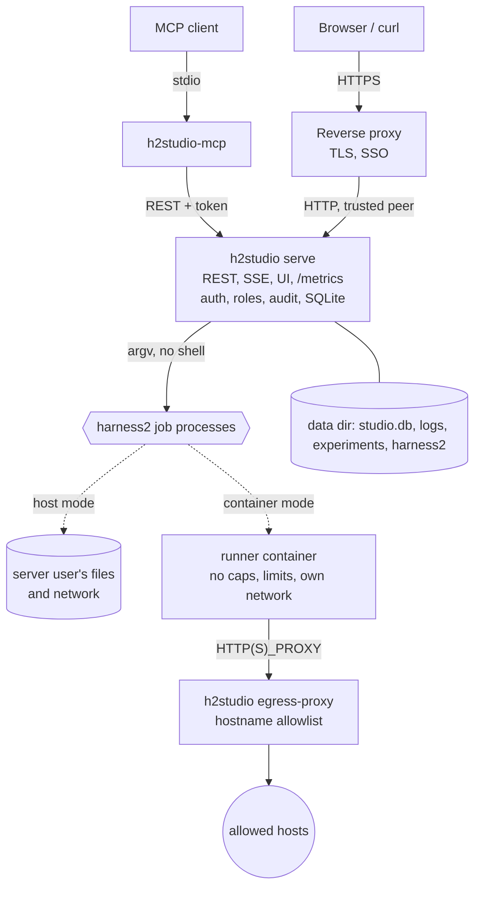

# Administrator's guide

How to install, configure, secure, run and maintain a Harness² Studio server (`h2studio`) and its
MCP server (`h2studio-mcp`). For what the pieces are, start with the [README](../README.md); for
the HTTP interface, [API.md](API.md); for what the security controls do and do not stop,
[THREAT-MODEL.md](THREAT-MODEL.md); for a message you are looking at, [TROUBLESHOOTING.md](TROUBLESHOOTING.md).

**What was verified, and how.** Commands and output on this page marked as a transcript were run
against `h2studio` 0.1.0 and harness2 `1cfe254` on Linux x86_64 on 2026-10-23 and 2026-10-24 (the
documentation author's runs: init, serve, tokens, doctor, a managed `install_harness2`, the demo,
proxy authentication with simulated proxy headers, the egress proxy on loopback, OTLP export to a
local collector, metrics, the MCP server). The container-isolation and compose-deployment
sections describe behaviour that the project maintainers **verified live on rootless Docker on
2026-10-23** (an `install_harness2` job through the egress proxy, the demo as a container job, a
cancelled container job stopped by label, and the compose stack behind a TLS ingress: `init`,
`/healthz`, the UI page and its CSP, a `421` for a forwarded unknown Host, install, demo, results,
SSE, `audit verify` and `doctor`); the author of this page did not repeat them, except where a
transcript says otherwise. **Not verified anywhere**: rootful Docker, Podman, a real SSO proxy
(only simulated headers), nginx or any proxy other than the compose stack's Caddy, the systemd
unit beyond a syntax check, and any model-backed run.

> **Read this first: host isolation is not a security boundary.** In the default `host` isolation,
> harness2's executors run as the server's user. A malicious or prompt-injected executor can
> therefore read the Studio's database (stored secrets, token hashes), its files and its
> environment, and rewrite them: it is, in effect, a Studio administrator plus the server user.
> For anything but your own trusted experiments use container isolation
> ([section 8](#8-container-isolation-step-by-step)); that is what it is for. The compose reference
> deployment ([section 10](#10-the-compose-reference-deployment)) contains the whole Studio from
> your host and network, but **the jobs inside it are not isolated from the Studio itself**.
> Items marked *planned, not in this commit* below describe fixes that are under way and are **not**
> part of this revision; they are collected in [section 17](#17-planned-changes-not-in-this-commit).

Contents: [1 Architecture](#1-architecture-in-one-page) · [2 Requirements](#2-requirements) ·
[3 Installation](#3-installation) · [4 First run](#4-first-run) ·
[5 Configuration reference](#5-configuration-reference) ·
[6 Authentication, roles and tokens](#6-authentication-roles-and-tokens) ·
[7 Reverse proxy and TLS](#7-reverse-proxy-and-tls) ·
[8 Container isolation](#8-container-isolation-step-by-step) · [9 The egress allowlist](#9-the-egress-allowlist) ·
[10 The compose reference deployment](#10-the-compose-reference-deployment) ·
[11 Observability](#11-observability) · [12 Data, backups and upgrades](#12-data-backups-and-upgrades) ·
[13 Audit log](#13-audit-log) · [14 systemd](#14-running-as-a-systemd-user-service) ·
[15 Hardening checklist](#15-hardening-checklist) · [16 Command reference](#16-command-reference) ·
[17 Planned changes](#17-planned-changes-not-in-this-commit)

## 1. Architecture in one page



*This Mermaid diagram was syntax-checked with the Mermaid 12.1.0 parser (`mermaid.parse`). It has not been rendered to an image, so its layout is unseen.*

- **`h2studio serve`** is the only component with authority. It owns authentication, roles, the
  job queue, the SQLite database and the audit log, and serves the REST API, server-sent events,
  `/metrics` and the web UI from one port (default `127.0.0.1:8722`). It speaks plain HTTP/1.1:
  **there is no native TLS**; put a reverse proxy in front for anything beyond loopback.
- **Jobs** are harness2's own commands, started as child processes without a shell, each in its own
  process group, with an environment built from scratch. In **host** isolation they run as the
  server's user; in **container** isolation each runs in a hardened container
  ([section 8](#8-container-isolation-step-by-step)).
- **`h2studio-mcp`** is a thin client that gives AI agents the same operations ([MCP.md](MCP.md)).
- **`h2studio egress-proxy`** is an allowlisting forward proxy for container jobs
  ([section 9](#9-the-egress-allowlist)).
- **Data** lives under one directory: the database, job logs, per-job temporary files, split files,
  the experiments (each one a plain harness2 results directory) and, when the Studio manages it, the
  harness2 checkout.

Only Linux is supported for running jobs (harness2's setup guide specifies Linux for benchmark runs,
and the server uses process groups and `/proc` for cancellation and restart recovery).

## 2. Requirements

| Needed for | Requirement | Checked by |
|---|---|---|
| everything that runs harness2 | `uv`, Python 3.12 available to uv, `git` | `h2studio doctor` rows `uv`, `python312`, `git` |
| benchmark setup (JobBench, LAB, WorkBuddy) | Node.js 20 or newer and `npm` | `node20`, `npm` |
| LAB | Pandoc and Poppler (`pdftoppm`) | `pandoc`, `pdftoppm` |
| WorkBuddy-Bench | Docker with permission to run `docker info`; `curl` | `docker`, `curl` |
| Vertex AI profiles | the Google Cloud CLI on `PATH`; Application Default Credentials | `gcloud`, `adc` |
| container isolation | Docker or Podman, and the runner image | `container_runtime` |
| building from source | the Rust toolchain pinned in `rust-toolchain.toml` (1.99.1; `rustup` installs it), and for the web UI `wasm-bindgen-cli` 0.2.129 | |
| free disk | 20 GiB or more recommended; benchmark setup downloads several GB and every rollout keeps its output | `disk` warns below 20 GiB |

Debian/Ubuntu: `sudo apt-get install -y git curl unzip ca-certificates pandoc poppler-utils`, then
install [uv](https://docs.astral.sh/uv/getting-started/installation/) and Node.js 20+.

## 3. Installation

### 3.1 From source (verified)

```console
$ git clone https://github.com/willboyden/harness2-studio.git && cd harness2-studio
$ cargo build --release --locked -p h2s-daemon -p h2s-mcp
    Finished `release` profile [optimized] target(s) in 1m 17s
$ ls -l target/release/h2studio target/release/h2studio-mcp | awk '{print $5, $9}'
17698000 target/release/h2studio
13948312 target/release/h2studio-mcp
```

This builds the two binaries (`h2studio`, `h2studio-mcp`) with SQLite bundled and TLS via rustls
(no OpenSSL). They are self-contained but **dynamically linked against glibc** (`libc`, `libm`,
`libgcc_s`). A binary needs a glibc at least as new as the one it was built against, so build on the
oldest distribution you will run it on (or on one with the same glibc). (The
times and sizes above are from a run with warm dependency caches and without the web UI.) The server
embeds the web UI at compile time when `dist/web/` exists; build it first
with `cargo xtask web` (needs `wasm-bindgen-cli` 0.2.129 and the `wasm32-unknown-unknown` target,
which `rust-toolchain.toml` installs). `cargo xtask dist` does both steps. **Without `dist/web/` the
server still builds and runs**: the API works and `/` shows a page saying `UI not built`. Cargo does
not notice that `dist/web/` appeared after a server build (verified: a `cargo build` after
`cargo xtask web` finished at once and the server still served that page), so build the UI first, or
run `touch crates/h2s-daemon/src/http/static_ui.rs` before rebuilding the server. `cargo xtask web`
builds a release-size UI (a 3.4 MB `.wasm` here); `cargo xtask web --dev` builds a faster debug one
(about 150 MB).

### 3.2 Release archives (not yet published)

Each tagged release will provide, per Linux target (`x86_64-unknown-linux-gnu`,
`aarch64-unknown-linux-gnu`), `harness2-studio-<tag>-<target>.tar.gz` holding `bin/h2studio`,
`bin/h2studio-mcp`, the documentation and the deployment files, plus `SHA256SUMS`, a CycloneDX SBOM
and a build-provenance attestation. Verify before use:

```sh
sha256sum -c SHA256SUMS --ignore-missing
gh attestation verify harness2-studio-<tag>-<target>.tar.gz --repo willboyden/harness2-studio
```

See [SUPPLY-CHAIN.md](SUPPLY-CHAIN.md) and [RELEASING.md](RELEASING.md). No release exists yet, so
this path is **unverified**.

### 3.3 Container images

Two images are built from the repository root (the CI builds them too; they are **not published**
to a registry):

```sh
docker build -f deploy/docker/runner.Dockerfile -t harness2-studio-runner:0.1.0 .
docker build -f deploy/docker/Dockerfile        -t harness2-studio:0.1.0 .
```

- **`harness2-studio-runner`**: Node 22, uv with a managed CPython 3.12, git, curl, unzip, Pandoc,
  Poppler and `tini`; no harness2 code (the checkout is mounted, so a harness2 bump never needs a
  rebuild). It is the image of container-isolated jobs and the base of the next one.
- **`harness2-studio`**: the runner plus `h2studio` and `h2studio-mcp`, running as user `node`
  with `H2S_DATA_DIR=/data` and `H2S_CONFIG=/config/h2studio.toml`, listening on 8722, with a
  `/healthz` health check. It is what [section 10](#10-the-compose-reference-deployment) runs.

Every base image is pinned by digest; Dependabot proposes updates with the same 14-day cooldown as
the crates.

### 3.4 Put the binaries on `PATH`

```sh
install -Dm755 target/release/h2studio target/release/h2studio-mcp -t ~/.local/bin
h2studio version
```

## 4. First run

All commands take `--config PATH`; without it the server uses `$H2S_CONFIG`, then
`$XDG_CONFIG_HOME/harness2-studio/h2studio.toml` (normally `~/.config/harness2-studio/`). A
transcript from a scratch directory (paths shortened to `/tmp/h2s-demo`):

```console
$ h2studio --config /tmp/h2s-demo/h2studio.toml init --data-dir /tmp/h2s-demo/data
h2s_xxxxxxxx_<redacted>                  <- stdout: the first admin token, the ONLY line on stdout
Wrote /tmp/h2s-demo/h2studio.toml.       <- stderr from here on
Created admin token enn02d72 (also saved to /tmp/h2s-demo/admin.token, mode 0600).
Start the server with `h2studio serve` and sign in with this token.
```

`init` creates the configuration (mode 0600, in a 0700 directory), the data directories and the
database, then mints a bootstrap token with the **admin** role. The token is printed once on
standard output (so `TOKEN=$(h2studio init)` works) and also saved to `admin.token` next to the
configuration; the saved copy is best effort, and a warning on standard error says when it cannot
be written (for example a read-only configuration directory in a container).

- `init` **never rewrites an existing configuration**; it uses it as it is. A second `init` refuses
  while an active admin token exists:

  ```console
  $ h2studio --config /tmp/h2s-demo/h2studio.toml init
  Using the existing configuration /tmp/h2s-demo/h2studio.toml (it is not modified).
  h2studio: already initialised: an admin token exists in /tmp/h2s-demo/data/studio.db. Create more with `h2studio token create`, or pass --force for another bootstrap token
  ```

  `--force` mints another bootstrap admin token (it does not touch the configuration).
- `--data-dir` is written into a **new** configuration only; otherwise `$H2S_DATA_DIR`, else the XDG
  data directory (`~/.local/share/harness2-studio`).

Then check the configuration, look at the environment, and start the server:

```console
$ h2studio config check
configuration OK
  config file: /tmp/h2s-demo/h2studio.toml
  data dir: /tmp/h2s-demo/data
  database: /tmp/h2s-demo/data/studio.db
  experiments: /tmp/h2s-demo/data/experiments
  harness2 home: /tmp/h2s-demo/data/harness2 (managed)
  listen: 127.0.0.1:8722
  public url: http://127.0.0.1:8722/

$ h2studio doctor
FAIL  harness2           harness2 is not installed
      remedy: Install harness2 (Settings → System → Install harness2, an install_harness2 job).
OK    uv                 uv 0.11.25 (x86_64-unknown-linux-gnu)
OK    python312          Python 3.12 is available to uv
OK    git                git version 2.53.0
OK    node20             Node.js v22.23.1
OK    npm                10.9.8
OK    curl               curl 8.18.0 (x86_64-pc-linux-gnu) libcurl/8.18.0 OpenSSL/3.5.5 zlib/1.3.1 ...
OK    docker             Docker daemon 29.9.1
SKIP  podman             Podman is not available (optional: an alternative runtime for container isolation)
WARN  pandoc             Pandoc is not installed; LAB converts documents with it
      remedy: Install Pandoc (Debian/Ubuntu: sudo apt-get install -y pandoc).
OK    pdftoppm           pdftoppm version 26.01.0
SKIP  gcloud             no model profile uses Vertex AI
SKIP  adc                no model profile uses Vertex AI
SKIP  container_runtime  jobs run on the host (isolation.mode = "host")
OK    disk               109 GiB free
OK    dotenv             no .env file in the harness2 checkout
problems found
```

`doctor` exits 1 while any check is `FAIL`. Check levels: `ok`, `warn` (works, but something
deserves attention or only some benchmarks are affected), `fail` (something you asked for cannot
work), `skip` (does not apply). `h2studio doctor --json` prints the same report as JSON. The same
report is served at `GET /api/v1/system/doctor` (cached for 60 s). The checks are in
[section 16](#16-command-reference) and [TROUBLESHOOTING.md](TROUBLESHOOTING.md#h2studio-doctor-checks).

**Start the server.** It prints exactly one line on standard output once the socket is bound, and
logs to standard error:

```console
$ h2studio serve
h2studio listening on http://127.0.0.1:8722
```

(`listen = "127.0.0.1:0"` picks a free port; the line shows which.) Stop it with Ctrl-C or
`SIGTERM`: it stops accepting connections, ends event streams, stops running jobs (`SIGTERM`,
`SIGKILL` after 10 s, marked `failed: server stopped`), and leaves queued jobs queued.

**Install harness2.** The Studio can manage the harness2 checkout (the default) or use one you
already have.

- *Managed:* sign in as an admin and start an `install_harness2` job (web UI: Settings → System).
  It fetches google-research/harness2 at the commit this release was tested against by commit hash
  (`git fetch --depth 1 origin <commit>`, then verifies it), creates a Python 3.12 virtual
  environment with `uv`, installs harness2 with its `render` extra, and checks that it imports. A
  real run took a few seconds with a warm uv cache:

  ```console
  $ curl -s -X POST -H "Authorization: Bearer $TOKEN" -H 'x-h2s-request: 1' -H 'content-type: application/json' \
         -d '{"kind":"install_harness2","params":{}}' http://127.0.0.1:8722/api/v1/jobs
  {"id": "01a16c2f-2130-70af-8585-5a8a65343ca3", "kind": "install_harness2", "status": "queued", ...}
  $ # a few seconds later, GET /api/v1/jobs/<id> (summarised):
  steps: init=succeeded, remote=succeeded, fetch=succeeded, checkout=succeeded, verify-commit=succeeded, venv=succeeded, install=succeeded, import=succeeded
  result: {"kind": "install", "commit": "1cfe254e8d25b15f37048c3730134686abe60335", "version": "0.1.0", "python": "3.12", "extras": ["render"]}
  $ h2studio doctor | head -1
  OK    harness2           harness2 0.1.0 at 1cfe254e8d25, Python 3.12
  ```

  Options: `rev` (a full 40-hex commit of google-research/harness2), `extras` (`bridge` adds the
  LiteLLM proxy the Codex bridge needs), `reinstall` (re-create the virtual environment).
- *Existing checkout:* set `paths.harness2_home` to it and `paths.harness2_managed = false`. The
  Studio **never modifies** such a checkout (an `install_harness2` job is refused with `409`
  `harness2_home is an existing checkout (paths.harness2_managed = false); the server does not
  modify it`). It must contain `.venv/bin/harness2`; install harness2 into it yourself:

  ```sh
  git clone https://github.com/google-research/harness2 ~/harness2 && cd ~/harness2
  git checkout 1cfe254e8d25b15f37048c3730134686abe60335    # the tested commit
  uv venv --python 3.12 .venv && uv pip install --python .venv/bin/python -e '.[render]'
  ```

  `doctor` warns when the installed commit differs from the tested one, and warns about a `.env`
  file in the checkout: harness2 loads it for every variable a job does not set, bypassing the
  Studio's profiles and secrets.

**Run the free demo** to prove the whole path works (no model, no network, about a second). With
the tokens created above:

```console
$ curl -s -X POST -H "Authorization: Bearer $TOKEN" -H 'x-h2s-request: 1' -H 'content-type: application/json' \
       -d '{"kind":"demo","params":{"experiment":"demo","k":2}}' http://127.0.0.1:8722/api/v1/jobs
```

```console
{"kind": "demo", "done": 2, "failed": 0, "execution_count": 28, "editor_calls": 32}      <- the job's result
```

then follow [API.md](API.md#10-a-curl-walkthrough) or open the web UI.

## 5. Configuration reference

`h2studio.toml` is TOML with seven tables. **Unknown keys are errors**, so a typo cannot silently
fall back to a default, and a key outside its table is an error too. Every value is validated once
at start-up and **all problems are reported together**. `~` and `~/` are expanded in paths (other
`~user` forms are refused).

```console
$ h2studio config check
h2studio: invalid configuration (/tmp/h2s-demo/bad/h2studio.toml):
  - server.listen: "localhost" is not an address like 127.0.0.1:8722
  - server.public_url: scheme must be http or https; query and fragment are not allowed; serving under a path prefix is not supported
  - server.trusted_proxies[1]: "not-an-ip" is not an IP address or CIDR
  - server.max_body_bytes: 10 is outside 1024..=1073741824
  - jobs.timeout_hours: -1 must be > 0 and <= 8760
  - isolation.container.image: "harness2-studio-runner:latest" must be pinned as name:tag (not latest) or name@sha256:<digest>
  - isolation.container.network: "host" must be "none" or a user-defined network (never host)
  - isolation.container.user: "root" must be a numeric uid or uid:gid
  - egress.allow[0]: "192.0.2.5" must be a host name or *.suffix (IP literals are not allowed)
  - egress.allow[2].ports: 0 is not a port
```

**Where the file is.** `--config PATH`, else `$H2S_CONFIG`, else
`$XDG_CONFIG_HOME/harness2-studio/h2studio.toml` (an absolute `XDG_CONFIG_HOME`, else
`~/.config`). A missing file at the *default* location means the built-in defaults; a missing file
at an *explicit* location is an error. Values pointing into a snap or Flatpak sandbox are logged as
warnings at start-up, as are the resolved paths.

**Environment overrides** (a non-empty value wins over the file): `H2S_LISTEN` (`server.listen`),
`H2S_DATA_DIR` (`paths.data_dir`), `H2S_PUBLIC_URL` (`server.public_url`), `H2S_LOG_FORMAT`
(`telemetry.log_format`: `pretty` or `json`), `H2S_OTLP_ENDPOINT` (`telemetry.otlp_endpoint`).
Other environment variables the server reads: `H2S_CONFIG` (the configuration path),
`H2S_SECRET_<NAME>` (secret values, [section 6.4](#64-secrets)), the variable named by
`auth.proxy.secret_env` (default `H2S_PROXY_SECRET`), and `HOME`, `XDG_CONFIG_HOME`,
`XDG_DATA_HOME` for default locations. The server does **not** read `RUST_LOG`; use
`telemetry.log_level`.

### `[server]`: the HTTP listener

| Key | Type | Default | Validation | Effect |
|---|---|---|---|---|
| `server.listen` | string | `"127.0.0.1:8722"` | `ip:port` (an IP, not a name; `[::1]:8722` for IPv6); port 0 picks a free port | Where the server binds. Loopback by default; the server prints the bound address once listening. Override: `H2S_LISTEN` |
| `server.public_url` | string | `"http://127.0.0.1:8722"` | `http` or `https` URL with a host; no credentials, query, fragment or path prefix | The URL people type. Its host (and port) join the `Host` allowlist, its origin is the expected `Origin` of browser requests, and `https` makes session cookies `Secure`. Override: `H2S_PUBLIC_URL` |
| `server.allowed_hosts` | list of strings | `[]` | each `host`, `host:port`, `[v6]` or `[v6]:port` with a valid name or IP | Extra `Host` values answered (a LAN name, or the name a reverse proxy forwards). An entry without a port matches any port. Anything else is `421` |
| `server.trusted_proxies` | list of strings | `[]` | each an IP address or CIDR | Peers whose `X-Forwarded-For` and `x-request-id` are believed (the client is the right-most address that is not itself trusted) and, in proxy mode, whose identity headers are accepted. Empty = none trusted |
| `server.max_body_bytes` | integer | `1048576` | 1024 to 1073741824 | Largest request body; more is `413` |
| `server.request_timeout_secs` | integer | `60` | 1 to 3600 | Longest a request may take; more is `503` |
| `server.sse_max_connections` | integer | `64` | 1 to 10000 | Open job event streams at once; more is `503` |
| `server.login_attempts_per_minute` | integer | `10` | 1 to 10000 | Login attempts, successful or not, per client address (IPv6 per /64): a token bucket of that size refilled over a minute; empty is `429` with `Retry-After` |

Fixed limits that are not configurable: 1024 concurrent connections, 10 s to send request headers,
SSE heartbeats every 15 s, 10 minutes idle and 1 hour maximum per event stream.

### `[auth]` and `[auth.proxy]`: who may call

| Key | Type | Default | Validation | Effect |
|---|---|---|---|---|
| `auth.mode` | string | `"token"` | `token` or `proxy` | `token`: API tokens (the web UI exchanges one for a session cookie). `proxy`: a trusted reverse proxy asserts the user and groups in headers; tokens keep working. `proxy` needs a non-empty `server.trusted_proxies`, and the shared secret in the environment when the server starts |
| `auth.session_ttl_hours` | integer | `12` | 1 to 8760 | Lifetime of a browser session; never longer than its token |
| `auth.proxy.user_header` | string | `"x-forwarded-user"` | a valid HTTP header name | Header carrying the authenticated user name |
| `auth.proxy.groups_header` | string | `"x-forwarded-groups"` | a valid HTTP header name | Header carrying the user's groups, comma-separated (several header lines are merged) |
| `auth.proxy.secret_header` | string | `"x-h2s-proxy-secret"` | a valid HTTP header name | Header in which the proxy presents the shared secret |
| `auth.proxy.secret_env` | string | `"H2S_PROXY_SECRET"` | `[A-Z_][A-Z0-9_]*`, at most 128 characters | Name of the environment variable holding the shared secret; its value must be at least 16 characters |
| `auth.proxy.admin_groups` | list of strings | `[]` | | Members become `admin` |
| `auth.proxy.operator_groups` | list of strings | `[]` | | Members become `operator` (if not admin) |
| `auth.proxy.viewer_groups` | list of strings | `[]` | | Members become `viewer`. **Empty = every authenticated proxy user is a viewer**; non-empty = users in none of the three lists get `403` |

### `[paths]`: where things live

| Key | Type | Default | Validation | Effect |
|---|---|---|---|---|
| `paths.data_dir` | string | `""` = `$XDG_DATA_HOME/harness2-studio` (normally `~/.local/share/harness2-studio`) | absolute or `~/...` | The database `studio.db`, `logs/jobs/`, `jobs/` (per-job temporary files), `splits/`. Created mode 0700. Override: `H2S_DATA_DIR` |
| `paths.experiments_dir` | string | `""` = `<data_dir>/experiments` | absolute or `~/...` | Each experiment is a directory here, one `HARNESS2_RUNS_DIR` |
| `paths.harness2_home` | string | `""` = `<data_dir>/harness2` | absolute or `~/...` | The harness2 checkout with its `.venv` and `dependencies/` |
| `paths.harness2_managed` | boolean | `true` | | `true`: the Studio installs and updates harness2 there. `false`: an existing checkout that is never modified; `install_harness2` is refused |

### `[jobs]`: the job engine

| Key | Type | Default | Validation | Effect |
|---|---|---|---|---|
| `jobs.max_concurrent` | integer | `2` | 1 to 64 | Jobs running at once (the bridge is outside the count) |
| `jobs.max_queued` | integer | `100` | 1 to 100000 | Queue length; more is `503` |
| `jobs.timeout_hours` | number | `48.0` | greater than 0, at most 8760; fractions allowed | Wall-clock limit per job; exceeding it ends the job `failed` with `timed out after ...` |
| `jobs.budget_poll_secs` | integer | `30` | 1 to 3600 | How often the budget guard reads recorded spend while a `run` step runs |
| `jobs.log_retention_days` | integer | `90` | 1 to 36500 | Job log files older than this are deleted (the job rows stay) |

### `[isolation]` and `[isolation.container]`: where jobs run

| Key | Type | Default | Validation | Effect |
|---|---|---|---|---|
| `isolation.mode` | string | `"host"` | `host` or `container` | `host`: jobs run as the server's user with its files and network (upstream's behaviour). `container`: each job runs in a hardened container ([section 8](#8-container-isolation-step-by-step)) |
| `isolation.preacknowledge_host_risks` | boolean | `false` | | When `false`, `run` and `pipeline` jobs in host mode must carry `acknowledge_risks: true` or are refused (`422`). `true` accepts every such run without the flag, **including runs started by MCP agents** (their own acknowledgement guard has nothing left to refuse): set it only on a machine where every operator has been told and no agent holds an operator token |
| `isolation.container.runtime` | string | `"docker"` | `docker` or `podman` | The container CLI |
| `isolation.container.image` | string | `"harness2-studio-runner:0.1.0"` | pinned: `name:tag` with a tag other than `latest`, or `name@sha256:<64 hex>`; the repository name in lowercase | The runner image |
| `isolation.container.network` | string | `"none"` | `none`, or a user-defined network name (`[A-Za-z0-9][A-Za-z0-9_.-]*`, at most 64 characters; never `host`, `bridge` or `default`) | `none`: no network (the demo works; model calls and installs do not). A network name puts jobs on it, normally an internal one behind an egress proxy |
| `isolation.container.proxy` | string | `""` | empty, or `http://host:port` with an explicit port and no credentials, path or query; needs a `network` other than `none` | The egress proxy as the job containers reach it. Set in each container as `HTTPS_PROXY`, `HTTP_PROXY`, `https_proxy`, `http_proxy`, with `NO_PROXY` and `no_proxy` = `localhost,127.0.0.1,::1`, as fixed `-e NAME=VALUE` arguments (never secrets) |
| `isolation.container.cpus` | number | `4.0` | greater than 0, at most 1024 | `--cpus` |
| `isolation.container.memory_mb` | integer | `8192` | 128 to 4194304 | `--memory` |
| `isolation.container.pids_limit` | integer | `2048` | 16 to 1000000 | `--pids-limit` |
| `isolation.container.user` | string | `""` = detected | empty, or numeric `uid` or `uid:gid` | The container user. Empty: `0:0` on a rootless runtime, the server's own `uid:gid` on a rootful one |

### `[egress]`: the allowlisting proxy (used only by `h2studio egress-proxy`)

| Key | Type | Default | Validation | Effect |
|---|---|---|---|---|
| `egress.listen` | string | `"0.0.0.0:3128"` | `ip:port` | Where the proxy binds. Every interface by default, which is right inside a container on an internal network and wrong on a shared host: bind `127.0.0.1:3128` or an internal address there (a default of `127.0.0.1:3128`, with the compose configuration setting `0.0.0.0` explicitly, is planned, not in this commit) |
| `egress.allow` | list | `[]` | each entry a host name, a `*.suffix` wildcard, or a table; IP literals are refused; names are validated; `ports` may not contain 0 | The only hosts the proxy will contact. **Empty refuses every request** (the proxy warns at start-up). Entry forms and rules: [section 9](#9-the-egress-allowlist) |

An `allow` entry is `"host"`, `"*.suffix"`, or `{ host = "...", allow_private = true, ports = [4000] }`.

### `[telemetry]`: logs, traces, metrics

| Key | Type | Default | Validation | Effect |
|---|---|---|---|---|
| `telemetry.log_format` | string | `"pretty"` | `pretty` or `json` | Log lines on standard error: human-readable or one JSON object per line. Override: `H2S_LOG_FORMAT` |
| `telemetry.log_level` | string | `"info"` | a level or filter directive such as `info` or `h2s_daemon=debug,warn` | Log verbosity |
| `telemetry.otlp_endpoint` | string | `""` | empty, or an `http(s)` URL with a host | OTLP/HTTP trace export. A URL without a path gets `/v1/traces` appended. Empty = no export. Override: `H2S_OTLP_ENDPOINT` |
| `telemetry.service_name` | string | `"harness2-studio"` | 1 to 128 characters | `service.name` of exported traces |
| `telemetry.metrics_token_secret` | string | `""` | empty, or a secret name `[A-Z][A-Z0-9_]{0,63}` | The secret whose value is accepted as a bearer token on `/metrics` ([section 11](#11-observability)) |

Two annotated examples ship with the code: `deploy/examples/h2studio.toml` (every key, with
comments) and `deploy/examples/h2studio.compose.toml` (the compose deployment). `init` writes every
key with its default.

## 6. Authentication, roles and tokens

### 6.1 Roles

**viewer < operator < admin**, each including the ones below it. The full per-route table is in
[API.md](API.md#4-roles-and-routes). In one line each: a viewer reads everything except secrets
metadata, tokens and the audit log; an operator also creates experiments and starts and cancels jobs
that use installed tooling; an admin also installs harness2, sets up benchmarks, runs the Codex
bridge and manages profiles, secrets, tokens and the audit log. Role checks are in every route
handler (not just a middleware), and a test walks the route table to prove each route enforces its
documented role.

### 6.2 Token mode

A token is `h2s_<id>_<secret>`: an 8-character public id and a 256-bit random secret. The server
stores only the SHA-256 of the secret and compares in constant time (ADR
[0008](adr/0008-api-tokens-and-sessions.md)). Browser users paste a token into the sign-in page,
which exchanges it for an `HttpOnly`, `SameSite=Strict` session cookie (`Secure` when
`public_url` is `https`).

```console
$ h2studio token create --name "ci viewer" --role viewer --expires-in-days 30 > viewer.token
Created viewer token ffpqjvis (ci viewer), expires 2026-11-23T04:33:53Z.
$ h2studio token list
ID         ROLE      STATE    CREATED               EXPIRES               NAME
ffpqjvis   viewer    active   2026-10-24T04:33:53Z  2026-11-23T04:33:53Z  ci viewer
jettl84k   admin     active   2026-10-24T04:30:38Z  never                 initial admin
$ h2studio token revoke ffpqjvis
Revoked token ffpqjvis.
$ h2studio token revoke nosuchid                      # exit status 1
h2studio: no active token with id nosuchid
```

- Names are 1 to 64 characters of letters, digits, space and `._-@`; `--expires-in-days` is 1 to
  3650. **A token created without an expiry never expires**, and neither does the bootstrap admin
  token: give every token an expiry unless you have a reason not to.
- `token list --json` adds `last_used_at` for tokens that have been used; the API equivalent is
  `GET /api/v1/tokens`.
- Revoking a token ends its browser sessions at once. The API refuses to revoke the **last active
  admin token** (`409`); the command line does not, and warns:
  `Warning: no active admin token remains; create one with `h2studio token create --role admin`.`
- The command line and a running server share the database safely (SQLite WAL, 10 s busy timeout);
  command-line token actions are audited with the actor `cli`.

**Lifecycle advice.** Treat the bootstrap token as a break-glass credential: create named admin
tokens for the people who administer the server, short-lived operator tokens for scripts and
agents, viewer tokens for dashboards, then store the bootstrap token offline or revoke it. Rotate by
creating the new token, switching clients, then revoking the old one.

### 6.3 Proxy (SSO) mode

For a team behind an identity-aware proxy (oauth2-proxy, Pomerium, an organisation's gateway), set
`auth.mode = "proxy"` and describe the headers the proxy sets. The Studio accepts a user from those
headers **only when all of these hold**: the connection comes from an address in
`server.trusted_proxies`; the request carries `auth.proxy.secret_header` with a value equal to the
shared secret (`$H2S_PROXY_SECRET`, at least 16 characters, compared in constant time); and the user
header is non-empty, at most 256 characters and has no control characters. The role comes from the
groups:

| Group membership | Role |
|---|---|
| any of `admin_groups` | admin |
| else any of `operator_groups` | operator |
| else `viewer_groups` empty, or any of `viewer_groups` | viewer |
| otherwise | `403` `your groups do not grant a role on this server` |

Start-up refuses a proxy configuration without the secret (`auth.mode = "proxy" needs the shared
secret in the environment variable H2S_PROXY_SECRET`) or with a short one (`H2S_PROXY_SECRET must be
at least 16 characters`). A transcript against a server with
`trusted_proxies = ["127.0.0.1"]` and the headers sent by `curl` standing in for a proxy (**not**
tested with a real SSO proxy):

```console
$ curl -H 'x-forwarded-user: alice' -H 'x-forwarded-groups: h2s-operators,staff' -H "x-h2s-proxy-secret: $SECRET" $BASE/api/v1/auth/me
{"id":"alice","name":"alice","role":"operator","kind":"proxy"}
$ ... -H 'x-forwarded-groups: contractors'            # viewer_groups is set and none matches
{"error":{"code":"forbidden","message":"your groups do not grant a role on this server", ...}}
$ ... -H 'x-h2s-proxy-secret: guess'                  # wrong shared secret
{"error":{"code":"unauthorized","message":"invalid credentials", ...}}
```

Configure the proxy to (1) authenticate users, (2) **strip any copy of the identity and secret
headers sent by the client** and set its own, (3) add the shared-secret header on every request it
forwards. In proxy mode tokens still work, so scripts keep using bearer tokens; the identity of a
proxy user is recorded in the audit log by the user header's value. The UI contract is unchanged:
mutating requests still need `x-h2s-request: 1` and a matching `Origin`.

**Duplicates.** The server takes the **first** value of the user header and of the secret header
and the **union of every** groups header. It does not reject a request that carries the same header
twice, so a proxy that *appends* to these headers instead of replacing them lets a client add a
groups line such as an administrators group, or put its own user header first. Make the proxy delete
all client-supplied copies of the user, groups and secret headers and set exactly one of each.
Rejecting duplicates with a `401` is planned, not in this commit.

**If `trusted_proxies` is broad**, for example all private ranges as in the compose example, any
host in those ranges can *try* the headers, and only the shared secret stands between it and an
admin identity. A job in host mode that can read the server's environment can read that secret. Keep the secret in a secret store, make it long and random, and narrow
`trusted_proxies` to the proxy's address as soon as it is known.

### 6.4 Secrets

Model-provider keys are **secrets**: write-only values stored either in the database
(`PUT /api/v1/secrets/{name}`, admin) or supplied as `H2S_SECRET_<NAME>` environment variables of
the server. An environment value **takes precedence** over a stored one with the same name and never
touches disk. Names are `[A-Z][A-Z0-9_]{0,63}`; a value is non-empty, at most 64 KiB, with no NUL.
No endpoint ever returns a value: the API shows only `{"name","set","chars","updated_at"}`, and the
audit log records the length ("36 chars"), never the value.

```console
$ curl -s -H "$AUTH" $BASE/api/v1/secrets
[{"name":"LITELLM_API_KEY","set":true,"chars":36,"updated_at":"2026-10-24T03:24:12Z"}]
```

A secret is handed to a job only when the job's profile references it, and only through the child's
environment (never the command line: a step whose argv would contain a secret value is refused).
Every log line, error message and audit detail passes through a redactor that replaces values with
`[REDACTED:<NAME>]` (including a value's JSON-escaped form and each line of a multi-line value).
**Redaction is best effort**: it matches the literal value, so a value that a job reverses, splits,
spaces out or encodes (base64 forms are planned, not in this commit) is not recognised, and **job
logs are readable by every viewer**. Do not give a job a secret you cannot afford to see in a log.
**Secrets stored in the database are not encrypted at rest**; the file is mode 0600 in a 0700
directory. See [THREAT-MODEL.md](THREAT-MODEL.md) for what that implies, in particular for host-mode
jobs and for backups.

## 7. Reverse proxy and TLS

The server does not terminate TLS. For anything beyond loopback, run a reverse proxy that does, and
tell the server about it with three settings that must agree:

```toml
[server]
listen = "127.0.0.1:8722"                       # or 0.0.0.0:8722 inside a container network
public_url = "https://studio.example.com"        # what people type: Host, Origin and Secure cookies derive from it
allowed_hosts = []                               # extra Host values if the proxy forwards another name
trusted_proxies = ["203.0.113.10"]               # the proxy's address(es): X-Forwarded-For is believed only from here
```

- **`Host` allowlist.** A request whose `Host` is not the host of `public_url`, in `allowed_hosts`,
  or a loopback form of the bound port gets `421 this server does not answer to that Host`. This
  stops DNS rebinding. When `public_url` uses the default port for its scheme (443 or 80), that name
  is accepted on any port. Make your proxy forward the original `Host` (or list the name it sends).
- **`public_url`** also fixes the expected `Origin` of browser requests and the `Secure` cookie
  attribute (`https`). The server ignores `X-Forwarded-Proto` and `X-Forwarded-Host`: `public_url`
  is the only source of truth for the scheme and host.
- **`trusted_proxies`.** Only peers in this list may set `X-Forwarded-For` and `x-request-id`, and
  (proxy mode) identity headers. The client address is found by walking `X-Forwarded-For` from the
  right and taking the first entry that is not itself a trusted proxy; an entry that is not an IP
  address ends the walk (everything left of it was written by the client), and no usable entry
  means the peer's own address. The client address feeds the login rate limit and the audit log.
  Verified live with a trusted peer at `127.0.0.1`:

  ```text
  X-Forwarded-For: 203.0.113.7                      -> audit ip 203.0.113.7
  X-Forwarded-For: garbage, 198.51.100.9            -> audit ip 198.51.100.9
  X-Forwarded-For: 203.0.113.50, junk, 127.0.0.1    -> audit ip 127.0.0.1
  X-Forwarded-For: 198.51.100.20, 127.0.0.1         -> audit ip 198.51.100.20
  X-Forwarded-For: (no header)                      -> audit ip 127.0.0.1
  ```

  If the proxy is not listed, every client appears with the proxy's address, shares one login
  rate-limit bucket, and the audit log is far less useful.
- **Streaming.** Job logs stream over server-sent events. The proxy must not buffer responses
  (the server sends `x-accel-buffering: no`; Caddy needs `flush_interval -1`, nginx
  `proxy_buffering off`). Allow responses to stay open for up to an hour.
- **Headers.** The server sets a strict Content-Security-Policy, `nosniff`, `X-Frame-Options:
  DENY`, `Referrer-Policy`, `Permissions-Policy` and cross-origin isolation headers itself; the
  proxy only needs to add HSTS.

The shipped `deploy/examples/Caddyfile`:

```caddyfile
studio.example.com {
	encode zstd gzip
	header Strict-Transport-Security "max-age=31536000; includeSubDomains"
	reverse_proxy studio:8722 {
		header_up X-Forwarded-Proto {scheme}
		flush_interval -1
	}
}
```

Caddy obtains and renews the certificate for the name in the site address (public DNS reachable on
ports 80 and 443 for the default ACME flow; for a private name use Caddy's own options, which this
guide does not cover). **Caddy answers requests for names it does not serve itself**, with an
empty `200`: the Studio's `421` appears only for a `Host` that Caddy forwards but the Studio does
not allow. Verified by the maintainers through the compose stack. Other proxies (nginx, Traefik,
cloud load balancers) follow the same rules; none was tested.

Keep the plain listener unreachable from outside: bind it to loopback or to an internal network,
and firewall the port.

## 8. Container isolation, step by step

In `isolation.mode = "container"` each job runs in a throw-away container from the runner image with
fixed hardening. This is the mode to use when executors might run code you do not trust, which, with
language models writing and running code, is always a question worth asking
([THREAT-MODEL.md](THREAT-MODEL.md)).

**What a container job gets.** Always: `--rm`, a name `h2s-job-<id>` and a label
`io.github.harness2-studio.job=<id>`, `--cap-drop ALL`, `--security-opt no-new-privileges`,
`--pids-limit`, `--cpus`, `--memory`, the configured `--network`, and three bind mounts at fixed
points:

| Mount | Host side | Mode |
|---|---|---|
| `/h2s/harness2` | the harness2 checkout | read-only, except for `install_harness2` and `setup` |
| `/h2s/experiment` | the experiment directory | read-write |
| `/h2s/job` | a per-job directory with generated files (OpenCode config, a service-account key) | read-only |

Secrets travel as `-e NAME` (the value comes from the runtime CLI's own environment, never from its
argument list). Nothing else of the server's environment enters the container; the proxy is added
with `isolation.container.proxy`. The image is pinned by tag or digest (`latest` is refused); the
`host` network, a writable job-files mount and a non-numeric user are refused; and the container's label is read
and compared with the job id **before** any stop, so a cancelled job stops its own container and
nothing else. Not set: a read-only root file system, ulimits or a disk quota, a custom seccomp or
AppArmor profile (the runtime's defaults apply). **The server does not check that the configured
network is `--internal`**: on a network with a route out a job can ignore the proxy, so verify it
yourself (`docker network inspect <name>` shows `"Internal": true`). The variables of a job
(including secret values) are given to the runtime command through that command's own environment
on the host, as `-e NAME`; handing them over in a 0600 environment file instead is planned, not in
this commit. On a **rootful** runtime the server user, who controls the runtime's socket, is
root-equivalent on the host: prefer rootless.

**Rootless and rootful runtimes** need different users. The experiment directory is bind-mounted
and must be writable by the job:

- *Rootless Docker or Podman*: container uid 0 **is** the server's unprivileged host user, and the
  only id that can write the mount (other ids map to subordinate ids that cannot). The server
  detects a rootless runtime (`docker info` security options contain `name=rootless`; Podman's
  `Host.Security.Rootless`) and runs jobs as `--user 0:0`, with every capability dropped.
- *Rootful runtime*: jobs run as the server's own `uid:gid`.
- Override with `isolation.container.user` (numeric). Because uid 0 without capabilities cannot
  write `/home/node`, the runner image sets `HOME=/h2s/home`, a sticky world-writable directory in
  the throw-away layer; **a custom runner image must give the job user a writable `HOME`** (uv, npm,
  Bun and OpenCode write caches there).

**Steps**, with the egress proxy on an internal network (the configuration the maintainers verified
on rootless Docker). The commands are from the example configuration's own comments; names
(`h2s-jobs`, `h2s-uplink`, `h2s-egress`) are yours to choose.

1. *Build the images* ([section 3.3](#33-container-images)).
2. *Create two networks*: an internal one with no route out for the jobs, and an uplink for the proxy.

   ```sh
   docker network create --internal h2s-jobs
   docker network create h2s-uplink
   ```

3. *Write the configuration* that both the Studio and the proxy read, with the allowlist (everything
   the jobs may reach; [section 9](#9-the-egress-allowlist)). It holds no secrets; the proxy
   container's user must be able to read it (`chmod 644`).

   ```toml
   [isolation]
   mode = "container"

   [isolation.container]
   runtime = "docker"
   image = "harness2-studio-runner:0.1.0"
   network = "h2s-jobs"
   proxy = "http://h2s-egress:3128"

   [egress]
   listen = "0.0.0.0:3128"
   allow = ["github.com", "pypi.org", "files.pythonhosted.org",
            "aiplatform.googleapis.com", "oauth2.googleapis.com"]
   ```

4. *Start the egress proxy* on the internal network, then give it the uplink:

   ```sh
   docker run -d --name h2s-egress --network h2s-jobs \
     -v "$PWD/h2studio.toml:/config/h2studio.toml:ro" \
     harness2-studio:0.1.0 egress-proxy --config /config/h2studio.toml
   docker network connect h2s-uplink h2s-egress
   ```

5. *Start the Studio* (on the host, as usual) with that configuration. `h2studio doctor` should show
   `container_runtime` ok and `GET /api/v1/system/info` should report `"isolation": "container"` and
   `"container_runtime": "docker"`.
6. *Install harness2 in container mode.* A harness2 environment created on the host points at the
   **host's** Python and cannot run inside the runner image (see below), so run the `install_harness2`
   job (admin) **while the Studio is in container mode**: the install then runs in the runner image
   and the virtual environment points at the image's interpreter. It needs `github.com`,
   `pypi.org` and `files.pythonhosted.org` on the allowlist. (Do not point a container-mode Studio
   at a host-installed checkout.)
7. *Run the demo* as a container job and check `isolation` in the job, the `h2s-job-<id>` container
   while it runs, and the proxy's log (`docker logs h2s-egress`: `decision="allow"` and
   `decision="deny"` lines).

Restrictions in this version: WorkBuddy-Bench and the Codex bridge refuse container isolation
(`409` `WorkBuddy-Bench and the Codex bridge need host isolation in this version`), and
`network = "none"` allows only the offline demo.

**What was verified.** The maintainers ran steps 2 to 7 on rootless Docker on 2026-10-23: the install
job fetched harness2 from GitHub and its packages from PyPI **through a real `egress-proxy`
container** (the proxy log showed only `github.com`, `pypi.org` and `files.pythonhosted.org`
allowed; `example.com`, `localhost` and an IP literal refused); the demo then ran as a container
job with its files owned by the server's user and read back through the API; a cancelled container
job was stopped by label and left no container. The documentation author verified, with the real
server and Docker's read-only commands only: that `isolation.mode = "container"` reports
`container_runtime: docker` and passes `doctor`, that `check` for WorkBuddy and `bridge` jobs get the
`409` above, and the failure mode below. **Not verified**: rootful Docker, Podman, an uplink-less
`none` network with the install job.

**The failure you will meet if you skip step 6.** With a harness2 installed on the host
(managed or not) and the Studio switched to container mode, a job fails like this (real output):

```text
status: failed
error: exited with code 127: [FATAL tini (7)] exec /h2s/harness2/.venv/bin/harness2-demo failed: No such file or directory
log: system  ▶ demo: harness2-demo --output /h2s/experiment --k 1 --mode both
     stderr  [FATAL tini (7)] exec /h2s/harness2/.venv/bin/harness2-demo failed: No such file or directory
```

The script exists, but its first line names the host's Python, which the image does not have.
Reinstall harness2 in container mode (`install_harness2` with `reinstall: true`) or switch back to
host mode.

## 9. The egress allowlist

`h2studio egress-proxy` is a forward proxy that lets job containers reach **only** the hosts and
ports you list. It speaks `CONNECT host:port` tunnels (HTTPS and anything else over TCP) and
absolute-form `http://` requests; every other request is `400`
`only CONNECT and absolute http:// requests are proxied`.

**Entries** (`[egress] allow`, first-match semantics per host and port):

| Entry | Meaning |
|---|---|
| `"pypi.org"` | exactly that host name, on ports **443 and 80** |
| `"*.example.net"` | any subdomain of `example.net` (not `example.net` itself), on 443 and 80 |
| `{ host = "litellm", allow_private = true, ports = [4000] }` | that host on port 4000 only; `allow_private` lets it resolve to a private address; an empty or missing `ports` means 443 and 80 |

- Host names are matched case-insensitively and without a trailing dot. **IP literals never match**
  and are rejected in the configuration.
- A host listed on some ports but requested on another is refused with `denied: port not allowed for
  this host`. A **later entry for the same host** can open another port, and each entry carries its
  own `allow_private`.
- `ports` may not contain 0 (`egress.allow[N].ports: 0 is not a port`).

**What the proxy checks before it connects**: it resolves the name, classifies **every** address
returned, and refuses the whole request if any is refused; it then dials only addresses it checked
(never a second lookup an attacker could race), in order, within the 10-second connect timeout, so an
unroutable IPv6 answer no longer fails a request that an IPv4 address could serve.

| Address class | Examples | Rule |
|---|---|---|
| public | everything else | allowed |
| private | RFC 1918, loopback, link-local (including cloud metadata addresses), CGNAT 100.64.0.0/10, unique-local and site-local IPv6 | refused unless the entry has `allow_private = true` |
| never | unspecified, multicast, broadcast, documentation, benchmarking, Teredo, IETF-reserved | always refused |

IPv4-mapped, NAT64 and 6to4 IPv6 addresses are judged by the IPv4 address they embed.

**What it tells the client** (real responses, verified on loopback with a local upstream):

| Situation | Status and body |
|---|---|
| host not listed (including a wildcard's apex) | `403` `denied: not on the allowlist` |
| host listed, port not | `403` `denied: port not allowed for this host` |
| IP literal | `403` `denied: only allowlisted host names are reachable` |
| resolves to a private address without `allow_private` | `403` `denied: resolves to a loopback address` (or the class, such as `private address`) |
| allowed, but the connection fails | `502` `denied: connect failed: Connection refused (os error 111)`; `504` for timeouts |
| not a proxy request | `400` `only CONNECT and absolute http:// requests are proxied` |

Refused clients get their answer and the connection closes. **Every decision is logged**, never a
body: `client`, `host`, `port`, `decision` (`allow`/`deny`) and `reason`:

```text
INFO egress client=127.0.0.1 host="localhost" port=47811 decision="allow" reason="allowlisted"
WARN egress client=127.0.0.1 host="localhost" port=47812 decision="deny" reason="port not allowed for this host"
WARN egress client=127.0.0.1 host="unlisted.example.org" port=443 decision="deny" reason="not on the allowlist"
WARN egress client=127.0.0.1 host="127.0.0.1" port=47811 decision="deny" reason="not a host name"
```

Fixed limits: 10 s to read a request head, 5 s DNS, 10 s connect, 300 s idle tunnel, 512
connections.

**What it is not.**

- It does **not authenticate clients**: anything that can reach its port can use it for the allowed
  hosts. Keep it on the internal jobs network, never on a shared one.
- It sees host names and ports, not content: HTTPS tunnels are opaque, so it cannot stop data
  leaving to a host you allowed (`*.googleapis.com` includes everyone's storage buckets). Prefer
  exact host names.
- It constrains only what is **forced through it**: a job on an `--internal` network cannot reach
  anything else, but a process on a network with a route out can ignore `HTTPS_PROXY`. Host-mode
  jobs have no such network control.
- Profiles' `egress_hosts` are documentation only; the server does not add them to this list.

**The allowlist is one list for install and for evaluation.** harness2's setup needs hosts that its
experiment guide says an evaluating executor should *not* reach, because public benchmark rubrics sit
there: the Studio's own catalogue records the setup hosts (`github.com`, `codeload.github.com`,
`registry.npmjs.org`, `huggingface.co`, `cdn-lfs.huggingface.co`, `astral.sh`, `pypi.org`,
`files.pythonhosted.org`) and the hosts upstream recommends blocking during evaluation
(`huggingface.co`, `hf.co`, `*.hf.co`, `github.com`, `raw.githubusercontent.com`). Allow what setup
needs, run setup, then **remove the blocked hosts and restart the proxy** before evaluation runs
(an experiment that reaches its own rubrics measures nothing). Record the restrictions you used
alongside any published result.

## 10. The compose reference deployment

`deploy/compose.yaml` runs the whole Studio contained **from your host and network**: three
services, three networks. **It does not isolate the jobs from the Studio**: they run in host
isolation inside the same container, as the same user, so a malicious or prompt-injected executor
can read and change the Studio's data volume (the database, stored secrets, token hashes, the audit
chain) and the server's environment, and so can act as a Studio administrator. What the container
does is keep that executor away from your host's files, your other containers and any network
except the hosts on the allowlist. To isolate jobs from the Studio, run `h2studio` on a host with
container isolation ([section 8](#8-container-isolation-step-by-step)).

```text
browser --https--> ingress (Caddy, TLS) --> studio --> egress proxy --> allowed hosts only
                   [edge + jobs nets]       [jobs net, internal]   [jobs + uplink nets]
```

- **`studio`** (the all-in-one image) sits only on the `jobs` network, which is `internal: true`
  (no route out). Its jobs inherit `HTTP(S)_PROXY` and can reach exactly the hosts in `[egress]
  allow`. It runs as `node`, with `cap_drop: [ALL]`, `no-new-privileges`, 4096 pids, 16 GB and 8
  CPUs, and the volume `studio-data` at `/data`.
- **`egress`** (the same image, command `egress-proxy`) is on `jobs` and `uplink`, read-only, with
  its own health check on port 3128 (the image's default check probes the Studio's port).
- **`ingress`** (Caddy, pinned by digest) publishes 443 and 80 on **loopback by default**
  (`H2S_INGRESS_BIND=0.0.0.0` on a real server) and terminates TLS using `deploy/examples/Caddyfile`.

Jobs here run in **host** isolation *inside* the studio container: the container is the boundary
around the Studio and its jobs together, and the egress proxy is the only way out. That differs from
[section 8](#8-container-isolation-step-by-step), where each job gets its own container; see
[THREAT-MODEL.md](THREAT-MODEL.md) for what it means that a job and the server share a user and the
data volume. The example configuration's `trusted_proxies` covers the private ranges, which include
the jobs network: a job can therefore set the client address that the Studio records in the audit
log and rate-limits by (narrow the list to the ingress's address once Docker has assigned it).

**Commands** (from the repository root; they are in the usage comment at the top of
`deploy/compose.yaml`):

```sh
cp deploy/examples/h2studio.compose.toml deploy/h2studio.toml   # then edit the EDIT lines
chmod 644 deploy/h2studio.toml     # it holds no secrets; the container user (uid 1000) must read it
docker compose -f deploy/compose.yaml run --rm studio init      # prints the first admin token
docker compose -f deploy/compose.yaml up -d
docker compose -f deploy/compose.yaml exec studio h2studio doctor
```

`deploy/examples/h2studio.compose.toml` sets `listen = "0.0.0.0:8722"` (inside the container), your
`public_url` (the site address in the Caddyfile), `trusted_proxies` covering the private ranges
(narrow it to the ingress's subnet once known: `docker network inspect`), `isolation.mode = "host"`
and the egress allowlist, which **must include `github.com`, `pypi.org` and
`files.pythonhosted.org`** so harness2 can be installed, plus your model endpoints. Edit the domain
in `deploy/examples/Caddyfile` too. The image sets `H2S_CONFIG=/config/h2studio.toml`, so `init`,
`doctor`, `audit verify` and `token create` work in the container without `--config`.

Notes:

- `init` prints the token **first** and treats the saved `admin.token` copy as best effort: the
  configuration is mounted read-only, so the warning `could not be saved to ...` is expected there. Copy
  the token from the output.
- Jobs and `doctor` probes also receive every `UV_*`, `PIP_*` and `NPM_CONFIG_*` variable of the
  server's environment, so the runner image's `UV_PYTHON_INSTALL_DIR` and a corporate package mirror
  (`UV_INDEX_URL`, `PIP_INDEX_URL`, `NPM_CONFIG_REGISTRY`) work. **A URL with credentials in those
  variables is readable by jobs.**
- Rootless Docker cannot publish ports below 1024 unless the host allows it
  (`net.ipv4.ip_unprivileged_port_start`); publish for example `8443:443` through an override file.
- If `up` fails with `all predefined address pools have been fully subnetted`, give the three
  networks explicit `ipam` subnets in an override file (choose unused /24 networks inside the ranges
  `trusted_proxies` covers):

  ```yaml
  # deploy/compose.override.yaml (suggested by the maintainers; not run by the author of this page)
  networks:
    jobs:   { ipam: { config: [ { subnet: <unused-private-/24-for-jobs> } ] } }
    uplink: { ipam: { config: [ { subnet: <unused-private-/24-for-uplink> } ] } }
    edge:   { ipam: { config: [ { subnet: <unused-private-/24-for-edge> } ] } }
  ```

- Refused egress shows in `docker compose logs egress` (`decision="deny"`); benchmark setup needs more
  hosts than installing harness2 does.

**Verified live by the maintainers** (rootless Docker, loopback, Caddy TLS ingress, 2026-10-23):
`compose run --rm studio init` printed the token with a warning instead of locking out; through the
ingress `/healthz`, the UI page with its Content-Security-Policy, `421` for a Host that Caddy
forwards but the Studio does not allow, `install_harness2` (git from `github.com`, packages from
PyPI, all through the egress proxy; no Python download), the demo, results, the SSE stream,
`audit verify` and `doctor` inside the container. Not re-run by the author of this page.

## 11. Observability

**Logs** go to standard error (standard output carries only machine-readable results).
`telemetry.log_format` is `pretty` (default) or `json` (one object per line); the verbosity is
`telemetry.log_level`. Start-up logs the resolved paths and a warning that host isolation runs jobs
as this user. Each request is one line: method, matched route, status, request id and latency;
never headers, cookies or bodies. `healthz`, `readyz` and `metrics` are logged at debug level.

```json
{"timestamp":"2026-10-24T03:48:38.983896Z","level":"INFO","fields":{"message":"request","latency_ms":1.0},"target":"h2s_daemon::http::guard","span":{"method":"GET","request_id":"1254656d1fbb421384b784a771f67b33","route":"/api/v1/auth/me","status":200,"name":"http"},"spans":[]}
```

Under systemd, `journalctl --user -u h2studio -f`; under compose, `docker compose logs -f studio`.
**Job logs** are files: `<data_dir>/logs/jobs/<job-id>.log`, one JSON object per line, mode 0600,
secrets already redacted and server paths masked; also served by `GET /api/v1/jobs/{id}/log`.

**Traces.** With `telemetry.otlp_endpoint` set, request spans (method, matched route, status,
request id) are exported over OTLP/HTTP (protobuf) to `<endpoint>/v1/traces` with
`service.name = telemetry.service_name`. Verified by pointing the server at a local collector:
after a few requests it received `POST /v1/traces` with `application/x-protobuf`. Export needs the
`otel` build feature, which is on by default (`features` in `GET /api/v1/system/info` lists it); build
with `--no-default-features` to remove it.

**Metrics.** `GET /metrics` is Prometheus text (OpenMetrics). Auth: any viewer credential, **or**,
when `telemetry.metrics_token_secret` names a secret, that secret's value as a bearer token (it
unlocks `/metrics` and nothing else). Verified live:

```console
$ curl -s -o /dev/null -w '%{http_code}\n' $BASE/metrics                                  # no credentials
401
$ curl -s -o /dev/null -w '%{http_code}\n' -H "Authorization: Bearer $SCRAPE_SECRET" $BASE/metrics
200
$ curl -s -H "Authorization: Bearer $SCRAPE_SECRET" $BASE/api/v1/auth/me                 # it works nowhere else
{"error":{"code":"unauthorized","message":"invalid credentials", ...}}
```

| Metric | Type | Labels | Meaning |
|---|---|---|---|
| `h2s_http_requests_total` | counter | `method`, `route`, `status` | requests; `route` is the matched template (`/api/v1/jobs/{id}`), `unmatched` or `static` |
| `h2s_http_request_duration_seconds` | histogram | `method`, `route` | latency until the response head |
| `h2s_jobs_total` | counter | `kind`, `status` | jobs that reached a terminal status |
| `h2s_jobs_running` | gauge | | jobs running now |
| `h2s_job_duration_seconds` | histogram | `kind` | wall-clock duration of finished jobs |
| `h2s_spend_usd_total` | counter | `experiment` | improver spend recorded while jobs ran (at most 50 experiments are labelled; the rest are `other`) |
| `h2s_auth_failures_total` | counter | `reason` | refused requests: `missing`, `malformed`, `unknown_token`, `bad_secret`, `expired`, `revoked`, `session_invalid`, `proxy_untrusted`, `proxy_secret`, `proxy_user`, `proxy_no_role`, `forbidden`, `rate_limited`, `host`, `csrf`, `origin`, `unavailable` |
| `h2s_sse_connections` | gauge | | open job event streams |

A family appears once it has a sample. Label sets are bounded by construction. A scrape job (not
exercised by the author of this page):

```yaml
scrape_configs:
  - job_name: harness2-studio
    metrics_path: /metrics
    authorization: { credentials_file: /etc/prometheus/h2s-metrics.token }   # the metrics secret's value
    static_configs: [ { targets: ["studio.internal.example:8722"] } ]
```

(Add the target's name to `server.allowed_hosts` if you scrape it by a name other than the ones
above.) Useful alerts: a rising `h2s_auth_failures_total{reason!="missing"}`,
`h2s_jobs_total{status="failed"}`, `h2s_sse_connections` near `server.sse_max_connections`, and
`/readyz` returning `503`.

**Health.** `GET /healthz` is `200 {"status":"ok"}` whenever the process answers. `GET /readyz`
is `200 {"ready":true,"failing":[]}` when the database answers and the job runner is alive, `503`
with the failing parts (`database`, `job_runner`) otherwise. Neither needs credentials and neither
reveals paths or versions.

## 12. Data, backups and upgrades

```text
<config dir>/h2studio.toml            configuration (0600)   <config dir>/admin.token   bootstrap token (0600)
<data_dir>/studio.db (+ -wal, -shm)   tokens (hashed), sessions, jobs, experiments, profiles, SECRETS, audit chain
<data_dir>/logs/jobs/<id>.log         job logs (0600), deleted after jobs.log_retention_days
<data_dir>/jobs/<id>/                 per-job generated files (0700): OpenCode config, key file; deleted when the job ends
<data_dir>/splits/<name>.json         train/test split files
<experiments_dir>/<name>/             one harness2 results directory per experiment
<harness2_home>/                      the harness2 checkout, its .venv and dependencies/ (reproducible)
```

**What to back up.** The database, the experiments directory, the configuration file, and any
`H2S_SECRET_*` values from wherever you keep them. Not the harness2 checkout (reinstall it; the
benchmark downloads are large) and not job logs unless you need them. **The database contains
secrets in plain text**, so a backup must be encrypted and access-controlled like the secrets
themselves.

**Backing up the database while the server runs.** SQLite's online-backup API gives a consistent
copy of a WAL database (copying `studio.db` alone does not). This was run, with Python's standard
library, against a live server's database:

```sh
python3 - <<'EOF'
import sqlite3
src = sqlite3.connect("file:/var/lib/h2studio/studio.db?mode=ro", uri=True)
dst = sqlite3.connect("/backups/studio-2026-10-24.db")
with dst:
    src.backup(dst)
EOF
chmod 600 /backups/studio-2026-10-24.db
```

The `sqlite3` command-line equivalent is `sqlite3 studio.db ".backup 'backup.db'"` (not run here: the
test machine had no `sqlite3` binary). Experiments are ordinary directories: `rsync -a` or `tar`
them; a running job writes into its experiment, so back up between jobs for a consistent copy.

**Restoring**: stop the server, put the database file in place (remove any stale `studio.db-wal`
and `studio.db-shm`), restore the experiments directory, start, and run `h2studio audit verify`.
The backup copy above opened and verified (`audit chain OK: 39 entries; head 39 57e6450f...`).

**Upgrading.**

1. Back up (above) and read the [changelog](../CHANGELOG.md) for breaking changes: before 1.0 a
   minor version may break; patch versions do not.
2. Stop the server (jobs running are stopped and marked failed; plan a quiet moment), replace the
   binaries, start. The database **migrates itself** on start (`PRAGMA user_version`).
3. A database written by a *newer* build is refused: `the database was written by a newer
   Harness² Studio (schema N, this build knows M)`. To go back, restore the pre-upgrade backup.
4. Each release is tested against one harness2 commit; `doctor` warns when yours differs. To move
   harness2, start `install_harness2` with `reinstall: true` (and `rev` for another commit; any
   40-character commit id is accepted today, and the job builds whatever it finds there, so use
   only commits you trust; restricting this to the tested commit unless a configuration flag
   allows others is planned, not in this commit) in managed mode, or update your own checkout and re-run its setup; completed sweeps are unaffected,
   but a resumed sweep should use the harness2 it started with.
5. Restart `h2studio-mcp` and re-check client configuration if the MCP tool list changed.

## 13. Audit log

Every authentication outcome, job create and cancel, experiment, profile, secret and token change,
and access denial is appended to a **SHA-256 hash chain** in the database: `hash = sha256(prev_hash
|| canonical JSON of the record)`. Records hold the actor, action, target, outcome, client address,
request id and a short detail (never a secret value or a request body). A request with **no**
credentials at all is only counted in `h2s_auth_failures_total`. A request that **presents** a
credential that is refused (even a junk bearer token) is recorded, so **any client that can reach
the server can add audit records** (the independent review measured about 33 MB for 140,000
requests). Throttling failed authentication and capping those records is planned, not in this
commit; until then keep the listener reachable only by people you trust, and let the reverse proxy
limit request rates.

```console
$ h2studio audit verify
audit chain OK: 39 entries; head 39 57e6450ff2086c6118b46a3997a5f0356fc80c6e9805131864e512a9aca9adf6
$ # after editing the actor of record 5 in a copy of the database:
$ h2studio audit verify
audit chain BROKEN: first bad record 5 of 39 entries          # exit status 1
```

The same check is `GET /api/v1/audit/verify` (admin); read the log with `GET /api/v1/audit` (newest
first, paged). **The log is a hash chain, not a tamper-proof record.** The chain is **unkeyed**: it
exposes edits to a record, a deleted record, a reordered record and a truncated chain **only if you
have seen the head hash before**, and only when the editor could not rewrite the whole chain.
Anyone with write access to the server's data directory (which includes every host-mode job, since
it runs as the server's user) can rewrite every record, recompute every hash, and `audit verify`
will report an intact chain. So record the head hash somewhere the server's user
cannot write: the server logs `audit chain head seq=... head=...` at every start, and `audit verify`
prints it. A cron job that runs `h2studio audit verify` and ships its output to your log system is
enough. Exit status is 0 for an intact chain and 1 for a broken one.

## 14. Running as a systemd user service

`deploy/systemd/h2studio.service` runs the server as you (no root) with modest hardening that is safe
in a *user* unit (`NoNewPrivileges`, `LockPersonality`, `RestrictRealtime`, `RestrictSUIDSGID`,
`SystemCallArchitectures=native`; `ProtectSystem`, `ProtectHome` and `PrivateTmp` are left out on
purpose, because in a user unit they can cut the server off from the harness2 checkout, your
experiments or a container runtime's socket).

```sh
install -Dm644 deploy/systemd/h2studio.service ~/.config/systemd/user/h2studio.service
systemctl --user daemon-reload
systemctl --user enable --now h2studio
journalctl --user -u h2studio -f
loginctl enable-linger "$USER"        # keep it running after you log out (needs admin rights)
```

`ExecStart=%h/.local/bin/h2studio serve`, `KillMode=mixed`, `TimeoutStopSec=30`, `UMask=0077`,
`Restart=on-failure`. The unit parsed without errors under `systemd-analyze verify --user` (systemd
259); **the service itself was not started** by the author of this page. With container isolation on
rootless Docker add the runtime's socket to the unit, for example
`Environment=DOCKER_HOST=unix://%t/docker.sock` (the server passes `DOCKER_HOST`, `DOCKER_CONTEXT`,
`DOCKER_CONFIG`, `XDG_RUNTIME_DIR`, `CONTAINER_HOST`, `CONTAINERS_CONF` and `REGISTRY_AUTH_FILE` to
the runtime CLI); that line is untested. Secrets for the service belong in a file read by
`EnvironmentFile=` (mode 0600), not in the unit.

## 15. Hardening checklist

- [ ] The listener is on loopback or an internal network; TLS ends at a reverse proxy; `public_url`
      is the real URL; the proxy streams SSE without buffering.
- [ ] `trusted_proxies` lists the proxy's address(es), no wider.
- [ ] Every person and automation has its own token with the lowest role and an expiry; the bootstrap
      token is stored offline or revoked once named admins exist.
- [ ] Anything that runs code you did not write (any model-driven executor, which means all of
      them) uses container isolation with an internal network and the egress proxy, or a dedicated
      machine. In host mode, `acknowledge_risks` is required (`preacknowledge_host_risks = false`).
- [ ] The egress allowlist names exact hosts, has no broad wildcards, and drops the setup hosts
      (GitHub, Hugging Face) before evaluation runs.
- [ ] The egress proxy's port is reachable only from the jobs network.
- [ ] Secrets are supplied as `H2S_SECRET_*` from a secret store where possible; the database and
      its backups are encrypted and access-controlled; short-lived cloud credentials are preferred.
- [ ] The head hash of the audit chain is recorded off the server on a schedule.
- [ ] `/metrics` is scraped with the dedicated bearer secret; alerts exist for auth failures, failed
      jobs and `/readyz`.
- [ ] MCP clients get viewer tokens unless they must run jobs; an operator token only when the agent
      must start them, short-lived; **never an admin token**; and the cloud account behind the models
      has its own spend limit ([MCP.md](MCP.md#3-safety-rules)).
- [ ] The jobs network really is `--internal` (`docker network inspect <name>` shows
      `"Internal": true`); the server does not check.
- [ ] Proxy mode: the proxy deletes every client-supplied identity and secret header and sets
      exactly one of each; `trusted_proxies` is the proxy's own address.
- [ ] The reverse proxy limits connections and request rates per client; the server's own caps on
      connections and event streams are global.
- [ ] Every token has an expiry, the bootstrap token included.
- [ ] `jobs.timeout_hours`, `jobs.max_concurrent` and disk space are sized; `doctor` is clean.
- [ ] No `.env` file in the harness2 checkout (it bypasses profiles and secrets).
- [ ] The server runs as an unprivileged user, never root.

## 16. Command reference

| Command | Standard output | Notes |
|---|---|---|
| `h2studio serve` | `h2studio listening on http://<ip>:<port>` once bound | graceful on `SIGINT`/`SIGTERM` |
| `h2studio init [--data-dir P] [--force]` | the new admin token, alone | see [section 4](#4-first-run) |
| `h2studio token create --name N --role R [--expires-in-days D]` | the new token, alone | `R` is `viewer`, `operator` or `admin`; `TOKEN=$(h2studio token create ...)` works |
| `h2studio token list [--json]` | a table, or JSON | never secrets |
| `h2studio token revoke ID` | nothing | exit 1 when no active token has that id |
| `h2studio doctor [--json]` | the checks | exit 1 while a check is `FAIL` |
| `h2studio config check` | `configuration OK` and the resolved paths | problems on standard error, exit 1; warns when proxy mode lacks its secret in the environment |
| `h2studio audit verify` | `audit chain OK: N entries; head <seq> <hash>` or `audit chain BROKEN: ...` | exit 1 when broken; `no database at <path>` if absent |
| `h2studio openapi` | the OpenAPI 3.1 document | needs neither configuration nor a server |
| `h2studio version` | `h2studio <version>` (and the commit when built with `H2S_BUILD_COMMIT`) | |
| `h2studio egress-proxy` | `h2studio egress proxy listening on <ip>:<port>` | [section 9](#9-the-egress-allowlist) |
| `h2studio-mcp ...` | | [MCP.md](MCP.md) |

Every `h2studio` command accepts `--config PATH` anywhere on the line. Explanations and logs go to
standard error; standard output is for results you can capture.

The `doctor` checks (id: what it looks for): `harness2` (installed, at the tested commit), `uv`,
`python312`, `git`, `node20`, `npm`, `curl`, `docker`, `podman`, `pandoc`, `pdftoppm`, `gcloud`,
`adc`, `container_runtime`, `disk`, `dotenv`. What each means and how to fix it:
[TROUBLESHOOTING.md](TROUBLESHOOTING.md#h2studio-doctor-checks).

## 17. Planned changes (not in this commit)

These fixes were found by an independent review and are under way. **None is part of this revision**:
this guide describes what the code does today. When one lands, its entry here and the *planned* marks
elsewhere are to be turned into plain statements.

| Planned change | Today | Where it is mentioned |
|---|---|---|
| The egress proxy's default `listen` becomes `127.0.0.1:3128`; the compose configuration sets `0.0.0.0` explicitly | default `0.0.0.0:3128` | [section 5](#5-configuration-reference), [section 9](#9-the-egress-allowlist) |
| `jobs.max_log_bytes`: a per-job cap on the log file | no cap beyond 64 KiB per line | [THREAT-MODEL.md](THREAT-MODEL.md) D3 |
| Throttling of failed authentication, and a cap on the audit records it creates | only login attempts are throttled; every refused credential is recorded | [section 13](#13-audit-log) |
| The session cookie is named `__Host-h2s_session` over https | `h2s_session` | [API.md](API.md#2-authentication) |
| `paths.allow_untested_harness2_rev`: `install_harness2` accepts only the tested commit unless this is `true` | any 40-hex commit id | [section 12](#12-data-backups-and-upgrades) |
| Container jobs receive their variables through a 0600 environment file | `-e NAME`, values in the runtime command's environment | [section 8](#8-container-isolation-step-by-step) |
| Redaction also covers base64 forms of a secret | literal value and its JSON-escaped form | [section 6.4](#64-secrets) |
| Duplicate identity headers in proxy mode are refused with `401` | first user value, union of groups | [section 6.3](#63-proxy-sso-mode) |
