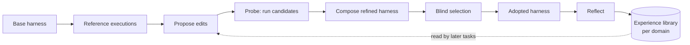

# Concepts: harness2, and where its ideas appear in Harness² Studio

Harness² Studio is an unofficial GUI, REST API and MCP server for
[google-research/harness2](https://github.com/google-research/harness2) ("Harness²: Recursive
Agent Harnessing for an Open World"). **harness2 is the work of its authors at Google
Research**; this page explains it only well enough to use the Studio and links to the sources
for everything else. It does not copy upstream's documentation. If this page and upstream
disagree, upstream is right.

- Paper: <https://arxiv.org/abs/2610.14224>
- Project site: <https://harness2.github.io>
- Code, setup guide, benchmark guides and experiment guide:
  <https://github.com/google-research/harness2>

This page describes harness2 at commit `1cfe254e8d25b15f37048c3730134686abe60335`, the commit
this release of the Studio is tested against. Harness² Studio is not affiliated with,
endorsed by or supported by Google.

## 1. The problem harness2 works on

A **harness** is everything around a language model that lets it act as an agent: prompts,
tools, memory, skills, orchestration. **Harnessing** is the work of tuning that system. harness2
automates part of that work while the model weights stay fixed: it measures an agent on
professional-work benchmarks, lets an *improver* model edit the agent's harness for each task,
and keeps what it learned for later tasks.

## 2. Two levels of recursion

harness2 connects two loops. They are what the name "Harness²" refers to.

**Task-level recursion** refines the harness for one task. One step is called
*Propose–Probe–Compose*:

1. **Reference executions.** The agent (the *executor*) attempts the task with the unchanged
   *base* harness.
2. **Propose.** An improver model proposes edits to the harness.
3. **Probe.** Each proposal becomes a *candidate harness* and is executed on the same task, so
   its effect is observed rather than guessed.
4. **Compose.** The improver combines what the executions showed into a refined harness. No
   ground-truth feedback is used: the improver sees the agent's behaviour, not the grading
   criteria.

**Harnessing-level recursion** carries lessons from one task to the next. After a task, a
*selector* picks one of the refined harnesses without seeing any scores ("blind", answer-free
selection), and a *reflection* step stores the adopted harness and the evidence-supported
lesson in a per-domain **experience library**. Later tasks in the same domain read the earlier
entries.



*This Mermaid diagram was syntax-checked with the Mermaid 12.1.0 parser (`mermaid.parse`). It has not been rendered to an image, so its layout is unseen.*

Tasks inside one *domain* run in order, because each reads the library entries of the tasks
before it; different domains can run side by side (`--workers`, the Studio's
`options.workers`). Libraries are separated by benchmark, executor, mode, budget and seed, so a
sweep never reads another sweep's lessons.

## 3. The eight harness components (c1 to c8)

harness2 exposes eight editable components. The improver may write only to these paths; the
Studio classifies every file of a harness tree the same way (`Component` in `h2s-api`) and
validates trees with a port of upstream's rules (`POST /api/v1/harness/validate`).

| # | Component | OpenCode executor (`oc`) | Codex executor (`cx`) | In context |
|---|---|---|---|---|
| c1 | System prompt | `systemprompt.md` | `AGENTS.md` (carries c1 to c4) | always on |
| c2 | Guardrails | `guardrails.md` | in `AGENTS.md` | always on |
| c3 | Memory | `LongTermMEMORY.md` | in `AGENTS.md` | always on |
| c4 | Tool guidance | `tool_descriptions/tool_guidance.md` | in `AGENTS.md` | always on |
| c5 | Subagents | `sub_agents/<name>/AGENT.md` | `sub_agents/<name>/AGENT.md` | on demand, own context |
| c6 | Skills | `skills/<name>/SKILL.md` | `.agents/skills/<name>/SKILL.md` | on demand |
| c7 | Scripts | `scripts/<name>.py` | `scripts/<name>.py` | on demand, via the shell |
| c8 | Plugins / hooks | `plugin/<name>.ts` | `.codex/hooks.json` | acts inside the tool loop |

Things the validator enforces that surprise newcomers:

- **Always-on text has a cap**: 24,000 characters across the four always-on files of an
  OpenCode harness, 8,000 for Codex's `AGENTS.md`. Every always-on token competes with the
  agent's own output budget. `POST /api/v1/harness/validate` returns the count and the cap as
  `census.always_on_chars` and `census.always_on_max`.
- **A skill must be named in the always-on text**, or the agent never loads it. The validator
  says so in words ("an untriggered skill is dead weight") and suggests a trigger line.
- Scripts must be named like `scripts/check_totals.py` (lowercase letters, digits and underscores;
  `scripts/Check.py` is not recognised as a script); the validator does not byte-compile them
  (harness2 does).
- Files outside the editable surface are reported as `off_surface` and dropped.

## 4. Recursion modes, the budget k, and what a sweep costs

`k` is the **task-level recursion budget**. The two **modes** spend it differently:

| Mode (CLI / on disk) | What happens with budget `k` |
|---|---|
| `parallel` / `agg` | probe `k` general (*invariant*, `inv1`..`invk`) and `k` domain-specific (`dom1`..`domk`) candidates, then make `k` independent compositions (`agg1`..`aggk`) from the whole pool |
| `sequential` / `seq` | refine through `k` successive steps, each carrying the refined harness and the accumulated evidence forward (`c1`..`ck`) |

Both modes start from `k` reference executions of the base harness (label `base`, `base1`, ...).
Per task and mode, upstream's budget identity is **R = 4k rollouts** (k shared base runs, 2k
candidates, k finals) and **P = 3k improver sessions** (k invariant, k domain, k
compositions); selection and reflection sessions are counted separately.

The Studio's cost estimate (`POST /api/v1/estimate`, the `estimate` inside a preview job
result, the MCP tool `estimate_cost`) follows that arithmetic. For `T` tasks and `M` selected
modes:

```text
executor rollouts = T * (k + M * 3k)           # the k base runs are shared by the modes
improver sessions = T * M * (3k + [k > 1] + 1) # +1 selector when k > 1, +1 reflection
```

For 20 tasks, `k = 2` and both modes that is 280 rollouts and 320 sessions, which is what
`POST /api/v1/estimate` returns for that request (see [API.md](API.md)). The estimate **excludes judging** (one
judge call per selected run, and per reference run with `bases`) and retries (a rejected proposal
gets one retry, a failed improver call one more attempt). Dollar figures appear only when the
model profile carries price assumptions or the experiment has earlier recorded spend; see
[MODELS.md](MODELS.md). harness2 records **improver spend only**: executor rollout spend is not
in its summaries, so the Studio's budget guard (`budget_usd`) cannot see it either.

`k` is capped at 32 by the Studio (harness2 itself only requires `k >= 1`), so a typo cannot
launch a sweep that costs orders of magnitude more than intended.

## 5. Benchmarks, executors and the "cell"

harness2 ships adapters for three benchmarks and two executors. Every harness2 command takes the
same triple, which the Studio calls a **cell**.

| Benchmark | Short name | Tasks, grouped by | Grading | Needs |
|---|---|---|---|---|
| JobBench | `jb` | occupation | weighted rubrics, LLM judge | node, uv, git; public dataset on Hugging Face |
| LAB (Harvey Labs) | `lab` | practice area | rubric criteria: *partial* (fraction passed) and *all-pass* | Pandoc, Poppler |
| WorkBuddy-Bench | `wb` + subset `office`, `web` or `code` | category or role | the benchmark's own verifier | Docker; Vertex AI Gemini models; custom licence with a territorial limitation |

| Executor | Short name | Notes |
|---|---|---|
| OpenCode | `oc` | default; run from a pinned source checkout |
| Codex | `cx` | needs a Responses-API endpoint (`harness2-bridge` provides one on Vertex AI); upstream runs it with its **sandbox disabled** |

The Studio validates the cell exactly as upstream does: `wb` needs a subset, the others must not
have one. Which model profile can drive which cell is the subject of [MODELS.md](MODELS.md).

## 6. Results on disk, namespaces and resuming

Every command writes under one output root, `HARNESS2_RUNS_DIR`. The Studio gives each
**experiment** its own such directory, so an experiment is simply a harness2 results directory
plus some metadata in the Studio's database. The files stay ordinary harness2 files: harness2's
own tools keep working on them, and the Studio only ever reads them through a path-checked
reader.

A run's identity is its **namespace**:

```text
<bench>-<substrate>-<mode><k>[-s<seed>][-<tag>]       e.g.  lab-oc-agg1-s7
```

Judging and reporting must use the same benchmark, executor, subset, `k`, mode and seed as the
run. `--seed` shuffles the task order reproducibly; it does not control model sampling.
Summaries for both modes live in the *parallel* (`agg`) namespace, which is why the Studio
calls that namespace the **sweep id**. Repeating a command resumes it; failed judgements stay
**ungraded**, which is not the same as zero, and every Studio view keeps the two apart.

Scores come in two units, and the Studio keeps upstream's convention: **percent (0..100)** in
reports and headlines, **fractions (0..1)** in judge rows, task rows and comparisons.

## 7. Glossary: harness2 terms and where they appear in the Studio

REST paths are relative to `/api/v1`. The MCP names are tools unless marked otherwise. "UI"
refers to the routes in the UI contract ([ARCHITECTURE.md](ARCHITECTURE.md) §12); the screens are
walked through in the [user guide](USER-GUIDE.md).

| harness2 term | Meaning | In the Studio |
|---|---|---|
| harness, tree | the c1 to c8 files an agent runs with | `GET /experiments/{exp}/sweeps/{sweep}/tasks/{task}/modes/{mode}/harnesses/{label}`; `get_harness`; UI task page |
| label | name of one harness in a task: `base`, `inv1`, `dom1`, `agg1`, `c1`, ... | the `{label}` path segment, `chosen_label` in task rows |
| diff | file-by-file change between two labels | `.../modes/{mode}/diff?from=&to=`; `diff_harnesses` |
| export | a harness as project files for OpenCode, Codex or raw | `.../harnesses/{label}/export?target=&format=`; `export_harness` |
| base / reference execution | the unchanged harness, run `k` times | label `base`; counted in R |
| invariant / domain candidate | edits for how the agent works vs. for the subject area | labels `inv<n>`, `dom<n>` |
| composition | a refined harness built from the candidates | labels `agg<n>` (parallel) and `c<n>` (sequential) |
| mode | `parallel` or `sequential` recursion | `Mode`; paths accept `parallel`/`sequential` or `agg`/`seq` |
| `k`, R, P | recursion budget; rollouts 4k; sessions 3k | `options.k`; `POST /estimate`; `estimate_cost` |
| cell | benchmark + subset + executor | `cell` in job parameters; `GET /benchmarks`; `list_benchmarks` |
| domain | the grouping unit of a benchmark's tasks | `domain` in task rows; `options.only_domains` |
| task, task slug | one benchmark task; its id with `/` written as `__` | `{task}` path segment; `list_tasks`, `get_task` |
| namespace / sweep | the run identity `<bench>-<sub>-<mode><k>...` | `{sweep}` path segment; `sweeps[]` of an experiment |
| `HARNESS2_RUNS_DIR` | the output root | an **experiment** (`GET /experiments`) |
| demo | `harness2-demo`: the real workflow with deterministic local editors, no credentials | job kind `demo`; `run_demo` |
| setup / check | install a benchmark; offline readiness check | job kinds `setup`, `check`; `setup_benchmark`, `check_benchmark` |
| dry run | `harness2 --dry-run`: task stream and namespaces, no model calls | job kind `preview`; `preview_run` |
| refinement run | `harness2`: the sweep | job kind `run`; `start_run` |
| judge, `--bases` | grade the selected runs, or the reference runs | job kind `judge`; `start_judge`; `GET .../scores` |
| report | `harness2-report`: the publication-format figures | job kind `report`; `GET .../report`; `get_report` |
| pipeline | check, run, judge, report in one go | job kind `pipeline`; `start_pipeline` |
| split | reproducible domain-stratified train/test partition | job kind `split`; `GET /splits`; `create_split`, `list_splits` |
| selection | the blind pick among finals; its rationale | `selection` in `TaskDetail`; `get_task` |
| reflection, experience library | per-domain adopted harnesses and lessons (`INDEX.md`, `EXPERIENCE.md`) | `GET .../library`; `get_library` |
| improver audit trail | the improver's missions, prompts and answers (`_audit/`) | `GET .../audit` and `.../audit/{session}/{part}`; `list_audit_sessions`, `read_audit_session` |
| judge rows | `judged.json`, `base_judged.json` | `GET .../scores`; `get_scores` |
| partial, all-pass | LAB's two metrics | `ScoreReport`; `get_report` |
| ungraded | no grade was produced (not a zero) | `graded: false` rows; excluded from denominators |
| bridge | `harness2-bridge`: a Responses-API endpoint on Vertex AI for Codex | job kind `bridge` (admin); `start_bridge` |
| fingerprint | short hash of a harness tree | recorded in summaries; used to check a harness is unchanged |
| compare | per-task deltas between two sweeps with an exact sign test | `GET /compare?a=&b=`; `compare_sweeps` |

Studio-only vocabulary (profiles, secrets, tokens, roles, jobs, isolation) is defined where it
is used: [ADMIN-GUIDE.md](ADMIN-GUIDE.md), [MODELS.md](MODELS.md), [API.md](API.md) and
[MCP.md](MCP.md).
