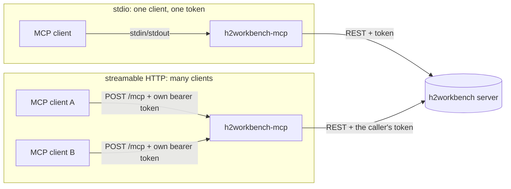

# MCP server: harness2 for AI agents

`h2workbench-mcp` exposes every harness2 operation of the Workbench as [Model Context
Protocol](https://modelcontextprotocol.io) **tools, resources and prompts**, so an agent in
Claude Code, opencode, Codex, Cursor, VS Code or any other MCP client can set up, run, wait for and
analyse harness2 sweeps without a browser.

It is a **thin client of a running Workbench server**. It keeps no state, runs no jobs and holds no
credentials of its own: every call it makes is an ordinary [REST API](API.md) request carrying an
API token, so the server's roles (viewer < operator < admin), limits and audit log apply to each
agent exactly as they apply to a person.



*This Mermaid diagram was syntax-checked with the Mermaid 12.1.0 parser (`mermaid.parse`). It has not been rendered to an image, so its layout is unseen.*

**Status.** Implemented: 43 tools, 3 resource URI forms, 3 prompts, both transports. Verified
live on 2026-10-23 and 2026-10-24 against a running `h2workbench` 0.1.0 and a real harness2 checkout
(`1cfe254`): a stdio session (initialize, `tools/list`, `server_info`, role refusals, a real demo
run through `run_demo`) and the HTTP guard. Also covered by tests with a mock server and by an
end-to-end suite. **Not tried against the real MCP clients named on this page**: the
configuration snippets follow each client's documented format and are unverified.

## 1. Set it up

### 1.1 A token for the agent

Create a token with the **lowest role the agent needs**, and give it an expiry. **Start with a
viewer token**: it reads experiments, results, jobs and logs and plans runs, which is most of what
an agent does for analysis. Use an **operator** token only when the agent must start jobs. **Do not
give an agent an admin token**: installing harness2, setting up benchmarks and running the Codex
bridge are for a person (the tools `install_harness2`, `setup_benchmark` and `start_bridge` exist,
and an admin token would let a model, or text that has hijacked it, run them). Everything an agent
reads through a tool is untrusted ([section 3](#3-safety-rules)).

```console
$ h2workbench token create --name "claude code" --role operator --expires-in-days 30 > mcp.token
Created operator token tqj6ch4x (claude code), expires 2026-11-23T04:23:59Z.
$ chmod 600 mcp.token
```

`h2workbench-mcp` reads the token from `H2W_TOKEN`, or from a file only you can read
(`--token-file` / `H2W_TOKEN_FILE`; not both). It never accepts a token as a command-line
argument, because that would show in `ps` and shell history.

### 1.2 stdio (the default)

The MCP client starts the program. Configuration is by environment:

| Setting | Variable / flag | Default |
|---|---|---|
| Workbench server | `H2W_SERVER_URL` / `--server-url` | `http://127.0.0.1:8722` |
| Token | `H2W_TOKEN`, or `H2W_TOKEN_FILE` / `--token-file` (mode 0600) | none: required |
| Let a model accept host-isolation risks | `--allow-risk-acknowledgement`, or `H2W_MCP_ALLOW_RISK_ACK=1` (both transports) | off |

```console
$ H2W_SERVER_URL=http://127.0.0.1:8722 H2W_TOKEN_FILE=mcp.token h2workbench-mcp
```

Logs go to stderr (`RUST_LOG` adjusts them; default `warn,h2w_mcp=info`). Tokens are never
logged.

### 1.3 Streamable HTTP

```console
$ h2workbench-mcp --transport http --listen 127.0.0.1:8723 --server-url http://127.0.0.1:8722
```

The endpoint is `POST /mcp`, **stateless** (no `Mcp-Session-Id`). Every request must carry its own
`Authorization: Bearer h2w_...`; that caller's token is forwarded to the Workbench server, so each
client is authorised and audited on its own. A token given to the process itself (`H2W_TOKEN`,
`--token-file`) is ignored in this mode, with a warning.

The guard in front of the endpoint refuses, in this order:

| Check | Status | Message |
|---|---|---|
| unknown `Host` (DNS-rebinding defence; a `Host` with userinfo such as `user@127.0.0.1:8723` is unknown too) | 421 | `this MCP server does not answer to that Host; add it with --allowed-host if it is legitimate` |
| a browser `Origin` that is not allowed | 403 | `cross-origin requests are not allowed; add the origin with --allowed-origin if it is legitimate` |
| no well-formed bearer token | 401 | ``send `Authorization: Bearer h2w_...` with a Harness² Workbench API token; it is forwarded to the Workbench server, which checks it`` (with `WWW-Authenticate: Bearer realm="h2workbench-mcp"`) |
| more than `--max-concurrent-requests` (default 32) in flight | 503 | `this MCP server is already handling N requests, its maximum (--max-concurrent-requests); retry in a moment` (with `Retry-After: 1`) |
| body over `--max-body-bytes` (1 MiB) | 413 | `Payload Too Large: request body exceeds 1048576 bytes` (plain text) |

Loopback forms of the listen address are always allowed; add other host names with
`--allowed-host` (repeatable). **Listening beyond loopback needs a TLS reverse proxy in front**:
the server warns when you do, and bearer tokens must not cross a network in clear text.
`h2workbench-mcp` itself refuses a plain-`http` `--server-url` on a non-loopback host
(`refusing to send API tokens over plain http to <host>: use an https URL ... or pass
--allow-insecure-remote`).

A real request, abbreviated:

```console
$ curl -s -X POST http://127.0.0.1:8723/mcp -H "Authorization: Bearer $TOKEN" \
       -H 'content-type: application/json' -H 'accept: application/json, text/event-stream' \
       -d '{"jsonrpc":"2.0","id":1,"method":"initialize","params":{"protocolVersion":"2025-06-18","capabilities":{},"clientInfo":{"name":"curl","version":"0"}}}'
data: {"jsonrpc":"2.0","id":1,"result":{"protocolVersion":"2025-06-18","capabilities":{"prompts":{},"resources":{},"tools":{}},"serverInfo":{"name":"h2workbench-mcp","title":"Harness² Workbench","version":"0.1.0", ...},"instructions":"Harness² Workbench drives google-research/harness2, which improves an AI agent's harness ... Safe order: server_info -> doctor -> list_benchmarks / check_benchmark -> preview_run -> estimate_cost -> the user's go-ahead -> start_pipeline ..."}}
```

The `instructions` string is sent to the client at initialisation and tells the model the safe
order of operations and which tools cost money.

### 1.4 Client configuration

Replace `/absolute/path/to/mcp.token` with the real path where a client does not expand
variables. `wait_for_job` can block for up to 600 s: give the client a tool timeout above the
waits you use. **None of these snippets has been tried against the client it is written for**;
they follow each client's documented configuration format.

**Claude Code**

```sh
claude mcp add h2workbench \
  --env H2W_SERVER_URL=http://127.0.0.1:8722 \
  --env H2W_TOKEN_FILE="$HOME/.config/harness2-workbench/mcp.token" \
  -- h2workbench-mcp
```

or, in a project's `.mcp.json` (Claude Code expands `${VAR}`); the HTTP form takes the token from
the environment of the shell that starts Claude Code:

```json
{
  "mcpServers": {
    "h2workbench": {
      "command": "h2workbench-mcp",
      "env": {
        "H2W_SERVER_URL": "http://127.0.0.1:8722",
        "H2W_TOKEN_FILE": "${HOME}/.config/harness2-workbench/mcp.token"
      }
    },
    "h2workbench-http": {
      "type": "http",
      "url": "http://127.0.0.1:8723/mcp",
      "headers": { "Authorization": "Bearer ${H2W_TOKEN}" }
    }
  }
}
```

If calls are cut off, raise `MCP_TOOL_TIMEOUT` (milliseconds).

**opencode** (`opencode.json`)

```json
{
  "$schema": "https://opencode.ai/config.json",
  "mcp": {
    "h2workbench": {
      "type": "local",
      "command": ["h2workbench-mcp"],
      "environment": {
        "H2W_SERVER_URL": "http://127.0.0.1:8722",
        "H2W_TOKEN_FILE": "/absolute/path/to/mcp.token"
      },
      "enabled": true
    }
  }
}
```

For HTTP use `"type": "remote"`, `"url": "http://127.0.0.1:8723/mcp"` and
`"headers": { "Authorization": "Bearer {env:H2W_TOKEN}" }`.

**Codex** (`~/.codex/config.toml`)

```toml
[mcp_servers.h2workbench]
command = "h2workbench-mcp"
env = { H2W_SERVER_URL = "http://127.0.0.1:8722", H2W_TOKEN_FILE = "/absolute/path/to/mcp.token" }
startup_timeout_sec = 20
tool_timeout_sec = 660   # the default (60 s) is shorter than long waits
```

For HTTP (Codex versions with streamable-HTTP support) use `url = "http://127.0.0.1:8723/mcp"`
and `bearer_token_env_var = "H2W_TOKEN"`.

**Cursor** (`~/.cursor/mcp.json` or `.cursor/mcp.json`)

```json
{
  "mcpServers": {
    "h2workbench": {
      "command": "h2workbench-mcp",
      "env": {
        "H2W_SERVER_URL": "http://127.0.0.1:8722",
        "H2W_TOKEN_FILE": "${userHome}/.config/harness2-workbench/mcp.token"
      }
    }
  }
}
```

For HTTP use `"url": "http://127.0.0.1:8723/mcp"` and
`"headers": { "Authorization": "Bearer ${env:H2W_TOKEN}" }`.

**VS Code** (`.vscode/mcp.json`)

```json
{
  "servers": {
    "h2workbench": {
      "type": "stdio",
      "command": "h2workbench-mcp",
      "env": {
        "H2W_SERVER_URL": "http://127.0.0.1:8722",
        "H2W_TOKEN_FILE": "${userHome}/.config/harness2-workbench/mcp.token"
      }
    }
  }
}
```

For HTTP, declare an `inputs` entry of type `promptString` with `"password": true` and send
`"headers": { "Authorization": "Bearer ${input:h2w-token}" }`.

## 2. What an agent gets

43 tools, grouped by purpose. "Role" is the minimum role the Workbench server demands; the MCP server
does not decide it. \* marks tools that **call model endpoints and can cost money** with cloud
models.

| Purpose | Tools | Role |
|---|---|---|
| Orient | `server_info` (who am I, what server), `doctor` (`refresh` needs operator), `list_benchmarks`, `list_profiles`, `check_profile` (a profile's warnings and unset secrets) | viewer |
| Experiments | `list_experiments`, `get_experiment`, `get_manifest`, `list_splits` | viewer |
| | `create_experiment`, `update_experiment` | operator |
| Plan (no model calls) | `estimate_cost`, `validate_harness` | viewer |
| | `preview_run` (a dry-run job), `check_benchmark` (offline readiness), `run_demo` (free local workflow), `create_split` (a random train/test split), `choose_split` (a split of tasks chosen by id: run exactly those) | operator |
| Run | `start_run`\*, `start_pipeline`\*, `start_judge`\*, `start_report` | operator |
| Install (admin) | `setup_benchmark`, `install_harness2`, `start_bridge`\* | admin |
| Follow | `list_jobs`, `get_job`, `wait_for_job`, `get_job_log` | viewer |
| | `cancel_job` (an admin kind needs admin) | operator |
| Read results | `list_tasks`, `get_task`, `get_harness`, `diff_harnesses`, `list_rollout_files`, `read_rollout_file`, `get_scores`, `get_report`, `get_library`, `list_audit_sessions`, `read_audit_session`, `compare_sweeps` | viewer |
| Adopt | `export_harness` (to raw, OpenCode or Codex project files) | viewer |

`get_job_log` returns one page: at most `limit` lines (up to 5,000) and about 1 MiB, with `next`
(pass it as `from` to continue) and `complete`. `tail=N` returns the newest of the last N lines that
fit in the result (about 66 KB of line text): older lines are dropped first, so long lines mean
fewer lines. It follows the server's pages to the end of the log in at most eight requests; when a
log's line sizes keep it from getting there, `complete` is `false` and `next` says where to go on.
`install_harness2` takes no `rev`: it always installs the commit this Workbench release was tested
against. `server_info` reports the MCP server's own settings under `mcp_server.policy`
(`allow_risk_acknowledgement`, `max_waits_per_token`) next to who you are and what the Workbench is.

**Resources** (read-only, `resources/read`): `h2w://jobs/{id}/log` (the newest of the last 2,000
lines that fit in about 100 KB, found the same way as `tail`; its header says which lines are shown,
and a newest line longer than that alone is cut and marked `[line cut to fit]`),
`h2w://experiments/{exp}/sweeps/{sweep}/report` and `h2w://experiments/{exp}/manifest` (JSON).
`resources/list` offers every experiment's manifest, every judged sweep's report and the 20 newest
jobs' logs.

**Prompts** (guided workflows): `improve_agent_harness` (doctor, profile, benchmark setup and
check, preview, cost estimate and your go-ahead, pipeline, waiting, report, inspection, export),
`analyze_sweep` (read-only analysis of one sweep) and `adopt_best_harness` (choose, explain,
validate and export a harness, with your approval before anything is written).

Observed on a live server (the list is the same for a viewer, an operator and an admin token; the
server decides at call time):

```text
tools: 43
cancel_job, check_benchmark, check_profile, choose_split, compare_sweeps, create_experiment, create_split,
diff_harnesses, doctor, estimate_cost, export_harness, get_experiment, get_harness, get_job,
get_job_log, get_library, get_manifest, get_report, get_scores, get_task, install_harness2,
list_audit_sessions, list_benchmarks, list_experiments, list_jobs, list_profiles,
list_rollout_files, list_splits, list_tasks, preview_run, read_audit_session, read_rollout_file,
run_demo, server_info, setup_benchmark, start_bridge, start_judge, start_pipeline, start_report,
start_run, update_experiment, validate_harness, wait_for_job
prompts: ['improve_agent_harness', 'analyze_sweep', 'adopt_best_harness']
resource templates: ['h2w://jobs/{id}/log', 'h2w://experiments/{exp}/sweeps/{sweep}/report',
                     'h2w://experiments/{exp}/manifest']
```

The tool list, descriptions and input schemas are frozen in a snapshot test
(`crates/h2w-mcp/tests/snapshots/tool_schemas.json`), so a change to the tool contract shows up in
review. Every tool carries MCP annotations: read-only tools are marked so; `cancel_job`,
`install_harness2` and `update_experiment` are marked destructive; tools that reach models or the
network (`setup_benchmark`, `install_harness2`, `start_run`, `start_pipeline`, `start_judge`,
`start_bridge`) are marked open-world.

### Arguments, results and errors

- **Arguments mirror the REST names**: `experiment`, `sweep` (the summary namespace id), `task`
  (slug), `mode`, `label`, `from`/`to`, `path`, `session` and `part`, `job_id`. Job tools take the
  job's parameters flat (`cell`, `options`, `profile`, ...) plus `wait_secs`. **Unknown or
  misspelled arguments are errors, never ignored:**

  ```text
  failed to deserialize parameters: unknown argument `jobid` (allowed here: job_id). Check the
  spelling against the tool's input schema.
  ```
- **Results** are the server's JSON, pretty-printed in the first text block (cut with a note
  above 100 KB) and attached as structured content when it is an object of at most 256 KiB. A
  second text block may add a short note (what a job's status means, what to call next).
- **Failures** are tool errors (`isError: true`) whose text starts with the server's error code,
  then the server's message, field problems, a hint where the fix is known, and the request id:

  ```text
  forbidden: this requires the operator role (this tool needs the operator role or higher; ask an
  admin for a token with that role) [request id 9f8d1cbf8da5475cb32c9f8e648c1a0a]
  forbidden: starting a install_harness2 job requires the admin role (this tool needs the admin
  role or higher; ask an admin for a token with that role) [request id 5c87d44ddb504b17900931e387c64998]
  ```

  The first came from a viewer token calling `run_demo`, the second from an operator token calling
  `install_harness2`. Look the request id up in the server's log or audit trail.
- **Units**: percent (0..100) in reports and headlines (`get_report`, `get_experiment`);
  fractions (0..1) in judge rows, task rows and comparisons (`get_scores`, `list_tasks`,
  `get_task`, `compare_sweeps`). Ungraded is not zero.

## 3. Safety rules

1. **The server decides, not the MCP server.** Roles are enforced by the Workbench server on every
   call, per token; the MCP layer only turns a refusal into a readable message. A viewer token
   cannot start a job whatever the model says, and the denial is written to the audit log (as
   `access.denied`). A token's refusals, an operator token's refused job starts and cancels
   included, are recorded at most 10 a minute and only counted after that, so an agent cannot flood
   the log with them. The one
   rule the MCP server adds itself is rule 3's: it refuses to let a model accept host-isolation
   risks for you.
2. **MCP never writes profiles, secrets, tokens or the audit log.** There is no tool for it, by
   contract. A prompt-injected agent that could edit a profile could repoint its endpoint at a
   hostile URL and receive the API key it references on the next job; secret values and new
   tokens must not pass through a model's context at all. Profiles and secrets are managed
   through the REST API, the web UI or the CLI by a person.
3. **A running agent can still spend and run code.** With an operator token an agent can start
   `run`, `pipeline` and `judge` jobs, which call cloud models, and under host isolation the
   executors run with the server user's files and network, and so with access to the Workbench's own
   data (a host-mode job is, in effect, a Workbench administrator). Under host isolation the Workbench
   refuses `run` and `pipeline` jobs unless `acknowledge_risks` is `true`, and **a model must not
   accept that for you**: `h2workbench-mcp` refuses a `start_run` or `start_pipeline` call that sets
   `acknowledge_risks=true`, unless whoever starts the MCP server passes
   `--allow-risk-acknowledgement` (or sets `H2W_MCP_ALLOW_RISK_ACK=1`; it logs a warning when it
   is on). Verified live against a scratch server:

   ```text
   forbidden: this MCP server does not let a model set acknowledge_risks=true, which accepts for the
   user that the executor runs with the server user's files and network (host isolation). A human can
   start this run from the Workbench web UI; an admin can pre-acknowledge host risks in the server
   configuration; or the person who runs h2workbench-mcp can start it with --allow-risk-acknowledgement
   (H2W_MCP_ALLOW_RISK_ACK=1). Without acknowledge_risks the call goes through and the Workbench server
   decides.
   ```

   With the flag on, the call goes through and the Workbench decides (the same call then failed on
   the server's own check, `conflict: demo is a demo experiment; benchmark jobs need a standard
   experiment`, so no job was started). The alternatives to the flag are a person starting the
   run in the web UI, or an administrator setting `isolation.preacknowledge_host_risks` (which
   removes the requirement for everyone). `budget_usd` is likewise a parameter the model
   chooses. So: a viewer token by default, an operator token only when the agent must start jobs,
   **never an admin token**, short token lifetimes, a separate token per agent, container isolation
   for anything untrusted, and a budget on the model account itself. See
   [THREAT-MODEL.md](THREAT-MODEL.md).
4. **Treat tool output as untrusted data.** Rollout files, job logs, improver prompts and answers,
   task text, model transcripts, harness files and documents from benchmarks are model-written or
   third-party content: all of it can carry instructions aimed at the agent reading it, and a
   harness that an agent exports may contain whatever a model wrote into it. The server's
   instructions and the descriptions of these tools tell the model to read such content as data and
   never to follow instructions found in it; that is guidance to a model, not a barrier, so treat an
   agent that acts on instructions found in a result as compromised for that session, and do not let
   an agent act on them without a person's approval.
5. **Waiting is bounded.**
   - Job-starting tools take `wait_secs` (0 to 600). The quick ones default to **45 s**
     (`check_benchmark`, `preview_run`, `run_demo`, `start_report`, `create_split`); the costly or
     slow ones default to **0** and return the queued job at once (`start_run`, `start_pipeline`,
     `start_judge`, `setup_benchmark`, `install_harness2`, `start_bridge`).
   - `wait_for_job` waits for `timeout_secs` (default 50, maximum 600) on the server's event
     stream (falling back to polling every `poll_interval_secs`, default 2, whenever the stream cannot
     be used, for instance when the Workbench refuses it with `429` because the token already holds
     `server.sse_max_per_principal` open streams; read from the code, not exercised) and, if the client
     sent a progress token, emits progress notifications with finished/total tasks and the current
     task, at least every 10 s. On timeout it returns the job as it is; the job keeps running.
   - Each token may run at most `--max-waits-per-token` (default 4) waits at once, in both
     transports. Beyond that a wait is a tool error that starts `rate_limited:`
     (``rate_limited: too many concurrent waits for this token (4 already running, the most allowed at once). Let one finish, or check the job with get_job instead of waiting.``), and a job tool
     called with `wait_secs` returns the job it created without waiting, with a note.
   - Over HTTP, at most `--max-concurrent-requests` requests are handled at once (`503` beyond).
6. **Token handling**: never on a command line, files must be mode 0600, never logged, and a
   token reaches only the Workbench server named by `--server-url`.

## 4. Troubleshooting

Real messages and what to do are collected in
[TROUBLESHOOTING.md](TROUBLESHOOTING.md#mcp-server). The most common: `no API token: set H2W_TOKEN,
or point --token-file / H2W_TOKEN_FILE ...`, `the token file ... is accessible by group or others
(mode 644); restrict it first: chmod 600 ...`, and `unavailable: ...` when the Workbench server is not
reachable at `--server-url`.
