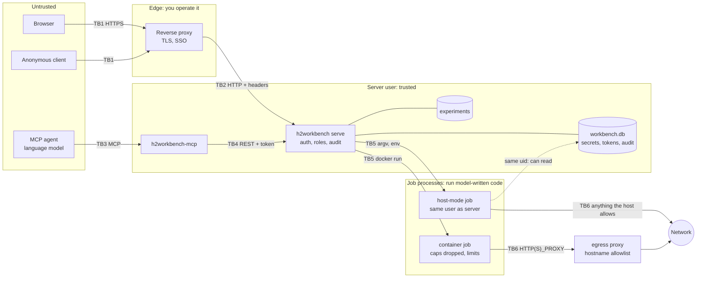

# Threat model

What Harness² Workbench protects, from whom, how, and what it deliberately does not stop. It covers
the Workbench 0.1.x: the `h2workbench` server, the web UI it serves, the `h2workbench-mcp` server, the egress
proxy and the deployment files in `deploy/`. It does not cover harness2 itself, the benchmarks it installs, or the
model providers; where they matter, the text says so.

**Status of this document.** It was written from a review of the code, the test suite and live runs
by the documentation author. **No human penetration test or professional security audit has been
done.** Two independent code reviews by a separate AI agent (the first of commit `f842ee1`, the second,
on 2026-10-24, of a later commit that already held the first round's fixes; the reports are not
published) found issues; the fixes are part of this revision (listed in
[ADMIN-GUIDE.md](ADMIN-GUIDE.md#17-what-changed-with-the-security-review)) and the rows below describe
the code as it is now. The second review confirmed the first round's fixes (some are partial or by
design, as the rows and the residual risks say) and found ten further issues, N1 to N10 (a results
file swapped for a FIFO hanging a reader, unbounded digests, log pages and responses, per-request
read budgets, audit flooding by an authenticated caller, limiter keys behind a proxy, the Origin
rule behind https, audit actor names, and two small ones); they are fixed in this revision.
**Those fixes have not been re-reviewed independently.** The fixes were checked by the
documentation author with the tests named in the rows and with live runs. Between them the reviews
reported trying, without finding a bypass, the Host allowlist and DNS rebinding, the CSRF header and Origin
rule (28 raw-socket cases), body and chunking limits, cookie flags, logout and revocation, `X-Forwarded-For` from an
untrusted peer, the role of every route (49 method and path pairs for each of four roles), the
results reader (symlinks, `..`, FIFOs, escapes), the static-file allowlist, XSS payloads in 15 UI
pages and `?next=` redirects, the job environment and argv guard, the container argv hardening, the
egress proxy's refusals, and the MCP guards; the second added 196 role-by-route requests, 686 hostile
fuzz requests (no `5xx`, no panic), 20 egress SSRF cases and hostile content in 21 UI pages. Treat
that as a report of an automated review, not as proof. Each mitigation below cites the file that implements it and an evidence grade:

| Grade | Meaning |
|---|---|
| **T** | covered by an automated test in the repository (the test is named); the workspace tests passed in the author's environment on 2026-10-24 (`cargo xtask check`) |
| **L** | exercised live by the documentation author against a running server (harness2 `1cfe254`, Linux, 2026-10-23/24) |
| **C** | established by reading the code only; not demonstrated |

Report problems with this model, or with the controls, through [SECURITY.md](../SECURITY.md).

## 1. Bottom line

Read these first; everything else supports them.

1. **A job is code execution.** harness2's executors (OpenCode, Codex) run model-written tool calls
   and scripts. In **host** isolation they run as the server's user with that user's files and
   network. Anyone who may start a `run`, `pipeline` or `judge` job (operator and above), and anyone
   who can steer the model's inputs (benchmark documents, MCP prompt injection), can in effect run
   commands as that user. Codex runs with its own sandbox **disabled** by upstream.
2. **In host mode a malicious or prompt-injected executor is, in effect, a Workbench administrator
   plus the server user.** It runs as the user that owns the Workbench's data directory, so it can read
   the database (stored secrets, token hashes), rewrite it, and signal the server. The independent
   review demonstrated reading the database and the server's `/proc` environment from a same-user
   job. The second route is closed (the server and the egress proxy are non-dumpable, so a same-user
   process gets `Permission denied` on `/proc/<pid>/environ`; checked live), the first is not, and
   neither is any file the server user can read, such as the one an `EnvironmentFile` points at.
   **Container isolation exists for this**: each job runs in its own container that sees only its
   experiment, the harness2 checkout and its own files. **The compose reference deployment contains
   the whole Workbench from your host and network, but the jobs inside it are not isolated from the
   Workbench itself**: they run in host mode inside the same container, as the same user.
3. **Secrets are visible to the code that needs them.** A job's profile keys are in its environment
   (in container mode they reach the container through a 0600 file that is deleted with the job).
   The Workbench keeps them out of responses, logs and command lines, but cannot hide them from the
   model-driven process that uses them; hostile code can send them anywhere the network lets it.
   Redaction is exact-substring matching: a safety net for accidents, not a barrier.
4. **Secrets are stored in plain text** in a 0600 SQLite file; the bootstrap admin token is also
   saved in plain text next to the configuration. There is no encryption at rest.
5. **The audit log is a SHA-256 hash chain, not a tamper-proof record.** It reveals an edit by
   someone who cannot rewrite the whole chain; anyone with write access to the server's data
   directory (which includes host-mode jobs) can rewrite every record and recompute every hash, and
   `audit verify` will then say the chain is intact. The chain is unkeyed; keep its head hash
   somewhere the server's user cannot write.
6. **MCP agents are prompt-injectable**, which is why MCP cannot write profiles, secrets or tokens,
   and why agents should hold a **viewer** token unless they must start jobs (an operator token
   then, never an admin one). Tool output (rollouts, logs, prompts, benchmark text) is untrusted
   model-written content. An agent with an operator token can still spend money and, in host mode,
   run code through jobs. The MCP server refuses a model's `acknowledge_risks=true` (the
   acknowledgement that host isolation is acceptable) unless a person started it with
   `--allow-risk-acknowledgement`; it likewise refuses `acknowledge_cloud_judge=true` unless a
   person started it with `--allow-cloud-judge-acknowledgement`. `budget_usd` and everything else
   an operator may do remain parameters the model chooses.
6a. **Every model endpoint receives the experiment's data.** The executor and improver see the
   tasks and documents, and the judge sees each task, its reference material and the agent's
   deliverables. A profile whose endpoints are at a cloud provider sends all of that there. The
   Workbench classifies the judge (`judge_site`) and requires a person's confirmation that the data
   is generated or synthetic before a judge or pipeline job sends it to a cloud judge (or refuses
   such jobs under `[judge] cloud = "refuse"`); it does not classify the executor or improver
   endpoints, and the classification is by host name only, so a local gateway that forwards to a
   cloud provider counts as local. The confirmation is a statement a person makes, not a check of
   the data.
7. The server has **no TLS** and **no general rate limit**. Failed authentication is throttled per
   client address (60 a minute), logins are limited, and connections and event streams are capped per
   address and per principal; everything else an authenticated client does is not. Put it behind a
   TLS proxy and bound the audience.

## 2. Assets

| # | Asset | Why it matters |
|---|---|---|
| A1 | Model-provider credentials (API keys, service-account JSON) | spend, impersonation, data access at the provider |
| A2 | API tokens and browser sessions | they are the access control |
| A3 | The server host and the server user's files and network | the executors act with them in host mode |
| A4 | Experiment data: task text, model transcripts, harnesses, scores | may be sensitive; scores are the product |
| A5 | The audit log | the record of who did what |
| A6 | Money: model spend, compute | runs can be expensive |
| A7 | Availability of the server and its queue | long runs, shared use |
| A8 | The software supply chain: the Workbench's build, harness2, benchmark checkouts, npm/PyPI packages | executed with the server user's privileges at install time |
| A9 | Integrity of results | a run that could read its own rubrics measures nothing |

## 3. Actors

| Actor | Capability | Trusted? |
|---|---|---|
| Anonymous network client | reaches the listener, `/healthz`, `/readyz`, login | no |
| Web page in an authenticated user's browser | CSRF, DNS rebinding, clickjacking attempts | no |
| Viewer | reads all experiments, results, logs, profiles (no secret values) | to read only |
| Operator | creates experiments; starts and cancels jobs; **effectively runs code in host mode** | trusted with that |
| Admin | installs harness2, sets up benchmarks (third-party code), manages secrets, tokens, profiles | fully trusted |
| MCP agent | an operator or viewer token driven by a language model | **no**: assume prompt injection |
| Model-written code inside a job | everything the executor's tools can do as the job's user | **no** |
| Benchmark content and tool output | text that may carry instructions to the model | no |
| Reverse proxy / SSO provider | asserts identities in proxy mode | yes |
| Container runtime and host administrator | enforce isolation | yes |
| Other local users of the host | read files and process lists the OS allows | no |
| Upstream sources (harness2, benchmarks, PyPI, npm, Hugging Face) | supply code and data at install time | partly: pinned, not audited here |

## 4. Trust boundaries

*This Mermaid diagram was syntax-checked with the Mermaid 12.1.0 parser (`mermaid.parse`). It has not been rendered to an image, so its layout is unseen.*

| Boundary | Crossing | Enforced by |
|---|---|---|
| TB1 | Internet or LAN to the reverse proxy | your proxy and firewall (TLS, SSO) |
| TB2 | Proxy to `h2workbench serve` | `Host` allowlist, CSRF header, `Origin` rule, bearer or session or proxy-header authentication, roles, body and time limits |
| TB3 | Agent to `h2workbench-mcp` | stdio (a local process pair) or bearer token plus `Host`/`Origin` checks over HTTP |
| TB4 | `h2workbench-mcp` to the server | the same authentication as any client; the caller's own token |
| TB5 | Server to job processes | argv without a shell, a cleared environment, process groups, validated identifiers; in container mode the runtime's hardening. **In host mode there is no OS boundary at all** |
| TB6 | Jobs to the network | nothing in host mode; in container mode the container's network, which should be internal with the egress proxy as its only way out |

## 5. STRIDE analysis

Paths are relative to the repository root. Tests are named where they exist.

### Spoofing

| ID | Threat | Mitigation (code) | Evidence | Residual |
|---|---|---|---|---|
| S1 | Guessing or brute-forcing a token | 256-bit random secret, stored as SHA-256, constant-time compare, equal hashing work for unknown ids; a presented token must be exactly `h2w_` + 8 of `[a-z0-9]` + `_` + 43 of `[A-Za-z0-9_-]` (anything else, any non-ASCII character included, is `401`); login attempts limited per client address (IPv6 per /64); **failed authentication throttled per client: 60 a minute, then `429`** (valid credentials from the same address keep working); the limiter tables are bounded and never fail open, and **keyed per TCP peer**: a peer holds at most 1,024 client keys, its further clients share one bucket of that peer, and a full table gives a newcomer its own peer's bucket, so one peer cannot starve another (`crates/h2w-daemon/src/auth.rs`, `http/extract.rs`, `http/routes/auth.rs`, `ratelimit.rs`) | T `auth.rs::bearer_tokens_authenticate_and_bad_ones_are_refused`, `login_attempts_are_rate_limited_per_client`, `non_ascii_tokens_are_refused_with_401`, `a_peer_inventing_forwarded_clients_only_limits_itself`; `ratelimit.rs::a_full_table_shares_overflow_buckets_instead_of_failing_open`, `one_peer_cannot_fill_the_table_or_starve_another`, `a_full_table_still_gives_each_peer_a_bucket`; L 75 junk bearer requests: 60 `401` then 15 `429`, a valid token unaffected in between; from a trusted peer 1,124 sign-ins with invented `X-Forwarded-For` clients: 1,034 `401` and 90 `429`, then a valid token for another invented client behind that peer `429`, and from another peer `200` | each client address has its own allowance, so an attacker with many addresses is limited per address (guessing 256 bits is infeasible anyway); behind a proxy that is not in `trusted_proxies` every user shares one bucket. **What remains (N6):** clients that arrive through the same trusted peer share that peer's overflow bucket once it holds 1,024 keys, so someone who can make a proxy forward invented `X-Forwarded-For` values can get the other users of that proxy refused; a process that connects directly (a job) is its own peer and limits only itself |
| S2 | Forged SSO identity headers | accepted only from `server.trusted_proxies` **and** with the shared secret (constant-time, at least 16 characters, required at start); proxy mode refuses to start without it; **a request in which the user, groups or secret header appears more than once is `401`**, so a value the client smuggled past the proxy cannot choose an identity or add a group (`http/extract.rs` `proxy_principal`, `http/server.rs`, `config.rs`) | T `auth.rs::proxy_headers_from_untrusted_peers_are_refused`, `proxy_mode_maps_groups_to_roles`, `proxy_mode_refuses_to_start_without_its_secret`, `repeated_proxy_identity_headers_are_refused`; L with simulated headers: repeated user, groups and secret headers `401`, single headers `200` | a broad `trusted_proxies` (all private ranges in the compose example) makes the shared secret the only barrier, and a leaked secret is an admin identity. A same-user job cannot read the secret from the server's `/proc` environment (non-dumpable), but can read it wherever else it is kept (an `EnvironmentFile`; the compose container's PID 1). In the compose example a job is inside the trusted range and can spoof `X-Forwarded-For`, so the address in the audit log can be false; the rate limits it can influence are its own peer's (S1). Not tested with a real SSO proxy |
| S3 | Session theft or fixation | session id 256-bit random, only its hash stored, `HttpOnly`, `SameSite=Strict`, TTL capped by the token's expiry, ended by logout and by revoking the token; over https the cookie is `Secure` and named `__Host-h2w_session` (`Path=/`, no `Domain`), so a sibling subdomain cannot plant one and a plain `h2w_session` cookie is ignored; an open event stream re-checks its credential at every heartbeat and ends when the token is revoked or the session ended (`routes/auth.rs`, `routes/jobs.rs`, `db/sessions.rs`) | T `auth.rs::login_sets_a_strict_session_cookie_and_logout_ends_it`, `revoking_a_token_ends_its_sessions_and_expired_sessions_fail`, `https_deployments_use_a_host_prefixed_session_cookie`; `sse.rs::revoked_credentials_end_their_streams_at_the_next_heartbeat`; L the `__Host-` cookie, and a stream that ended 15.0 s after its token was revoked | sessions are not bound to an address or user agent; a stolen cookie works until it ends; a stream already open outlives the revocation by up to one heartbeat (15 s); proxy users have nothing to revoke, so their streams only end after an hour |
| S4 | DNS rebinding: a hostile page reaches a loopback server | `Host` must be on the allowlist, else `421` (`http/guard.rs` `host_allowed`) | T `security.rs::foreign_host_headers_are_misdirected`; L | depends on `public_url` and `allowed_hosts` being right; behind a proxy that rewrites `Host`, list the name it sends |
| S5 | Spoofed client address (X-Forwarded-For) or Host header | `X-Forwarded-For` honoured only from trusted peers, walked from the right, a malformed entry ends the walk (`http/guard.rs` `forwarded_client_from`); **more than one `Host` header is `400`**, and an absolute-form request target must name an allowed host too (`guard.rs` `host_allowed`, `check_and_run`) | T unit test in `guard.rs`; `security.rs::foreign_host_headers_are_misdirected`; L five header shapes; two `Host` lines `400`, an absolute-form target for another host `421` | if the proxy is not in `trusted_proxies`, all clients share one address, one login bucket and one connection limit |
| S6 | Impersonating a user at the MCP HTTP endpoint | bearer token required, forwarded to the server which authenticates it; `Host`/`Origin` guard (`crates/h2w-mcp/src/http.rs`) | T `h2w-mcp/tests/http_transport.rs`; L | the MCP server cannot verify a token itself; it relays |
| S7 | A fake harness2 / tampered checkout at install | fixed upstream URL; **only the tested commit** can be installed unless `paths.allow_untested_harness2_rev = true` (`422` on `params.rev` otherwise; the MCP tool takes no `rev` at all); fetch by full 40-hex commit id, then `git merge-base --is-ancestor` (which confirms that the checkout is the requested commit, **not** that the commit belongs to upstream's own branches), then a venv install whose dependencies are resolved with `--exclude-newer <the tested commit's date>` (`crates/h2w-core/src/install.rs`, `jobs/mod.rs`) | T `jobs.rs::installing_an_untested_harness2_commit_needs_the_config_switch`, `h2w-core` plan tests; L managed install (2 s with warm caches, the cutoff visible in the log); `rev` of 40 zeros `422` with the switch off, and with it on the job started and failed at `git fetch` (`not our ref`) | with the switch on, any commit GitHub serves, including one that exists only in a fork, runs its build code as the server user (an admin action). `--exclude-newer` pins dependency versions to a date; it is not the 14-day cooldown of ADR 0007 (which covers the Workbench's own Rust build) and it vets nothing. Trust in GitHub's TLS and PyPI |
| S8 | Open redirect after sign-in (`/login?next=...`) used for phishing | the UI follows `next` only if it stays on this origin: a pure check refuses control characters, whitespace, backslashes, a leading `//`, dot segments (also `%2e`) and empty segments, then the browser's own URL parser must keep the origin (`crates/h2w-web/src/logic/urls.rs` `clean_next`, `nav.rs` `follow_next`) | T `logic/urls.rs::next_cannot_leave_the_origin` | the control lives in the UI; the server does not redirect |

### Tampering

| ID | Threat | Mitigation (code) | Evidence | Residual |
|---|---|---|---|---|
| T1 | Cross-site request forgery | every unsafe method needs `x-h2w-request: 1` (not sendable cross-site without a CORS preflight, which is never granted); a present `Origin` must be unique and equal the public origin or `https://<Host>`, and `http://<Host>` only when `public_url` is itself plain http (behind an https public URL a plain-http page of the same host is refused); `null` and a repeated `Origin` header are `403`; no CORS headers ever, `SameSite=Strict` (`http/guard.rs` `origin_allowed`, `check_and_run`, `finalize`) | T `security.rs::unsafe_methods_need_the_csrf_header_and_a_same_origin`, `https_deployments_accept_only_https_origins_and_one_origin_header`, `no_cors_headers_are_ever_sent`; L 12 raw-socket Origin cases under an https and an http `public_url` (ADMIN-GUIDE section 7) | a non-browser client is unconstrained by design (it presents a credential) |
| T2 | Editing or deleting audit records | SHA-256 hash chain, verified by `audit verify` and the API (`db/audit.rs`) | T `audit.rs::tampering_is_detected_by_the_api_and_the_cli`; L | the chain is **unkeyed**: a writer of the database file can recompute it; truncation is detectable only against a head hash you recorded elsewhere |
| T3 | Path traversal through names or result files | every identifier validated (`crates/h2w-core/src/names.rs`), and every control character (including terminal escape bytes) refused in a relative path, so an exported file name cannot carry one; every path resolved one component at a time under a `cap_std` handle, symlinks never followed, absolute paths in results mapped under the experiment or refused (`safefs.rs`, `results.rs`). **Every results file is opened without blocking:** `lstat`, then `open` with `O_NONBLOCK` and `O_NOFOLLOW`, then `fstat` of the handle, which must be a regular file with the device and inode the `lstat` saw, so a FIFO, socket, device or link swapped in at any moment is refused at once (a task is listed `unreadable`) and never waited on (`safefs::open_file`; N1). **Size bounds** on everything read from files a job may rewrite: `summary.json` 4 MiB (a larger one is marked `too-large` and not parsed), 10,000 task directories per sweep, 256 MiB of summaries per sweep, `judged.json` 32 MiB and 100,000 rows, a harness tree 2,000 files / 64 MiB / 4 MiB per file, 250,000 entries in any directory listing, 2 MiB for the file viewer; **the harness fingerprint and the manifest's results digest obey them too**: a file over its cap is recorded as `<too large: N bytes>` and never read, and more than 64 MiB (fingerprint) or 1 GiB and 10,000 summaries per namespace (digest) is `413` (`tree.rs`, `results.rs`; N2). Past a bound the server answers `413` `too large: ...` and returns nothing partial (`docs/notes/core.md`). **Per request** (`crates/h2w-daemon/src/reads.rs` and `sweeps.rs`; N3, N4): at most 4 blocking reads of results or logs at once (the rest wait within the request timeout); a **read budget** of bytes and sweeps per route (256 MiB for a task list or one experiment, 64 MiB for scores and the report, 640 MiB for a comparison, 512 MiB for the experiment list, 1 GiB for the manifest) answered `413` `this request may read at most ...`; a request that goes away (timeout, client gone) **cancels its reads** at the next file or sweep (`503`) and its permit comes back; a results response is serialized inside its permit and refused with `413` past **64 MiB**; log pages and event-stream replays stop near **1 MiB**. **Sweep lists** list at most 200 sweeps per experiment (the newest by directory time; the others stay reachable by id) and are cached (4,096 sweeps, least recently used evicted) under a stamp of their files; a changed or five-minute-old entry is **served as it was** while one background read (16 at most) refreshes it; a sweep that cannot be read is left out with a warning. Result files a job leaves for the server (`demo.json`, split files) are read without following symlinks, a FIFO or device is refused without blocking, and more than 16 MiB is refused (`util.rs` `read_job_file`) | T property tests in `h2w-core`; `safefs.rs::a_fifo_swapped_in_after_the_lstat_is_refused_without_blocking`, `other_swaps_after_the_lstat_are_refused`, `a_fifo_in_place_of_a_file_is_refused_by_every_reader`; `results.rs::task_lists_survive_a_fifo_swapped_in_and_out`, `a_read_budget_spans_calls`, `files_over_their_cap_are_not_charged`, `cancellation_is_checked_between_files`, `the_digest_records_oversized_files_by_size`, `the_digest_has_a_total_and_a_summary_count`, `an_oversized_summary_is_flagged_and_the_others_still_read`, `judged_files_are_capped_by_size_and_rows`; `tree.rs::a_terabyte_file_is_fingerprinted_by_its_size`, `fingerprint_caps_are_exact`, `harness_caps_are_exact`; `reads.rs::json_stops_at_the_cap`, `a_dropped_request_cancels_its_read`; `sweeps.rs::cached_sweeps_are_reused_until_their_files_change`, `changed_sweeps_are_served_stale_while_they_are_read_again`, `the_least_recently_used_sweep_is_evicted`, `at_most_the_newest_sweeps_are_listed`, `a_spent_budget_stops_the_listing_without_caching_failures`; `core_real.rs::results_reads_wait_for_a_permit`, `oversized_results_responses_are_refused`, `a_sweep_that_cannot_be_read_does_not_hide_the_others`, `planted_result_files_fail_the_job_instead_of_hanging_it`; `sse.rs::log_pages_and_replays_are_bounded_by_bytes`; L (no negative control against the earlier code was run): 300 task directories whose `summary.json` was exchanged with a FIFO 9.2 million times in 25 s while the task list was read 2,993 times: every answer `200`, the slowest 0.01 s, 136 to 239 tasks `unreadable` per listing, nothing hung; a 1 TiB sparse file in a harness directory and a 32 GiB sparse `judged.json`: harness view and manifest in under 0.01 s, the fingerprint and digest changing with the size, `scores` `413`; 12 MiB of control bytes in a harness: `413` `the response would be larger than 64 MiB` for the view and the JSON export, `200` for the tar.gz; 62 summaries of 4 MiB plus a 12 MiB judged file: `413` `may read at most 268435456 bytes`; eight sweeps of 160 MiB listed 2, 3, ... 8 sweeps on successive calls; 250 sweeps listed as 200; a 262 MB job log in pages of 0.98 MB, eight concurrent first pages taking the server from 36 to 51 MiB resident | bounded, not free: four reads run at once, each up to its budget (hundreds of MiB), so a hostile experiment can keep results views slow or refused (`413`, or `503` `the request took too long`) and can fill its directory with large or hostile files, but cannot hang them, and the memory they take is bounded by four reads, each within its file caps, and a 64 MiB response (the independent reviews measured the earlier, unbounded readers at 0.8 to 3.8 GB for one list call, a 1 TiB sparse file stalling every results call for a minute, and 4.2 GB for eight log pages; none of that was re-measured on the old code); a read that has started finishes before its permit returns (it is bounded by its file's cap); the stale window of a changed sweep is one refresh or five minutes, and a list of very large sweeps is incomplete for the first calls; with four permits, four slow reads of a hostile experiment delay every other results view until they finish or are cancelled (by reasoning, not measured) |
| T4 | Command or argument injection into harness2 | argv only, never a shell; typed parameters turned into argv by `crates/h2w-core/src/cli.rs`; no value may start with `-`; a step whose argv would contain a secret value is refused (`jobs/runner.rs`) | T `jobs.rs::a_secret_in_argv_refuses_the_step`; core `cli` tests | the validators encode upstream's CLI as of the tested commit |
| T5 | Environment injection through a profile | reserved names and prefixes refused: the loader, interpreters and shell (`PATH`, `HOME`, `LD_*`, `PYTHON*`, `NODE_OPTIONS`, `NODE_PATH`, `JAVA_TOOL_OPTIONS`, `RUBYOPT`, `PERL5OPT`, `BASH_ENV`, ...), the server (`H2W_*`, `OPENCODE_*`, `UV_*`, `NPM_CONFIG_*`), the container runtime CLI (`DOCKER_*`, `CONTAINERS_*`, `CONTAINER_HOST`, `REGISTRY_AUTH_FILE`, `XDG_*`), `GIT_*`, the proxy variables and the CA variables (`SSL_CERT_FILE`, `SSL_CERT_DIR`, `REQUESTS_CA_BUNDLE`, `NODE_EXTRA_CA_CERTS`, `CURL_CA_BUNDLE`) (`crates/h2w-core/src/env.rs`); profiles are admin-only; MCP cannot write them; in container mode profile variables never reach the runtime CLI's environment (I3) | T `env.rs::dangerous_names_are_reserved` and the other `env.rs` tests; L the `422`s (`names starting with GIT_ are reserved and cannot be set by a profile`, `SSL_CERT_FILE is managed by the server and cannot be set by a profile`) | the list is a safety net for mistakes, not a boundary: an admin can set any other variable (admins are trusted: protect the admin role). A profile stored before a name was reserved is refused (`422`) when a job would use it; save it again without the variable |
| T6 | Tampering with the harness2 checkout or its `.env` | a managed checkout changes only through `install_harness2`; an unmanaged one is never modified; `doctor` warns on a `.env` (`jobs/mod.rs`, `core/src/doctor.rs`) | L the `409` and the doctor row | jobs in host mode run as the owner of the checkout and can modify it |
| T7 | Reading or modifying state files | database 0600 in a 0700 directory, `-wal`/`-shm` too, no symlinks accepted; logs and generated job files 0600/0700 (`db/mod.rs`, `util.rs`) | T `secrets.rs::state_files_and_directories_are_private` | the same user (and root) can; see the bottom line |
| T8 | Killing the wrong container | the job label is read and must equal the job id before any stop (`jobs/container.rs` `verify_and_stop`) | T unit tests; maintainers L | |
| T9 | A job damaging its own or other experiments | one container sees only its experiment (read-write), the checkout (read-only except install/setup) and its files (read-only) | maintainers L | in host mode a job can write anywhere the server user can, including other experiments |
| T10 | A tampered or hostile install bundle | import requires `--sha256`, compared with the whole archive before anything is unpacked; every entry is checked before it becomes a path: relative, no `.`/`..`, only the manifest, the runner image and `harness2/...`, only files, directories and links, nothing below a link, relative link targets inside the tree, absolute ones only for `.venv/bin/python*`, setuid, setgid and sticky bits dropped, counts equal to the manifest's; unpacked into a private directory, then swapped in by rename with the previous installation kept; a loaded runner image must carry the manifest's id; command line only, audited (`crates/h2w-core/src/bundle.rs`, `crates/h2w-daemon/src/bundles.rs`) | T `bundle.rs::hostile_entries_are_refused` (fifteen archives), `round_trip_keeps_content_modes_and_links`, `counts_must_match_the_manifest`, `runner_image_travels_second`; maintainers L 2026-10-26 (a wrong SHA-256 refused with nothing changed; a 7.3 GiB installation imported identical) | a matching SHA-256 proves the bundle is the one exported, not that its code is benign: it holds what an install would have downloaded, and it runs as jobs. The hash is only as trustworthy as the channel it came through. An interpreter link may point anywhere; under container isolation it is resolved inside the job's container |

### Repudiation

| ID | Threat | Mitigation (code) | Evidence | Residual |
|---|---|---|---|---|
| R1 | Deniable actions | an append-only chain records authentication outcomes, job create and cancel including refused attempts, experiment, profile, secret and token changes, and access denials, with actor, address, request id and a short detail; **the actor names its kind** (`token:<name>`, `proxy:<user>`, `cli`, `server`, `anonymous`), so a proxy user cannot pose as a token (a user called `initial admin` is `proxy:initial admin`, not the bootstrap token; N10); **failures with presented credentials are recorded at most 10 per client and minute** and **refused requests at most 10 per principal and minute**, one allowance shared by `access.denied` and the job engine's refused `job.create` and `job.cancel` (the rest are counted in `h2w_audit_suppressed_total`), and requests without credentials are not recorded at all (`db/audit.rs` `actor_of`, `jobs/mod.rs` `audit_refusal`, `http/extract.rs`, `http/mod.rs` `audit_failure` and `audit_denial`; N5) | T `audit.rs::security_relevant_actions_form_a_verifiable_chain`; `auth.rs::failed_authentication_cannot_flood_the_audit_log`, `refused_requests_cannot_flood_the_audit_log`, `refused_job_requests_cannot_flood_the_audit_log`, `audit_actors_name_their_kind`; L 75 junk requests left 10 `auth.failed` records and `h2w_audit_suppressed_total 50`; 500 refusals of a viewer token left 10 records (counter +490) and a second principal's refusal was still recorded; an operator token's 300 refused `install_harness2` starts left 10 records, its next 300 refused cancels and 5 `access.denied` none (counter 590), an admin's refusal was still recorded (the earlier code: 300 requests, 300 records); a proxy user `initial admin` appeared as `proxy:initial admin` and the bootstrap token as `token:initial admin` | attribution is as good as the credential: a shared token is a shared identity, and proxy users appear by the name the proxy asserted. Successful actions are always recorded, so a principal allowed to start jobs or change experiments adds one record per change; a client with many addresses has an allowance per address (600 failure records an hour each) |
| R2 | Silent audit failure | changes to tokens, secrets, profiles, experiments and sessions append their audit record inside the same database transaction as the change (`routes/admin.rs`, `routes/experiments.rs`, `routes/auth.rs`) | T | records of denials, failed authentications and **job create and cancel** are written afterwards and are **best effort**: if the append fails the error is logged and the request carries on (`http/mod.rs` `AppState::audit`, `jobs/mod.rs`) |
| R3 | Actions by a job after its creator's token is revoked | jobs are not tied to the token afterwards | C | a running job outlives the revocation of the token that started it; cancel it explicitly |

### Information disclosure

| ID | Threat | Mitigation (code) | Evidence | Residual |
|---|---|---|---|---|
| I1 | Secret values in responses, logs, errors, audit | secrets are write-only (`SecretInfo` carries a length, never a value); every log line, error and audit detail passes through a `Redactor` that replaces values, their JSON-escaped forms, each line of a multi-line value, JSON strings, and the standard and URL-safe base64 spellings of the whole value (padded and unpadded) with `[REDACTED:NAME]` (`crates/h2w-core/src/redact.rs`, `jobs/logs.rs`); validation messages never quote input (`error.rs` `scrub_quoted`) | T `secrets.rs::planted_secrets_never_appear_in_responses_or_logs`, `jobs.rs::secrets_printed_by_a_job_are_redacted_everywhere`, `redact.rs::base64_spellings_are_redacted`; L set/list | string matching of known spellings: a value that is reversed, split, spaced, hashed, hex- or percent-encoded, or base64-encoded together with other text (an HTTP Basic `user:password` header) is not recognised. **Redaction is best effort, and job logs are readable by every viewer**, so assume a job that holds a secret can leak it into a log |
| I2 | Secrets at rest | file mode only | C | **plain text in `workbench.db`**, in backups, and (bootstrap token) in `<config dir>/admin.token`. Prefer `H2W_SECRET_*` from a secret store; delete or revoke the bootstrap token file |
| I3 | Secrets reaching the code that uses them | by design: environment of the job process only, only secrets its profile references; **in container mode every job variable goes through a 0600 `--env-file` in the job's directory (deleted with it), and the runtime CLI's own environment holds only its pass-through variables, its own settings and `H2W_JOB_ID`**, so neither its command line nor its environment carries a secret; the server and the egress proxy are **non-dumpable** (`prctl(PR_SET_DUMPABLE, 0)`), so a same-user process cannot read their `/proc/<pid>/environ` or memory (`env.rs`, `isolation.rs`, `jobs/core_backend.rs`, `util.rs` `make_non_dumpable`) | T `cli.rs::jobs_cannot_read_the_server_environment`, `container_jobs_get_their_environment_through_an_env_file`; `util.rs::the_process_can_be_made_non_dumpable`; `core_real.rs::container_plans_use_fixed_hardening_and_numeric_users`; L `cat /proc/<pid>/environ` of the server and of the egress proxy: `Permission denied`; with a stand-in `docker` script (not a real runtime), the env file held the profile variable and the secret in mode 600 while the script's own environment and the log held neither | model-written code in the job can read and exfiltrate the secrets it is given over whatever network it has. In host mode it runs as the server's user, which owns the database: it can open `workbench.db` (stored secrets, token hashes) and anything else that user can read, so being non-dumpable does not make host mode safe. In the compose image PID 1 is `tini`, which holds the container's environment (from the Dockerfile; not run) |
| I4 | Server paths in responses | masked in job logs, **in the text a result carries from the job's output (check failures, setup plans and notes, the report text, the next command, the preview header), and inside `file://` URLs**: `<experiment>`, `<harness2>`, `<data>`, `~` (`jobs/logs.rs` `PathMasker`, `jobs/runner.rs` `mask_result`); admin-only fields for `data_dir` and the checkout path | T `core_real.rs::check_failures_and_logs_do_not_show_host_paths`, `logs.rs` masking tests; L a viewer's `check` job JSON held `<harness2>/dependencies/...` and no `/home/` or `/tmp/` anywhere; an install log line `file://<harness2>` | best effort: only the server's own directories are replaced, so a path of another program, or text a job transforms, is not masked. Treat masking as a courtesy, not a boundary |
| I5 | One user reading everything | roles are global | C | **there is no per-experiment access control**: a viewer reads every experiment, transcript, log and profile (not secret values) |
| I6 | Error detail leaking internals | internal errors return a generic message and log the cause under the request id (`error.rs`); `Malformed` upstream data becomes a generic `harness2 wrote a malformed ...` | L | |
| I7 | Timing and enumeration of tokens | unknown ids spend the same hashing work; refusals share one message (`invalid credentials`) | T/L | the audit log records the reason |
| I8 | Unauthenticated information | `/healthz` and `/readyz` reveal liveness and the names `database`/`job_runner` only; the OpenAPI document needs viewer | L | a viewer can read the doctor report, which includes the versions of installed tools and, in container mode, the runtime and image names |
| I9 | Script injection into the UI | strict Content-Security-Policy on every response: `default-src 'none'; script-src 'self' 'wasm-unsafe-eval'; style-src 'self'; ... frame-ancestors 'none'`, plus `nosniff`, `X-Frame-Options: DENY`, no-referrer, cross-origin isolation (`guard.rs` `SECURITY_HEADERS`). The UI (`crates/h2w-web`, `web/`) starts from one external module script (`web/app.js`; `web/index.html` has no inline script), is `#![forbid(unsafe_code)]`, and its source contains no raw-HTML insertion (`inner_html`, `set_inner_html`, `insert_adjacent_html`, `eval`: none found with grep). It keeps no credential in script-readable storage: the session is the `HttpOnly` cookie, and `localStorage` holds only the theme and a dismissed-welcome flag (`browser.rs`, `state.rs`, `pages/dashboard.rs`) | T `security.rs::every_response_carries_the_headers_and_errors_carry_request_ids`; C for the UI source | `wasm-unsafe-eval` is required for WebAssembly; rendering untrusted text (transcripts, harness files, benchmark documents) relies on Leptos' default escaping, and the documentation author did **not** test the UI with hostile content in a browser. Script that did run in the page would act with the user's session |
| I10 | Rubric leakage making results meaningless | the egress allowlist can exclude the hosts upstream lists (Hugging Face, GitHub) | [ADMIN-GUIDE.md](ADMIN-GUIDE.md#9-the-egress-allowlist) | host mode has no network control; upstream documents that an executor with web access can fetch grading criteria |

### Denial of service

| ID | Threat | Mitigation (code) | Evidence | Residual |
|---|---|---|---|---|
| D1 | Slow or flooding clients | 1024 connection cap and **256 per client address** (IPv6 per /64; peers in `trusted_proxies` exempt; refusals counted in `h2w_connections_refused_total`), 10 s header-read timeout, body limit (declared and chunked), 60 s request timeout, 64 event-stream cap and **8 per principal** (`429`) with idle and lifetime limits, queue cap, failed-authentication throttle and per-peer limiter keys (S1), audit records of refused requests limited per principal (R1) (`http/server.rs`, `guard.rs`, `ratelimit.rs`, `routes/jobs.rs`, `jobs/mod.rs`) | T `security.rs::body_limits_apply_to_declared_and_chunked_bodies`, `stalled_requests_time_out_with_503`, `connections_are_capped_per_client_address`; `sse.rs::event_streams_are_capped`, `event_streams_are_capped_per_principal`; `jobs.rs::queued_jobs_cancel_at_once_and_the_queue_is_capped`; L with the limit at 5, the 6th connection was closed at accept and counted; with the default 8, the 9th event stream got `429` | no general request-rate limit: an authenticated client can issue requests as fast as the server answers, and many client addresses (or one behind a trusted proxy) each get their own allowance. Limit connections and request rates at your reverse proxy |
| D2 | Job resource exhaustion | `jobs.max_concurrent`, per-job wall-clock timeout, one writer per experiment; container jobs add `--cpus`, `--memory`, `--pids-limit` (`jobs/mod.rs`, `isolation.rs`) | T `jobs.rs::wall_clock_timeout_fails_the_job`, `cancelling_kills_the_whole_process_group` | **host jobs have no CPU, memory, pid or disk limits**; the free-space floor (D3) stops running jobs when the filesystem is nearly full, but nothing caps how much one job writes before then (`doctor` warns below 20 GiB free) |
| D3 | Log flooding and disk exhaustion | lines cut at 64 KiB, a ring buffer for streaming, retention by age, **a stored-log cap of `jobs.max_log_bytes` (256 MiB; one marker line, then output is read and parsed but not stored, so the job never blocks)**, and **running jobs are stopped when the data directory's filesystem has less than `jobs.min_free_disk_mb` (256) free** (`jobs/logs.rs`, `jobs/runner.rs`) | T `jobs.rs::long_lines_are_truncated_at_64_kib`, `output_beyond_the_log_limit_is_read_but_not_stored`, `jobs_stop_when_the_data_directory_is_almost_full`; L a job that printed 32 MiB against a 64 KiB cap succeeded in about a second with a 65,862-byte log, and an impossible floor failed a job at start with `stopped: less than 999999999 MiB free on the data directory` | the floor is checked at start and every 15 s, so a job that writes quickly can still fill a disk in between; a job can fill its experiment directory (which is not capped) |
| D4 | Spend runaway | `budget_usd` guard, cancels at the cap | T `jobs.rs::budget_guard_cancels_when_spend_reaches_the_cap` | counts improver spend only, polled every 30 s; self-hosted models may record zero ([MODELS.md](MODELS.md)); judging has no guard |
| D5 | Abuse of the egress proxy | 512 connection cap, header 10 s, DNS 5 s, connect 10 s, idle 300 s (`egress.rs`) | T `egress.rs::connections_beyond_the_cap_are_closed`, `idle_tunnels_are_closed` | the proxy does not authenticate clients |
| D6 | MCP resource abuse | per-token wait slots, concurrent-request cap, body cap (`crates/h2w-mcp/src/limits.rs`, `http.rs`) | T `h2w-mcp` tests; L 413 | |
| D7 | Restart or crash | jobs left running are failed on start-up, and their process groups are terminated only after **positive identification**: the job row records the leader's pid, start time and the boot id, and every step process carries `H2W_JOB_ID=<job id>`; a record from another boot signals nothing, and a group is signalled only while a live member still carries the marker (`jobs/procfs.rs`); a member caught in the middle of an exec, whose environment reads empty or denied for a moment, is read again for up to about 0.25 s before it counts as unmarked; a panicking runner fails its job | T `jobs.rs::restart_recovers_running_jobs_and_kills_their_processes`, `restart_recovery_signals_nothing_recorded_on_another_boot`, `a_panicking_runner_fails_its_job_and_frees_the_slot`; `procfs.rs::unmarked_groups_are_never_signalled`, `a_process_caught_mid_exec_still_carries_its_marker` (fails with a single read); L `kill -9` of the server with a sleeping job: after the restart the job was `failed` (`server restarted`), its log said `terminated its process group <pid>` and no process of the group remained | a process that removed the marker from its environment is not found: it is left running (the log says nothing was signalled); single node, single SQLite writer, no high availability |

### Elevation of privilege

| ID | Threat | Mitigation (code) | Evidence | Residual |
|---|---|---|---|---|
| E1 | Calling a route above one's role | role is a route-level extractor in every handler (not only middleware); a test walks the route table and proves each enforces its documented role; job creation re-checks the role the job kind needs; cancelling needs the starter's role (`http/extract.rs` `Auth<R>`, `http/mod.rs` `ROUTES`, `jobs/mod.rs`) | T `rbac.rs::every_route_enforces_its_documented_role`, `the_router_serves_exactly_the_route_table`; L 403s | |
| E2 | Removing the last administrator | the API refuses to revoke the last active admin token (`routes/admin.rs`) | L | the command line can (with a warning) |
| E3 | Operator to host shell | not prevented, **by design**: operators start jobs whose executors run commands | C | see the bottom line; use container isolation and grant operator sparingly |
| E4 | Admin to host shell | not prevented: `install_harness2` and `setup` fetch and run third-party code (git, `uv pip install -e`, npm, Bun, Docker builds) as the server user | C | the commit and benchmark pins limit what is fetched, not what it does |
| E5 | Container escape | fixed flags: `--cap-drop ALL`, `--security-opt no-new-privileges`, pids/cpu/memory limits, no `host` network, no privileged mode, no runtime socket mounted, image pinned, mounts at three fixed points (`crates/h2w-core/src/isolation.rs` `run_argv`); with a proxy configured the server **warns at start-up and in the doctor (`container_network`) when the job network is not `--internal`**, and the doctor checks that the runner image exists (`runner_image`) | T argv tests; `container.rs::the_jobs_network_must_be_internal_when_a_proxy_is_set`, `the_runner_image_must_be_present_in_container_mode`; maintainers L; L with a stand-in runtime: the `SECURITY: network ... is NOT internal` warning and the failing `runner_image` check | the runtime's default seccomp and LSM profile only (no custom profile, no read-only root file system, no ulimits or disk quota, no user-namespace remap beyond rootless); a kernel or runtime bug is out of scope; the server warns about a network with a route out but cannot make a job use the proxy. **On a rootful Docker host the Workbench user controls a root-equivalent daemon**: prefer rootless |
| E6 | MCP prompt injection to action | the MCP server holds no power of its own, the server enforces roles per token, no tool writes profiles, secrets, tokens or the audit log, and `h2workbench-mcp` refuses a model's `acknowledge_risks=true` unless a person started it with `--allow-risk-acknowledgement` (`crates/h2w-mcp/src/server.rs`, [ARCHITECTURE.md](ARCHITECTURE.md) §16) | T `crates/h2w-mcp/tests/http_transport.rs`, and the end-to-end `crates/h2w-e2e/tests/mcp.rs::mcp_tools_respect_the_callers_role` (run by `cargo xtask e2e`); L role refusals and the acknowledgement refusal | an operator-token agent can start paid jobs, and `budget_usd` is a parameter it chooses (and if an admin set `isolation.preacknowledge_host_risks`, no acknowledgement is asked at all). Tool output (rollout files, logs, prompts) is untrusted model-written content that can carry instructions to the agent; the server instructions and tool descriptions tell the model so, which is guidance, not a barrier. Use viewer tokens, short lifetimes, budgets at the provider |
| E7 | Local privilege escalation through the service | runs unprivileged; the user unit sets `NoNewPrivileges` and friends | C | |

## 6. Residual risks, in plain words

These are accepted properties of the current design or known gaps, not oversights. Each says what to
do. What changed after the independent review is listed in
[ADMIN-GUIDE.md](ADMIN-GUIDE.md#17-what-changed-with-the-security-review).

1. **Host mode runs upstream executors with the server user's privileges and network, and that
   includes the Workbench's own data.** That is how harness2 works. A malicious or prompt-injected
   executor can read the database (stored secrets, token hashes) and any other file the server user
   can read, rewrite the database and the audit chain, and signal the server: it is effectively a
   Workbench administrator plus the server user. (The server's own `/proc` environment is no longer
   readable to it, because the server is non-dumpable; that closes one route, not the class.) The Workbench gates host mode (an explicit `acknowledge_risks`
   on every run unless pre-acknowledged, audit records) but cannot make it safe. *Do:* container
   isolation for anything but your own trusted experiments; a dedicated machine or VM otherwise.
2. **The Codex executor's own sandbox is disabled upstream.** The Workbench cannot restore it. *Do:*
   rely on container isolation and network policy rather than on Codex's settings (upstream says the
   same).
3. **Model-generated code executes**, also inside containers. A container limits what it reaches,
   not what it computes. It can still read the secrets of its profile, write its experiment, and use
   any host the egress allowlist opens.
4. **Prompt injection reaches MCP agents** through benchmark text, documents, logs and transcripts.
   The design answer is structural (no profile, secret or token writes through MCP; per-token
   roles); the remaining exposure is what the token's role allows. *Do:* a viewer token by default,
   an operator token only when the agent must start jobs, never an admin token; treat everything a
   tool returns as untrusted (the MCP server's instructions say so to the model, which is guidance,
   not a barrier). The MCP server refuses a model's `acknowledge_risks=true` unless it was started
   with `--allow-risk-acknowledgement`; leave that off.
5. **Secrets are not encrypted at rest**, and the first admin token is saved in plain text. Tokens
   and the bootstrap token do not expire unless you set an expiry. *Do:* restrict and encrypt
   backups; use environment-supplied secrets; remove `admin.token` after use; give every token an
   expiry.
6. **The audit chain is unkeyed** and its anchor is yours to keep: anyone who can write the data
   directory, host-mode jobs included, can rewrite it. Flooding it with refusals is limited: failure
   records to 10 a minute per client address, records of refused requests (refused job starts and
   cancels included) to 10 a minute per principal (R1). **Successful actions are always recorded**:
   an operator or admin, or an agent holding such a token, adds one record per job start, cancel or
   experiment change, as fast as the server accepts them. *Do:* record the head hash off the server on
   a schedule ([ADMIN-GUIDE.md](ADMIN-GUIDE.md#13-audit-log)); limit who can reach the listener and
   who holds an operator token.
7. **Jobs and the server can share a user and a database.** In host mode and in the compose
   deployment a job can read and write `workbench.db` and the server's environment. *Do:* container
   isolation puts jobs in separate containers; the compose file contains the Workbench and its jobs
   together from the rest of the host, not from each other. In `auth.mode = "proxy"` a job that
   reads the shared secret can impersonate any user: it cannot take it from the server's `/proc`
   environment any more, but it can from any file or other process of the same user that holds it
   (in the compose image, PID 1 is `tini`, which holds the container's environment).
8. **The egress proxy is a hostname filter, not a data-loss barrier.** It cannot see inside TLS, it
   does not authenticate clients, and anything on an allowed host (a wildcard to a cloud-storage
   domain, for example) is a possible exfiltration route. It listens on `127.0.0.1:3128` unless
   you change `egress.listen`; the compose example configuration sets `0.0.0.0:3128` because job
   containers must reach it from another network, which makes the port reachable from every network
   it is attached to. One allowlist serves installation and evaluation, so the setup hosts (GitHub,
   PyPI) stay reachable while an executor runs unless you remove them. The server warns when the
   job network is not `--internal` (at start-up, and in `doctor` as `container_network`) but does
   not enforce it. *Do:* exact host names, ports listed, the jobs network internal, the proxy
   unreachable from elsewhere.
9. **No TLS in the server, no per-experiment permissions, no high availability, no general rate
   limit.** Login attempts are limited, failed authentication is throttled (60 a minute per client
   address), and connections (256 per address) and event streams (8 per principal) are capped per
   client; but each client address has its own allowance, an authenticated client can send requests
   as fast as the server answers, behind a proxy that is not in `trusted_proxies` all users share
   one address, and behind one that is, the clients of a peer that invents `X-Forwarded-For` values
   share that peer's bucket (S1). *Do:* limit request rates at your reverse proxy.
10. **Path and detail masking is incomplete** (section 5, I4). Do not rely on it to hide the server's
    layout from users you do not trust.
11. **Parsers read files that jobs write.** Reads are bounded: per file, per listing and tree, per
    view, and per request (a budget of bytes and sweeps by route; past a cap the server answers
    `413`), a request that goes away cancels its reads, a results response stops at 64 MiB, a log
    page at about 1 MiB, malformed input becomes an error, and at most four reads run at once. A
    hostile experiment can still make results views slow or refused, and a changed sweep can be
    shown as it was for one refresh (T3). A job's stored log stops at
    `jobs.max_log_bytes` (256 MiB by default) and running jobs are stopped below
    `jobs.min_free_disk_mb` (256 MiB) of free space, but nothing caps what a job writes into its
    experiment, and a job that writes fast can still fill a disk between two checks (15 s apart).
    *Do:* size the data volume, watch `doctor`'s disk check, limit request rates at the reverse
    proxy, and treat anyone who can start jobs as able to exhaust the host.
12. **Redaction of job logs is best effort.** Literal secret values, their JSON-escaped forms and
    their base64 spellings are replaced; values a job transforms any other way (reverses, splits,
    spaces out, hex-encodes, or encodes together with other text) are not caught, and job logs are
    readable by every viewer.
13. **Supply chain.** The Workbench's Rust dependencies obey a 14-day cooldown, `cargo-deny` and pinned
    CI actions ([SUPPLY-CHAIN.md](SUPPLY-CHAIN.md)); harness2 and the benchmarks are pinned by
    commit, harness2's own Python dependencies are resolved as of the tested commit's date
    (`--exclude-newer`) but are not covered by the cooldown, and `install_harness2` installs only the
    tested commit unless an administrator sets `paths.allow_untested_harness2_rev = true`. Nothing
    here audits their contents or the packages they install.
14. **The compose deployment's TLS name and `trusted_proxies`** need to be set by the operator; the
    shipped values (a placeholder domain, all private ranges) are for trying it out. While they
    cover the jobs network, a job can spoof the client address that the Workbench records and
    rate-limits by.

## 7. What container isolation protects, and what it does not

| Protected | Not protected |
|---|---|
| The server user's home directory, keys, shell history, other projects (not mounted) | The experiment directory: mounted read-write, so a job can destroy or poison its own results |
| The Workbench's database, logs and other experiments (not mounted) | The profile's secrets: they are in the job's environment by necessity |
| Other processes and the server itself (separate pid namespace, no signals across) | Model-written code's ability to compute anything and to use any allowed host |
| The host network, when the network is `none` or internal behind the proxy | Data sent to an allowed host over TLS (the proxy cannot inspect it); a job network that is not `--internal`, which the Workbench warns about but does not enforce, and which lets a job ignore the proxy |
| Privilege: no capabilities, no new privileges, pids/CPU/memory limits | The container runtime and kernel: a bug there is a bug here; defaults only (no custom seccomp or LSM profile) |
| The harness2 checkout: read-only except during install and setup | `install_harness2` and `setup` jobs, which write the checkout and run third-party code (in a container, but with the checkout mounted read-write) |
| The generated files (`/h2w/job`): read-only | Their content: an OpenCode config and, for a service-account profile, the key file, readable by the job |

Rootless runtimes map container uid 0 to the server's unprivileged user, so "root in the container"
is not root on the host, and files the job writes belong to the server user. On a rootful runtime
the job runs as the server's own uid and gid, and the server user, who controls the runtime's socket,
is root-equivalent on that host: prefer a rootless runtime.

## 8. Assumptions and out of scope

Assumed trustworthy: the operating system and its administrator; the server user's account; the
reverse proxy and SSO provider; the container runtime; the person who edits the configuration; the
time source. Out of scope: vulnerabilities in harness2, OpenCode, Codex, the benchmarks, the model
providers or the Rust ecosystem (report those upstream; see [SECURITY.md](../SECURITY.md)); physical
access; denial of service by the platform itself; the correctness of harness2's scores.

A finding of the form "an executor in host mode can read the server user's files" is the documented
behaviour of host isolation, not a vulnerability. A way around the `acknowledge_risks` requirement,
the container hardening, the egress allowlist, the role checks or the Host/CSRF/Origin rules is.
