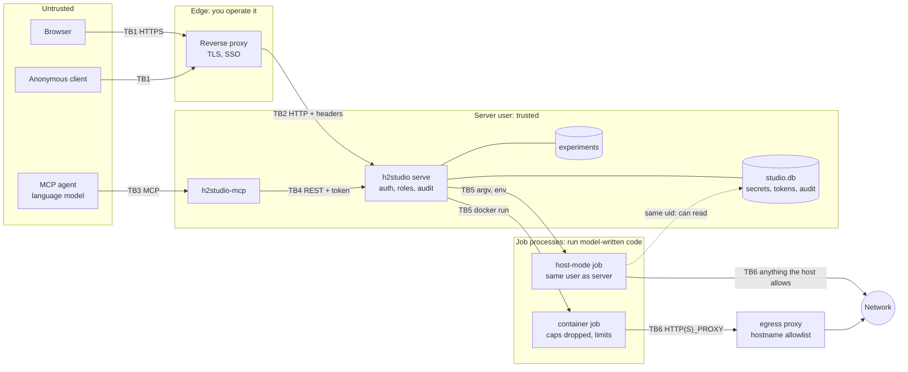

# Threat model

What Harness² Studio protects, from whom, how, and what it deliberately does not stop. It covers
the Studio 0.1.x: the `h2studio` server, the web UI it serves, the `h2studio-mcp` server, the egress
proxy and the deployment files in `deploy/`. It does not cover harness2 itself, the benchmarks it installs, or the
model providers; where they matter, the text says so.

**Status of this document.** It was written from a review of the code, the test suite and live runs
by the documentation author. **No human penetration test or professional security audit has been
done.** An independent code review by a separate AI agent (of commit `f842ee1`; its report is not
published) found issues that are reflected below: the ones not yet fixed are listed as residual
risks and marked *planned, not in this commit* where a fix is under way. The same review reported
trying, without finding a bypass, the Host allowlist and DNS rebinding, the CSRF header and Origin
rule, body and chunking limits, cookie flags, logout and revocation, `X-Forwarded-For` from an
untrusted peer, the role of every route (49 method and path pairs for each of four roles), the
results reader (symlinks, `..`, FIFOs, escapes), the static-file allowlist, XSS payloads in 15 UI
pages and `?next=` redirects, the job environment and argv guard, the container argv hardening, the
egress proxy's refusals, and the MCP guards. Treat that as a report of an automated review, not as
proof. Each mitigation below cites the file that implements it and an evidence grade:

| Grade | Meaning |
|---|---|
| **T** | covered by an automated test in the repository (the test is named); the workspace tests passed in the author's environment on 2026-10-24 (`cargo xtask check`) |
| **L** | exercised live by the documentation author against a running server (harness2 `1cfe254`, Linux, 2026-10-23/24) |
| **C** | established by reading the code only; not demonstrated |

Report problems with this model, or with the controls, through [SECURITY.md](../SECURITY.md).

## 1. Bottom line

Read these first; everything else supports them.

1. **A job is code execution.** harness2's executors (OpenCode, Codex) run model-written tool calls
   and scripts. In **host** isolation they run as the server's user with that user's files and
   network. Anyone who may start a `run`, `pipeline` or `judge` job (operator and above), and anyone
   who can steer the model's inputs (benchmark documents, MCP prompt injection), can in effect run
   commands as that user. Codex runs with its own sandbox **disabled** by upstream.
2. **In host mode a malicious or prompt-injected executor is, in effect, a Studio administrator
   plus the server user.** It runs as the user that owns the Studio's data directory, so it can read
   the database (stored secrets, token hashes) and the server's environment (`H2S_SECRET_*`, the
   proxy shared secret), rewrite the database, and signal the server. The independent review
   demonstrated reading the database and the server's `/proc` environment from a same-user job.
   **Container isolation exists for this**: each job runs in its own container that sees only its
   experiment, the harness2 checkout and its own files. **The compose reference deployment contains
   the whole Studio from your host and network, but the jobs inside it are not isolated from the
   Studio itself**: they run in host mode inside the same container, as the same user.
3. **Secrets are visible to the code that needs them.** A job's profile keys are in its environment.
   The Studio keeps them out of responses, logs and command lines, but cannot hide them from the
   model-driven process that uses them; hostile code can send them anywhere the network lets it.
   Redaction is exact-substring matching: a safety net for accidents, not a barrier.
4. **Secrets are stored in plain text** in a 0600 SQLite file; the bootstrap admin token is also
   saved in plain text next to the configuration. There is no encryption at rest.
5. **The audit log is a SHA-256 hash chain, not a tamper-proof record.** It reveals an edit by
   someone who cannot rewrite the whole chain; anyone with write access to the server's data
   directory (which includes host-mode jobs) can rewrite every record and recompute every hash, and
   `audit verify` will then say the chain is intact. The chain is unkeyed; keep its head hash
   somewhere the server's user cannot write.
6. **MCP agents are prompt-injectable**, which is why MCP cannot write profiles, secrets or tokens,
   and why agents should hold a **viewer** token unless they must start jobs (an operator token
   then, never an admin one). Tool output (rollouts, logs, prompts, benchmark text) is untrusted
   model-written content. An agent with an operator token can still spend money and, in host mode,
   run code through jobs. The MCP server refuses a model's `acknowledge_risks=true` (the
   acknowledgement that host isolation is acceptable) unless a person started it with
   `--allow-risk-acknowledgement`; `budget_usd` and everything else an operator may do remain
   parameters the model chooses.
7. The server has **no TLS** and **one rate limit** (login). Put it behind a TLS proxy and bound the
   audience.

## 2. Assets

| # | Asset | Why it matters |
|---|---|---|
| A1 | Model-provider credentials (API keys, service-account JSON) | spend, impersonation, data access at the provider |
| A2 | API tokens and browser sessions | they are the access control |
| A3 | The server host and the server user's files and network | the executors act with them in host mode |
| A4 | Experiment data: task text, model transcripts, harnesses, scores | may be sensitive; scores are the product |
| A5 | The audit log | the record of who did what |
| A6 | Money: model spend, compute | runs can be expensive |
| A7 | Availability of the server and its queue | long runs, shared use |
| A8 | The software supply chain: the Studio's build, harness2, benchmark checkouts, npm/PyPI packages | executed with the server user's privileges at install time |
| A9 | Integrity of results | a run that could read its own rubrics measures nothing |

## 3. Actors

| Actor | Capability | Trusted? |
|---|---|---|
| Anonymous network client | reaches the listener, `/healthz`, `/readyz`, login | no |
| Web page in an authenticated user's browser | CSRF, DNS rebinding, clickjacking attempts | no |
| Viewer | reads all experiments, results, logs, profiles (no secret values) | to read only |
| Operator | creates experiments; starts and cancels jobs; **effectively runs code in host mode** | trusted with that |
| Admin | installs harness2, sets up benchmarks (third-party code), manages secrets, tokens, profiles | fully trusted |
| MCP agent | an operator or viewer token driven by a language model | **no**: assume prompt injection |
| Model-written code inside a job | everything the executor's tools can do as the job's user | **no** |
| Benchmark content and tool output | text that may carry instructions to the model | no |
| Reverse proxy / SSO provider | asserts identities in proxy mode | yes |
| Container runtime and host administrator | enforce isolation | yes |
| Other local users of the host | read files and process lists the OS allows | no |
| Upstream sources (harness2, benchmarks, PyPI, npm, Hugging Face) | supply code and data at install time | partly: pinned, not audited here |

## 4. Trust boundaries

*This Mermaid diagram was syntax-checked with the Mermaid 12.1.0 parser (`mermaid.parse`). It has not been rendered to an image, so its layout is unseen.*

| Boundary | Crossing | Enforced by |
|---|---|---|
| TB1 | Internet or LAN to the reverse proxy | your proxy and firewall (TLS, SSO) |
| TB2 | Proxy to `h2studio serve` | `Host` allowlist, CSRF header, `Origin` rule, bearer or session or proxy-header authentication, roles, body and time limits |
| TB3 | Agent to `h2studio-mcp` | stdio (a local process pair) or bearer token plus `Host`/`Origin` checks over HTTP |
| TB4 | `h2studio-mcp` to the server | the same authentication as any client; the caller's own token |
| TB5 | Server to job processes | argv without a shell, a cleared environment, process groups, validated identifiers; in container mode the runtime's hardening. **In host mode there is no OS boundary at all** |
| TB6 | Jobs to the network | nothing in host mode; in container mode the container's network, which should be internal with the egress proxy as its only way out |

## 5. STRIDE analysis

Paths are relative to the repository root. Tests are named where they exist.

### Spoofing

| ID | Threat | Mitigation (code) | Evidence | Residual |
|---|---|---|---|---|
| S1 | Guessing or brute-forcing a token | 256-bit random secret, stored as SHA-256, constant-time compare, equal hashing work for unknown ids (`crates/h2s-daemon/src/auth.rs`, `http/extract.rs` `verify_token`); login rate limit per client, IPv6 per /64 (`ratelimit.rs`, `http/routes/auth.rs`) | T `auth.rs::bearer_tokens_authenticate_and_bad_ones_are_refused`, `login_attempts_are_rate_limited_per_client`; L 429 after 10 attempts | the limit covers login only: bearer requests with a bad token are not throttled (guessing 256 bits is infeasible, but the requests are free) The limiter remembers at most 10,000 clients; when that table is full of recent entries it forgets all of them, so a flood from many addresses resets everyone's attempt count (`ratelimit.rs`). Planned, not in this commit: throttling of failed bearer authentication. |
| S2 | Forged SSO identity headers | accepted only from `server.trusted_proxies` **and** with the shared secret (constant-time, at least 16 characters, required at start); proxy mode refuses to start without it (`http/extract.rs` `proxy_principal`, `http/server.rs`, `config.rs`) | T `proxy_headers_from_untrusted_peers_are_refused`, `proxy_mode_maps_groups_to_roles`, `proxy_mode_refuses_to_start_without_its_secret`; L with simulated headers | a broad `trusted_proxies` (all private ranges in the compose example) makes the shared secret the only barrier; a leaked secret is an admin identity. Not tested with a real SSO proxy **The server uses the first user header and the union of every groups header**, so an extra `x-forwarded-groups` line that your proxy appends instead of replacing, or a client-supplied user header it fails to strip, is trusted: the proxy must delete client-supplied copies of all three headers and set its own (rejecting duplicates is planned, not in this commit). In the compose example a job on the same network is inside the trusted range, can spoof `X-Forwarded-For` (the address that is recorded and rate-limited), and, if it learns the shared secret (readable from the server's environment by a same-user job), can assert any identity. |
| S3 | Session theft or fixation | session id 256-bit random, only its hash stored, `HttpOnly`, `SameSite=Strict`, `Secure` under https, TTL capped by the token's expiry, ended by logout and by revoking the token (`routes/auth.rs`, `db/sessions.rs`) | T `login_sets_a_strict_session_cookie_and_logout_ends_it`, `revoking_a_token_ends_its_sessions_and_expired_sessions_fail`; L | sessions are not bound to an address or user agent; a stolen cookie works until it ends An event stream is authorised when it opens and is not re-checked: after the token is revoked a stream already open keeps delivering until it ends (at most one hour). |
| S4 | DNS rebinding: a hostile page reaches a loopback server | `Host` must be on the allowlist, else `421` (`http/guard.rs` `host_allowed`) | T `security.rs::foreign_host_headers_are_misdirected`; L | depends on `public_url` and `allowed_hosts` being right; behind a proxy that rewrites `Host`, list the name it sends |
| S5 | Spoofed client address (X-Forwarded-For) | honoured only from trusted peers; walked from the right; a malformed entry ends the walk (`http/guard.rs` `forwarded_client_from`) | T unit test in `guard.rs`; L five header shapes | if the proxy is not in `trusted_proxies`, all clients share one address and one login bucket Duplicate `Host` headers are accepted (the first is checked). |
| S6 | Impersonating a user at the MCP HTTP endpoint | bearer token required, forwarded to the server which authenticates it; `Host`/`Origin` guard (`crates/h2s-mcp/src/http.rs`) | T `h2s-mcp/tests/http_transport.rs`; L | the MCP server cannot verify a token itself; it relays |
| S7 | A fake harness2 / tampered checkout at install | fixed upstream URL, fetch by full 40-hex commit id, then `git merge-base --is-ancestor` (which confirms that the checkout is the requested commit, **not** that the commit belongs to upstream's own branches), then a venv install (`crates/h2s-core/src/install.rs`) | L managed install; T `h2s-core` plan tests | the job needs the admin role, but the REST API accepts **any** 40-hex commit id, and GitHub can serve a commit that exists only in a fork through the upstream repository's address, so an admin can make the server build code the harness2 authors never published (the MCP tool takes no `rev` and always installs the tested commit); restricting the REST `rev` to the tested commit unless a config flag allows others is planned, not in this commit. harness2's own Python dependencies are resolved at install time by `uv pip install -e` with no lock file and no `--exclude-newer`, so the 14-day cooldown (ADR 0007) does not cover them. Trust in GitHub's TLS and PyPI |
| S8 | Open redirect after sign-in (`/login?next=...`) used for phishing | the UI follows `next` only if it stays on this origin: a pure check refuses control characters, whitespace, backslashes, a leading `//`, dot segments (also `%2e`) and empty segments, then the browser's own URL parser must keep the origin (`crates/h2s-web/src/logic/urls.rs` `clean_next`, `nav.rs` `follow_next`) | T `logic/urls.rs::next_cannot_leave_the_origin` | the control lives in the UI; the server does not redirect |

### Tampering

| ID | Threat | Mitigation (code) | Evidence | Residual |
|---|---|---|---|---|
| T1 | Cross-site request forgery | every unsafe method needs `x-h2s-request: 1` (not sendable cross-site without a CORS preflight, which is never granted), a present `Origin` must be the public origin or the request's own host, no CORS headers ever, `SameSite=Strict` (`http/guard.rs` `check_and_run`, `finalize`) | T `security.rs::unsafe_methods_need_the_csrf_header_and_a_same_origin`, `no_cors_headers_are_ever_sent`; L both `403`s | a non-browser client is unconstrained by design (it presents a credential) |
| T2 | Editing or deleting audit records | SHA-256 hash chain, verified by `audit verify` and the API (`db/audit.rs`) | T `audit.rs::tampering_is_detected_by_the_api_and_the_cli`; L | the chain is **unkeyed**: a writer of the database file can recompute it; truncation is detectable only against a head hash you recorded elsewhere |
| T3 | Path traversal through names or result files | every identifier validated (`crates/h2s-core/src/names.rs`); every path resolved one component at a time under a `cap_std` handle, symlinks never followed, absolute paths in results mapped under the experiment or refused (`safefs.rs`, `results.rs`); read caps 64 MiB JSON, 4 MiB text, 2 MiB for the file viewer | T property tests in `h2s-core`, `static_ui.rs::only_allowlisted_files_are_served_and_traversal_goes_nowhere` | a job can still fill its experiment with large or hostile files; reading them is bounded, not free **The caps are per file, not in total**: a job that writes many large `summary.json` files can make a listing of experiments (or a harness export) use gigabytes of memory, and a hostile tree can make a response very large. The independent review measured, for example, six 38 MiB summaries taking one list call from 0.8 to 3.8 GB, and four such calls in parallel reaching 14.7 GB. Aggregate limits are planned, not in this commit. |
| T4 | Command or argument injection into harness2 | argv only, never a shell; typed parameters turned into argv by `crates/h2s-core/src/cli.rs`; no value may start with `-`; a step whose argv would contain a secret value is refused (`jobs/runner.rs`) | T `jobs.rs::a_secret_in_argv_refuses_the_step`; core `cli` tests | the validators encode upstream's CLI as of the tested commit |
| T5 | Environment injection through a profile | reserved names and prefixes refused (`PATH`, `HOME`, `LD_*`, `PYTHON*`, `H2S_*`, proxy variables, ...; `crates/h2s-core/src/env.rs`); profiles are admin-only; MCP cannot write them | T `env.rs` tests; L the `422`s | the denylist is a safety net for mistakes, not a boundary: it does not cover, for example, `DOCKER_CONTEXT`, `DOCKER_CONFIG`, `XDG_RUNTIME_DIR`, `CONTAINER_HOST`, `GIT_SSH_COMMAND`, `GIT_ASKPASS`, `NODE_PATH`, `SSL_CERT_FILE`, `JAVA_TOOL_OPTIONS` or `OPENCODE_CONFIG_DIR`, and a profile's variables also reach the container runtime command that the server starts on the host in container mode. An admin can set any other variable: admins are trusted, so protect the admin role |
| T6 | Tampering with the harness2 checkout or its `.env` | a managed checkout changes only through `install_harness2`; an unmanaged one is never modified; `doctor` warns on a `.env` (`jobs/mod.rs`, `core/src/doctor.rs`) | L the `409` and the doctor row | jobs in host mode run as the owner of the checkout and can modify it |
| T7 | Reading or modifying state files | database 0600 in a 0700 directory, `-wal`/`-shm` too, no symlinks accepted; logs and generated job files 0600/0700 (`db/mod.rs`, `util.rs`) | T `secrets.rs::state_files_and_directories_are_private` | the same user (and root) can; see the bottom line |
| T8 | Killing the wrong container | the job label is read and must equal the job id before any stop (`jobs/container.rs` `verify_and_stop`) | T unit tests; maintainers L | |
| T9 | A job damaging its own or other experiments | one container sees only its experiment (read-write), the checkout (read-only except install/setup) and its files (read-only) | maintainers L | in host mode a job can write anywhere the server user can, including other experiments |

### Repudiation

| ID | Threat | Mitigation (code) | Evidence | Residual |
|---|---|---|---|---|
| R1 | Deniable actions | an append-only chain records authentication outcomes (failures only when credentials were presented), job create and cancel including refused attempts, experiment, profile, secret and token changes, and access denials, with actor, address, request id and a short detail (`db/audit.rs`, `jobs/mod.rs`, `http/extract.rs`) | T `audit.rs::security_relevant_actions_form_a_verifiable_chain`; L | attribution is as good as the credential: a shared token is a shared identity; proxy users appear by the name the proxy asserted **Any client that can reach the server can add audit rows**: a request with a junk bearer token counts as "credentials presented" and appends a record (the independent review measured 140,000 such requests adding 140,000 rows and about 33 MB). Failed-authentication throttling and a cap on those records are planned, not in this commit; until then, limit who can reach the listener. |
| R2 | Silent audit failure | changes to tokens, secrets, profiles, experiments and sessions append their audit record inside the same database transaction as the change (`routes/admin.rs`, `routes/experiments.rs`, `routes/auth.rs`) | T | records of denials, failed authentications and **job create and cancel** are written afterwards and are **best effort**: if the append fails the error is logged and the request carries on (`http/mod.rs` `AppState::audit`, `jobs/mod.rs`) |
| R3 | Actions by a job after its creator's token is revoked | jobs are not tied to the token afterwards | C | a running job outlives the revocation of the token that started it; cancel it explicitly |

### Information disclosure

| ID | Threat | Mitigation (code) | Evidence | Residual |
|---|---|---|---|---|
| I1 | Secret values in responses, logs, errors, audit | secrets are write-only (`SecretInfo` carries a length, never a value); every log line, error and audit detail passes through a `Redactor` that replaces values, their JSON-escaped forms, lines and JSON strings with `[REDACTED:NAME]` (`crates/h2s-core/src/redact.rs`, `jobs/logs.rs`); validation messages never quote input (`error.rs` `scrub_quoted`) | T `secrets.rs::planted_secrets_never_appear_in_responses_or_logs`, `jobs.rs::secrets_printed_by_a_job_are_redacted_everywhere`; L set/list | exact-substring matching of the literal value: a value that is reversed, split, spaced, hashed or encoded by the job is not recognised (base64 forms are planned, not in this commit). **Redaction is best effort, and job logs are readable by every viewer**, so assume a job that holds a secret can leak it into a log |
| I2 | Secrets at rest | file mode only | C | **plain text in `studio.db`**, in backups, and (bootstrap token) in `<config dir>/admin.token`. Prefer `H2S_SECRET_*` from a secret store; delete or revoke the bootstrap token file |
| I3 | Secrets reaching the code that uses them | by design: environment of the job process only, only secrets its profile references; container mode passes `-e NAME` so values are not on the runtime's command line (`env.rs`, `isolation.rs`) | T `core_real.rs::container_plans_use_fixed_hardening_and_numeric_users`; independent review: a same-user job read `studio.db` and the server's `/proc/<pid>/environ` | model-written code in the job can read and exfiltrate them over whatever network it has; in host mode it runs as the server's user and so can also read the database and the server's own environment through `/proc`, including `H2S_SECRET_*` and the proxy shared secret (demonstrated by the independent review). Planned, not in this commit: container jobs receive their variables through a 0600 environment file instead of the runtime command's environment |
| I4 | Server paths in responses | masked in job logs (`<experiment>`, `<harness2>`, `<data>`, `~`; `jobs/logs.rs` `PathMasker`); admin-only fields for `data_dir` and the checkout path | L logs masked | **incomplete**: the parsed `result` of a `check` job contains raw paths in its messages (L: a viewer read the harness2 checkout's absolute path there; `setup` results take the same route, C), and `file:///...` URLs printed by tools are not masked (L, in the install log). Treat masking as a courtesy, not a boundary |
| I5 | One user reading everything | roles are global | C | **there is no per-experiment access control**: a viewer reads every experiment, transcript, log and profile (not secret values) |
| I6 | Error detail leaking internals | internal errors return a generic message and log the cause under the request id (`error.rs`); `Malformed` upstream data becomes a generic `harness2 wrote a malformed ...` | L | |
| I7 | Timing and enumeration of tokens | unknown ids spend the same hashing work; refusals share one message (`invalid credentials`) | T/L | the audit log records the reason |
| I8 | Unauthenticated information | `/healthz` and `/readyz` reveal liveness and the names `database`/`job_runner` only; the OpenAPI document needs viewer | L | A viewer can read the doctor report, which includes the versions of installed tools. |
| I9 | Script injection into the UI | strict Content-Security-Policy on every response: `default-src 'none'; script-src 'self' 'wasm-unsafe-eval'; style-src 'self'; ... frame-ancestors 'none'`, plus `nosniff`, `X-Frame-Options: DENY`, no-referrer, cross-origin isolation (`guard.rs` `SECURITY_HEADERS`). The UI (`crates/h2s-web`, `web/`) starts from one external module script (`web/app.js`; `web/index.html` has no inline script), is `#![forbid(unsafe_code)]`, and its source contains no raw-HTML insertion (`inner_html`, `set_inner_html`, `insert_adjacent_html`, `eval`: none found with grep). It keeps no credential in script-readable storage: the session is the `HttpOnly` cookie, and `localStorage` holds only the theme and a dismissed-welcome flag (`browser.rs`, `state.rs`, `pages/dashboard.rs`) | T `security.rs::every_response_carries_the_headers_and_errors_carry_request_ids`; C for the UI source | `wasm-unsafe-eval` is required for WebAssembly; rendering untrusted text (transcripts, harness files, benchmark documents) relies on Leptos' default escaping, and the documentation author did **not** test the UI with hostile content in a browser. Script that did run in the page would act with the user's session |
| I10 | Rubric leakage making results meaningless | the egress allowlist can exclude the hosts upstream lists (Hugging Face, GitHub) | [ADMIN-GUIDE.md](ADMIN-GUIDE.md#9-the-egress-allowlist) | host mode has no network control; upstream documents that an executor with web access can fetch grading criteria |

### Denial of service

| ID | Threat | Mitigation (code) | Evidence | Residual |
|---|---|---|---|---|
| D1 | Slow or flooding clients | 1024 connection cap, 10 s header-read timeout, body limit (declared and chunked), 60 s request timeout, 64 event-stream cap with idle and lifetime limits, queue cap (`http/server.rs`, `guard.rs`, `routes/jobs.rs`, `jobs/mod.rs`) | T `security.rs::body_limits_apply_to_declared_and_chunked_bodies`, `stalled_requests_time_out_with_503`, `sse.rs::event_streams_are_capped`, `jobs.rs::queued_jobs_cancel_at_once_and_the_queue_is_capped` | no general request-rate limit: an authenticated client can issue requests as fast as the server answers. The connection cap (1,024) and the event-stream cap (64) are **global**: one client can hold every slot, so 1,100 idle sockets delay everyone else until the 10 s header timeout, and one viewer opening 64 streams makes the 65th (an administrator's) fail with 503. Per-client limits belong in your reverse proxy; per-principal stream limits are planned, not in this commit |
| D2 | Job resource exhaustion | `jobs.max_concurrent`, per-job wall-clock timeout, one writer per experiment; container jobs add `--cpus`, `--memory`, `--pids-limit` (`jobs/mod.rs`, `isolation.rs`) | T `jobs.rs::wall_clock_timeout_fails_the_job`, `cancelling_kills_the_whole_process_group` | **host jobs have no CPU, memory, pid or disk limits**; nothing stops a job filling the disk (`doctor` warns below 20 GiB free) |
| D3 | Log flooding | lines cut at 64 KiB, a ring buffer for streaming, retention by age | T `jobs.rs::long_lines_are_truncated_at_64_kib` | **a job's log file has no size cap**: the independent review wrote a 694 MB log from 400 MB of output in 29 seconds, and retention is by age only. A per-job byte cap (`jobs.max_log_bytes`) is planned, not in this commit |
| D4 | Spend runaway | `budget_usd` guard, cancels at the cap | T `jobs.rs::budget_guard_cancels_when_spend_reaches_the_cap` | counts improver spend only, polled every 30 s; self-hosted models may record zero ([MODELS.md](MODELS.md)); judging has no guard |
| D5 | Abuse of the egress proxy | 512 connection cap, header 10 s, DNS 5 s, connect 10 s, idle 300 s (`egress.rs`) | T `egress.rs::connections_beyond_the_cap_are_closed`, `idle_tunnels_are_closed` | the proxy does not authenticate clients |
| D6 | MCP resource abuse | per-token wait slots, concurrent-request cap, body cap (`crates/h2s-mcp/src/limits.rs`, `http.rs`) | T `h2s-mcp` tests; L 413 | |
| D7 | Restart or crash | jobs left running are failed and their process groups terminated when the recorded leader still matches (`jobs/procfs.rs`); a panicking runner fails its job | T `jobs.rs::restart_recovers_running_jobs_and_kills_their_processes`, `a_panicking_runner_fails_its_job_and_frees_the_slot` | single node, single SQLite writer, no high availability After a host reboot the recorded process identity (start time in ticks since boot, no boot id) can match an unrelated process group, which restart recovery would then signal (reproduced by the independent review); a boot-id check is planned, not in this commit. |

### Elevation of privilege

| ID | Threat | Mitigation (code) | Evidence | Residual |
|---|---|---|---|---|
| E1 | Calling a route above one's role | role is a route-level extractor in every handler (not only middleware); a test walks the route table and proves each enforces its documented role; job creation re-checks the role the job kind needs; cancelling needs the starter's role (`http/extract.rs` `Auth<R>`, `http/mod.rs` `ROUTES`, `jobs/mod.rs`) | T `rbac.rs::every_route_enforces_its_documented_role`, `the_router_serves_exactly_the_route_table`; L 403s | |
| E2 | Removing the last administrator | the API refuses to revoke the last active admin token (`routes/admin.rs`) | L | the command line can (with a warning) |
| E3 | Operator to host shell | not prevented, **by design**: operators start jobs whose executors run commands | C | see the bottom line; use container isolation and grant operator sparingly |
| E4 | Admin to host shell | not prevented: `install_harness2` and `setup` fetch and run third-party code (git, `uv pip install -e`, npm, Bun, Docker builds) as the server user | C | the commit and benchmark pins limit what is fetched, not what it does |
| E5 | Container escape | fixed flags: `--cap-drop ALL`, `--security-opt no-new-privileges`, pids/cpu/memory limits, no `host` network, no privileged mode, no runtime socket mounted, image pinned, mounts at three fixed points (`crates/h2s-core/src/isolation.rs` `run_argv`) | T argv tests; maintainers L | the runtime's default seccomp and LSM profile only (no custom profile, no read-only root file system, no user-namespace remap beyond rootless); a kernel or runtime bug is out of scope. **On a rootful Docker host the Studio user controls a root-equivalent daemon**: prefer rootless The server does not check that the job network is `--internal` (a network with a route out lets a job ignore the proxy), and no ulimits or disk quota are set. |
| E6 | MCP prompt injection to action | the MCP server holds no power of its own, the server enforces roles per token, no tool writes profiles, secrets, tokens or the audit log (`crates/h2s-mcp/src/server.rs`, [ARCHITECTURE.md](ARCHITECTURE.md) §16) | T `crates/h2s-mcp/tests/http_transport.rs`, and the end-to-end `crates/h2s-e2e/tests/mcp.rs::mcp_tools_respect_the_callers_role` (run by `cargo xtask e2e`); L role refusals | an operator-token agent can start paid jobs, and `acknowledge_risks`/`budget_usd` are parameters it chooses. Use viewer tokens, short lifetimes, budgets at the provider Tool output (rollout files, logs, prompts) is untrusted model-written content that can carry instructions to the agent; the server instructions and tool descriptions tell the model so, which is guidance, not a barrier. A model's `acknowledge_risks=true` is refused by `h2studio-mcp` unless it was started with `--allow-risk-acknowledgement` (T `h2s-mcp` tests; L). |
| E7 | Local privilege escalation through the service | runs unprivileged; the user unit sets `NoNewPrivileges` and friends | C | |

## 6. Residual risks, in plain words

These are accepted properties of the current design or known gaps, not oversights. Each says what to
do. Items marked *planned, not in this commit* have a fix under way that is not part of this
revision; they are listed again in [ADMIN-GUIDE.md](ADMIN-GUIDE.md#17-planned-changes-not-in-this-commit).

1. **Host mode runs upstream executors with the server user's privileges and network, and that
   includes the Studio's own data.** That is how harness2 works. A malicious or prompt-injected
   executor can read the database (stored secrets, token hashes) and the server's environment,
   rewrite the database and the audit chain, and signal the server: it is effectively a Studio
   administrator plus the server user. The Studio gates host mode (an explicit `acknowledge_risks`
   on every run unless pre-acknowledged, audit records) but cannot make it safe. *Do:* container
   isolation for anything but your own trusted experiments; a dedicated machine or VM otherwise.
2. **The Codex executor's own sandbox is disabled upstream.** The Studio cannot restore it. *Do:*
   rely on container isolation and network policy rather than on Codex's settings (upstream says the
   same).
3. **Model-generated code executes**, also inside containers. A container limits what it reaches,
   not what it computes. It can still read the secrets of its profile, write its experiment, and use
   any host the egress allowlist opens.
4. **Prompt injection reaches MCP agents** through benchmark text, documents, logs and transcripts.
   The design answer is structural (no profile, secret or token writes through MCP; per-token
   roles); the remaining exposure is what the token's role allows. *Do:* a viewer token by default,
   an operator token only when the agent must start jobs, never an admin token; treat everything a
   tool returns as untrusted (the MCP server's instructions say so to the model, which is guidance,
   not a barrier). The MCP server refuses a model's `acknowledge_risks=true` unless it was started
   with `--allow-risk-acknowledgement`; leave that off.
5. **Secrets are not encrypted at rest**, and the first admin token is saved in plain text. Tokens
   and the bootstrap token do not expire unless you set an expiry. *Do:* restrict and encrypt
   backups; use environment-supplied secrets; remove `admin.token` after use; give every token an
   expiry.
6. **The audit chain is unkeyed** and its anchor is yours to keep: anyone who can write the data
   directory, host-mode jobs included, can rewrite it. It is also open to flooding by any client
   that can reach the server (R1). *Do:* record the head hash off the server on a schedule
   ([ADMIN-GUIDE.md](ADMIN-GUIDE.md#13-audit-log)); limit who can reach the listener.
7. **Jobs and the server can share a user and a database.** In host mode and in the compose
   deployment a job can read and write `studio.db` and the server's environment. *Do:* container
   isolation puts jobs in separate containers; the compose file contains the Studio and its jobs
   together from the rest of the host, not from each other. In `auth.mode = "proxy"` a job that
   reads the shared secret can impersonate any user.
8. **The egress proxy is a hostname filter, not a data-loss barrier.** It cannot see inside TLS, it
   does not authenticate clients, and anything on an allowed host (a wildcard to a cloud-storage
   domain, for example) is a possible exfiltration route. It binds `0.0.0.0:3128` by default (a
   default of `127.0.0.1:3128`, with the compose file setting `0.0.0.0` explicitly, is planned, not
   in this commit). One allowlist serves installation and evaluation, so the setup hosts (GitHub,
   PyPI) stay reachable while an executor runs unless you remove them. The server does not check
   that the job network is `--internal`. *Do:* exact host names, ports listed, the jobs network
   internal, the proxy unreachable from elsewhere.
9. **No TLS in the server, no per-experiment permissions, no high availability, no general rate
   limit.** Login attempts are limited; failed bearer authentication is not (throttling is planned,
   not in this commit), and the connection and event-stream caps are global rather than per client.
10. **Path and detail masking is incomplete** (section 5, I4). Do not rely on it to hide the server's
    layout from users you do not trust.
11. **Parsers read files that jobs write.** Reads are capped per file and malformed input becomes an
    error, but there is no aggregate bound: a hostile job can make a listing, a harness view or an
    export use gigabytes of memory, and a job's log has no size cap (planned, not in this commit).
    A runaway job can fill the disk. *Do:* size the data volume, watch `doctor`'s disk check, and
    treat anyone who can start jobs as able to exhaust the host.
12. **Redaction of job logs is best effort.** Literal secret values are replaced; values a job
    transforms (reverses, splits, encodes differently) are not caught, and job logs are readable by
    every viewer.
13. **Supply chain.** The Studio's Rust dependencies obey a 14-day cooldown, `cargo-deny` and pinned
    CI actions ([SUPPLY-CHAIN.md](SUPPLY-CHAIN.md)); harness2 and the benchmarks are pinned by
    commit, but harness2's own Python dependencies are resolved at install time without a lock file
    or a cooldown, and any commit id is accepted by `install_harness2` (restriction planned, not in
    this commit). Nothing here audits their contents or the packages they install.
14. **The compose deployment's TLS name and `trusted_proxies`** need to be set by the operator; the
    shipped values (a placeholder domain, all private ranges) are for trying it out. While they
    cover the jobs network, a job can spoof the client address that the Studio records and
    rate-limits by.

## 7. What container isolation protects, and what it does not

| Protected | Not protected |
|---|---|
| The server user's home directory, keys, shell history, other projects (not mounted) | The experiment directory: mounted read-write, so a job can destroy or poison its own results |
| The Studio's database, logs and other experiments (not mounted) | The profile's secrets: they are in the job's environment by necessity |
| Other processes and the server itself (separate pid namespace, no signals across) | Model-written code's ability to compute anything and to use any allowed host |
| The host network, when the network is `none` or internal behind the proxy | Data sent to an allowed host over TLS (the proxy cannot inspect it); a job network that is not `--internal`, which the Studio does not verify and which lets a job ignore the proxy |
| Privilege: no capabilities, no new privileges, pids/CPU/memory limits | The container runtime and kernel: a bug there is a bug here; defaults only (no custom seccomp or LSM profile) |
| The harness2 checkout: read-only except during install and setup | `install_harness2` and `setup` jobs, which write the checkout and run third-party code (in a container, but with the checkout mounted read-write) |
| The generated files (`/h2s/job`): read-only | Their content: an OpenCode config and, for a service-account profile, the key file, readable by the job |

Rootless runtimes map container uid 0 to the server's unprivileged user, so "root in the container"
is not root on the host, and files the job writes belong to the server user. On a rootful runtime
the job runs as the server's own uid and gid, and the server user, who controls the runtime's socket,
is root-equivalent on that host: prefer a rootless runtime.

## 8. Assumptions and out of scope

Assumed trustworthy: the operating system and its administrator; the server user's account; the
reverse proxy and SSO provider; the container runtime; the person who edits the configuration; the
time source. Out of scope: vulnerabilities in harness2, OpenCode, Codex, the benchmarks, the model
providers or the Rust ecosystem (report those upstream; see [SECURITY.md](../SECURITY.md)); physical
access; denial of service by the platform itself; the correctness of harness2's scores.

A finding of the form "an executor in host mode can read the server user's files" is the documented
behaviour of host isolation, not a vulnerability. A way around the `acknowledge_risks` requirement,
the container hardening, the egress allowlist, the role checks or the Host/CSRF/Origin rules is.
