# User guide: the web UI

This guide walks through the Harness² Workbench web interface screen by screen: what each page shows,
what you can do on it, and what your role decides. It assumes a running Workbench server and an API
token ([ADMIN-GUIDE.md](ADMIN-GUIDE.md) shows how to get both). If harness2's own vocabulary is new
to you, read [CONCEPTS.md](CONCEPTS.md) first; the UI also explains every term in place (dotted
underlines) and in its **Help** page.

**What is real in the pictures.** Screenshots were taken on 2026-10-24 in headless Firefox 157
(driven through geckodriver 0.37.1) against two backends:

- **Real server** (most pictures): `h2workbench` 0.1.0 with a real harness2 checkout at the tested
  commit, after running the free offline demo twice. Everything on those pages is what the server
  returned. The demo produces tasks, harness trees and library lessons but no scores, no improver
  sessions and no model calls.
- **Mock API** (captions say *mock*): the pages that need judged scores, improver sessions or a
  running job (the report, the audit trail, a scored task, the wizard's later steps, a live job and
  the comparison) use `tools/h2w-mock-api`, a development server with **fictional data**. Its
  numbers mean nothing; they show how a populated page looks. No model-backed sweep has been run
  through the Workbench.

What the documentation author did and did not exercise is listed in [section 15](#15-what-was-verified).

Contents: [1 Before you start](#1-before-you-start) · [2 Signing in and out](#2-signing-in-and-out) ·
[3 The shell](#3-the-shell) · [4 Dashboard and guided tour](#4-the-dashboard-and-the-guided-tour) ·
[5 Experiments and sweeps](#5-experiments-and-sweeps) · [6 A task in depth](#6-a-task-in-depth) ·
[7 Starting a run](#7-starting-a-run) · [8 Jobs and live logs](#8-jobs-and-live-logs) ·
[9 Comparing results](#9-comparing-results) · [10 Benchmarks and splits](#10-benchmarks-and-splits) ·
[11 Settings](#11-settings) · [12 Keyboard, themes and phones](#12-keyboard-themes-and-phones) ·
[13 What each role sees](#13-what-each-role-sees) · [14 When something looks wrong](#14-when-something-looks-wrong) ·
[15 What was verified](#15-what-was-verified)

## 1. Before you start

- **Open the server's address** in a browser: `http://127.0.0.1:8722` by default, or the
  `public_url` your administrator set. The UI is a single-page application compiled to WebAssembly
  and served by the Workbench itself; it needs JavaScript and WebAssembly (the page's `<noscript>` text reads
  *Harness² Workbench needs JavaScript and WebAssembly*). The pictures and checks used Firefox; other current browsers were
  not tried.
- **If the page says `UI not built`**, this server was built without the UI. Tell your
  administrator ([TROUBLESHOOTING.md](TROUBLESHOOTING.md#browser-and-reverse-proxy-symptoms)). The
  REST API works without it ([API.md](API.md)).
- **You need an API token**: the first administrator token is printed once by `h2workbench init`;
  administrators create more under **Settings → API tokens**. The token decides your role:
  **viewer** (read everything except secrets, tokens and the audit log), **operator** (also create
  experiments and start or cancel jobs) or **admin** (also install, set up benchmarks, and manage
  profiles, secrets, tokens and the audit log). The full table is in
  [API.md](API.md#4-roles-and-routes); [section 13](#13-what-each-role-sees) shows what changes on
  screen.
- **The UI is a client of the REST API.** Anything it does, `curl` can do, and the server enforces
  the roles whatever the page shows: a hidden button is a convenience, not a permission check.

## 2. Signing in and out

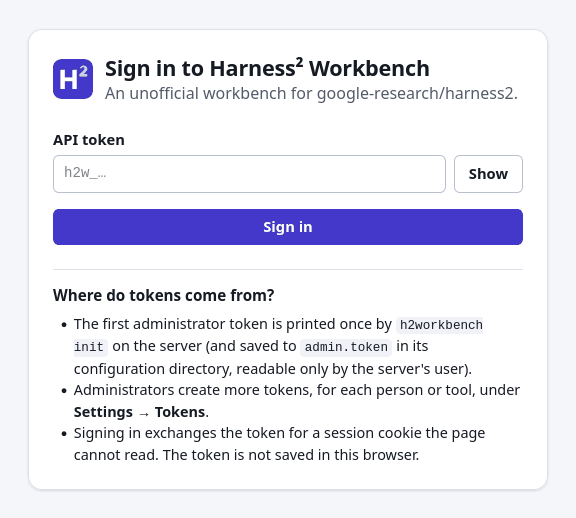

Paste your token into **API token** and press **Sign in**. **Show** reveals what you pasted. The page
exchanges the token for a session cookie that scripts on the page cannot read; the token itself is
not stored in the browser. The session lasts `auth.session_ttl_hours` (12 by default) and never
longer than the token.

**Deep links work.** If you open a link such as a task page while signed out, you land on
`/login?next=…`, and after signing in you arrive at the page you asked for (checked: a task page
link returned to that task page). Only paths inside the app are followed: anything that could leave
the site, such as `//host` or a path with backslashes, whitespace or `..`, is ignored and you land on
the dashboard.

The messages you can meet here (all seen while testing):

| Message | Meaning |
|---|---|
| `Paste your API token first.` | The field was empty. |
| `That does not look like a Workbench token: tokens start with “h2w_”.` | The text is not a token. |
| `The server did not accept this token. Check that it was copied completely and has not been revoked or expired.` | Unknown, revoked or expired token (the server's own message is deliberately the same for all of them). |
| `Too many sign-in attempts from this address. Wait a minute before trying again.` | The login rate limit; see [TROUBLESHOOTING.md](TROUBLESHOOTING.md#413-421-429). |

**Signing out.** The arrow icon at the top right ends the session on the server and returns to the
sign-in page; **Sign out** is also in the command palette. **If your session ends** (it expired, you
signed out elsewhere, or the token was revoked) the next thing you do sends you to `/login?next=…`
with no error message (checked by revoking a token under a signed-in browser): sign in again and you
return to where you were.

## 3. The shell

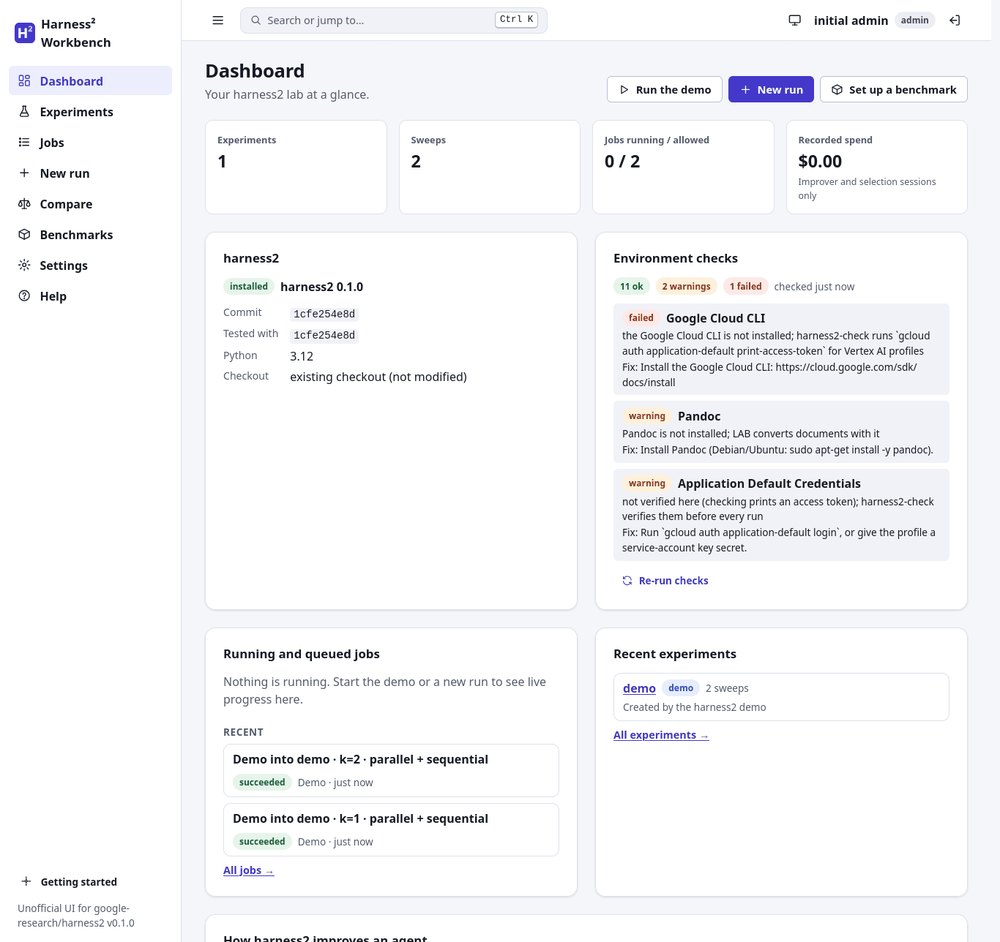

- **Sidebar** (left): Dashboard, Experiments, Jobs, New run, Compare, Benchmarks, Settings, Help,
  and **Getting started** (the guided tour) at the bottom. Entries you cannot use are hidden for
  your role (for a viewer, *New run* is not in the list).
- **Search or jump to… (Ctrl K)** (top): the command palette ([section 12](#12-keyboard-themes-and-phones)).
- **Your name and role** (top right), the **theme button** (the monitor icon: system, light or dark)
  and **Sign out**.
- **Dotted underlines** mark glossary terms; hover or focus one for a definition, or open **Help**.
- **Toasts** (bottom right) confirm actions (`Job started`, `Profile local-vllm saved`) and report
  errors with the server's message.

## 4. The dashboard and the guided tour

The dashboard answers "is my lab healthy?" at a glance:

| Card | What it shows |
|---|---|
| **Experiments**, **Sweeps** | counts |
| **Jobs running / allowed** | running jobs against `jobs.max_concurrent` |
| **Recorded spend** | spend harness2 recorded for **improver and selection sessions only**; executor rollouts are not recorded, so real cost is higher |
| **harness2** | whether it is installed, its version, the commit and the commit this Workbench was tested with, the Python version, and whether the checkout is managed or an existing one that is never modified |
| **Environment checks** | the doctor's counts (ok, warnings, failed) and each problem with its fix; **Re-run checks** refreshes (operators and admins) |
| **Running and queued jobs**, **Recent experiments** | live progress and shortcuts |

The buttons at the top are **Run the demo** (an operator action: starts `harness2-demo` into the
experiment `demo`, then opens the job), **New run** and **Set up a benchmark** (admin). While there
are no experiments yet, or harness2 is not installed, a **New to harness2?** card also offers
**Start the guided tour** and a **Dismiss** button (remembered in this browser).

The **guided tour** (`/welcome`, sidebar **Getting started**) explains harness2 in two minutes, then
walks seven steps that turn green as you complete them: check the server, install harness2, run the
free demo (and **Explore the demo results**), add a model profile, set up a benchmark, start a first
small run (the *smoke test* preset), and read the results.

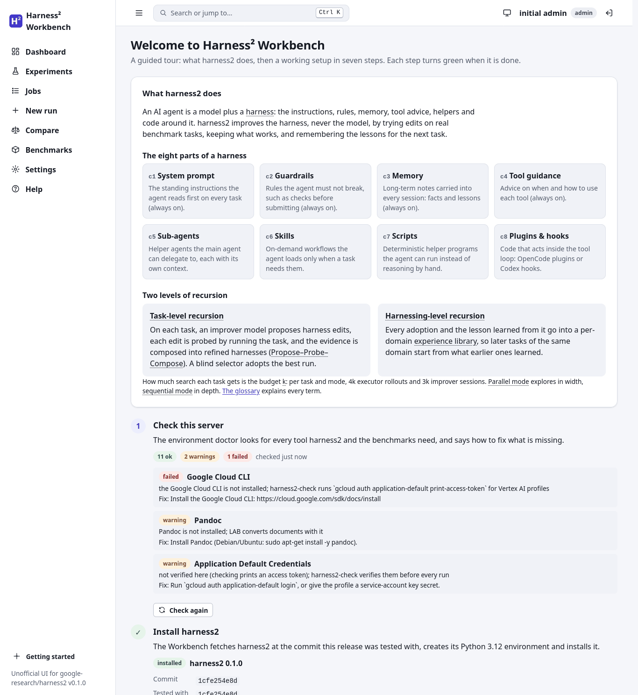

## 5. Experiments and sweeps

### 5.1 The experiment list

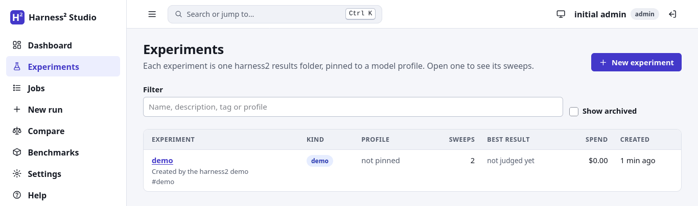

An **experiment** is one harness2 results folder (one `HARNESS2_RUNS_DIR`) tied to one model
profile. The table shows its kind (`demo` or `standard`), pinned profile, number of sweeps, best
result, spend and age. **Filter** matches name, description, tag or profile; **Show archived**
includes archived ones. **New experiment** (operator) asks for a name (lowercase letters, digits, `-`
and `_`; it is the folder name and cannot change), a description, tags and the **model profile**.
The profile is optional here: it is pinned by the first job that writes into the experiment, and
every later run, judging and report must use the same profile ("pinned for good": harness2 refuses to
resume or judge under different models).

### 5.2 One experiment

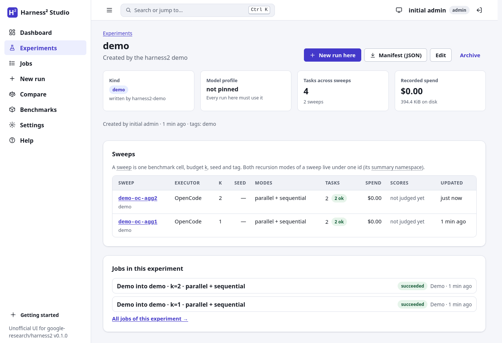

The cards show the kind, the pinned profile (*not pinned* for the demo), the number of tasks across
sweeps, recorded spend and the size on disk. Actions (operator and above): **New run here** (opens
the wizard with this experiment chosen), **Manifest (JSON)** (a reproducibility record: the harness2
commit, dependency pins, model ids, environment variable *names*, isolation, every job's command and
a digest of the results; viewers can download it too), **Edit** (description and tags; the name and
profile cannot change) and **Archive** (hides it from lists and pickers; nothing is deleted).

The **Sweeps** table lists each run configuration: its id (the summary namespace such as
`demo-oc-agg2`), executor, budget **k**, seed, modes, tasks, spend, scores and last update. Below it,
**Jobs in this experiment**.

### 5.3 A sweep

A **sweep** is one benchmark cell, budget k, seed and tag; both recursion modes live under its one id.

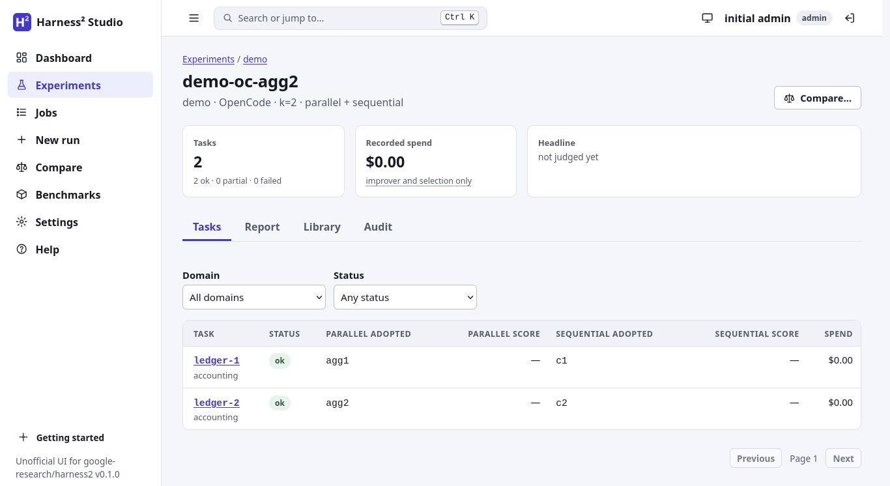

The header shows the number of tasks (`2 ok · 0 partial · 0 failed`), recorded spend and the
**Headline** (the scores per mode once judged, "not judged yet" before). **Compare…** opens the
comparison with this sweep (its first mode) chosen as A. The four tabs are bound to the address (`?tab=report`), so
you can link to them.

**Tasks.** One row per task: status (`ok`, `skipped`, `partial`, `base-failed`, `running`,
`exception`, or `unreadable` / `too-large` for a summary file the server could not or would not
read), the harness each mode adopted (`agg1`, `c1`, or *kept base*), its score, and spend.
Filter by **Domain** and **Status**; the table pages. A score is a percentage of the judge's points
with an *all pass* or *not all pass* note; badges such as `1 fell back` (a stage fell back after two
rejected proposals) and `1 error` explain odd rows. A task that was not graded shows `—`: ungraded
is not zero. Click a task to open it ([section 6](#6-a-task-in-depth)).

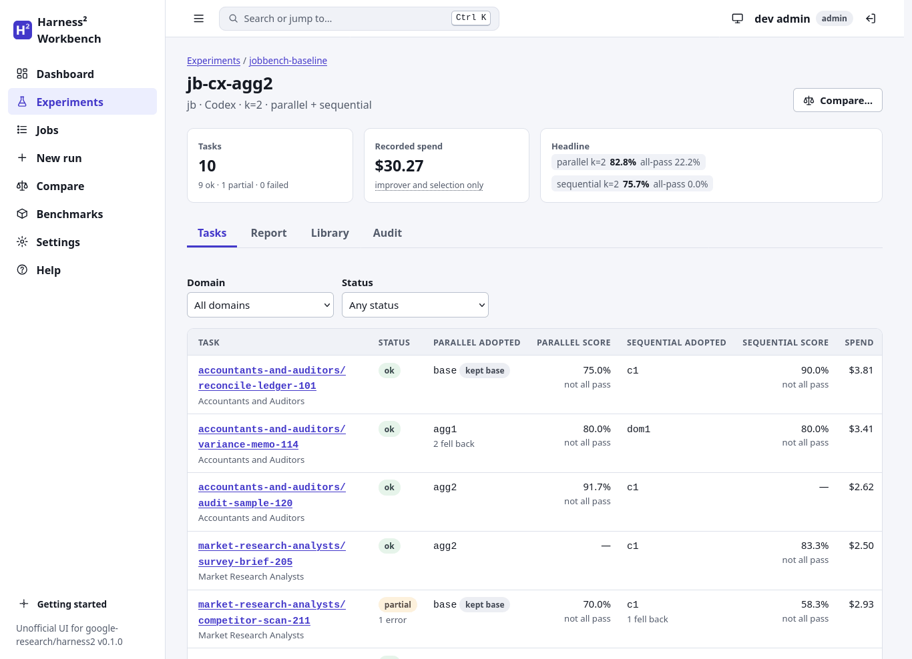

*Mock data: the free demo does not judge, so this picture of a scored sweep comes from the mock API.*

**Report.** Before judging the tab says **Not judged yet** and offers **Judge this sweep** and
**Judge the base runs** (operators; each starts a `judge` job; the unmodified harness is scored too
so you can see the score to beat). It says **Cannot judge from here** when the sweep has no
benchmark cell or the experiment has no pinned profile (which is the case for the demo). Once
judged:

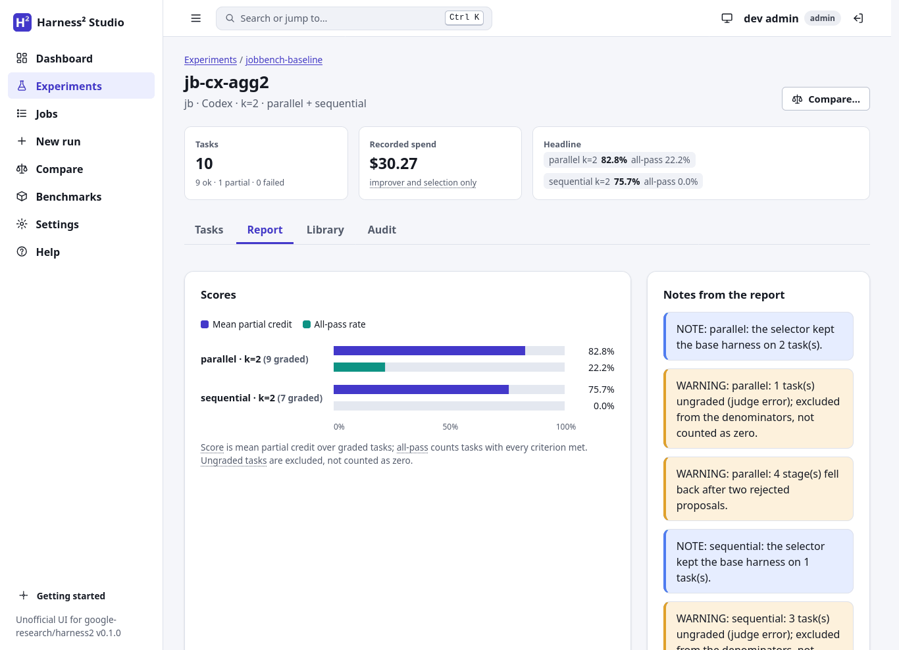

*Mock data.* **Scores** shows, per mode, the mean partial credit and the all-pass rate over the
graded tasks (ungraded tasks are excluded, not counted as zero). **Notes from the report** repeats
harness2's `NOTE:` and `WARNING:` lines (for example that the selector kept the base harness on some
tasks, or that tasks were ungraded after a judge error). Further down: a **By mode** table (graded,
ungraded, score, all-pass, where the adopted harness came from, fallbacks, spend), the **Report text**
in harness2-report's format (**Copy**, **Download .txt**) and **Judged rows (JSON)**.

**Library.** The experience library of each mode and domain: which harness every task adopted, why,
and the lesson the reflector drew (cue, lesson, evidence, confidence, and a *per-edit account*).
Later tasks of the same domain start from these entries. This one is real: the demo writes a library.

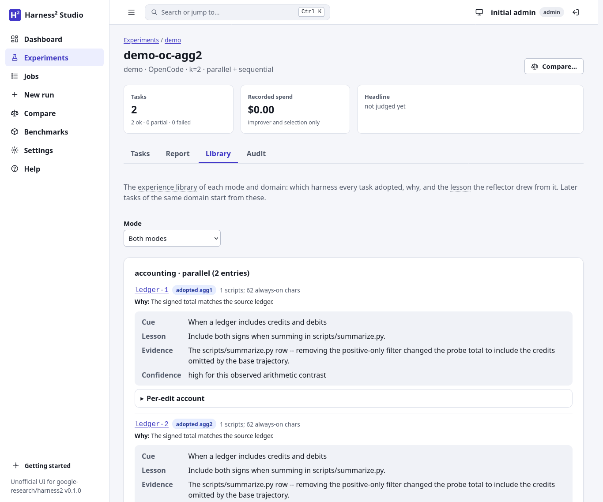

**Audit.** Every improver and selector session of the sweep: model, effort, attempts, wall time,
cost, and buttons to read the exact **mission**, **system** prompt and **response** text. The demo
makes no improver sessions (the tab says *No sessions recorded*), so this picture is from the mock.

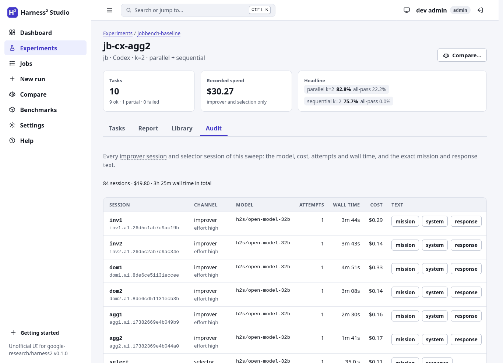

*Mock data.* The text of those sessions is written by models: read it as data, never as instructions.

## 6. A task in depth

The task page shows the whole recursion for one task: what was tried, what was adopted and why, and
every harness as files.

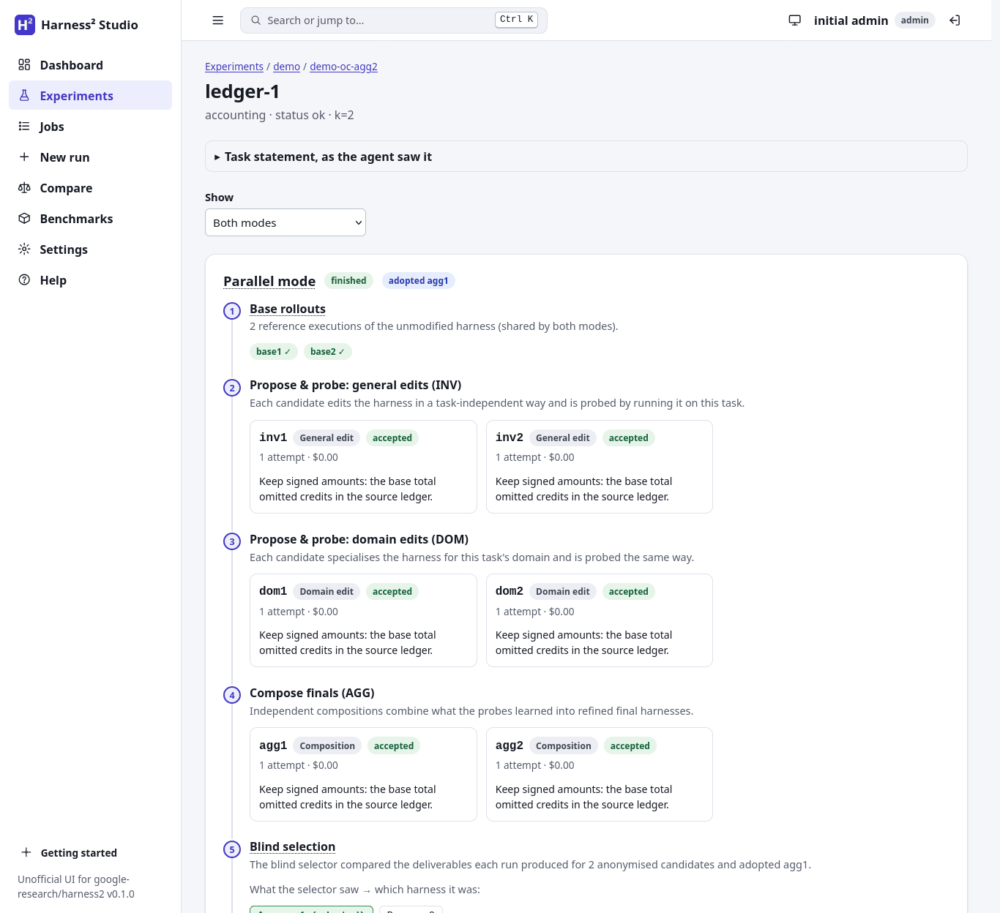

At the top: the breadcrumb, the task's domain, status and k, a collapsed **Task statement, as the
agent saw it**, and **Show** (both modes, parallel only, or sequential only). Each mode is a card
with a numbered timeline:

1. **Base rollouts**: the reference executions of the unmodified harness (`base1 ✓`, `base2 ✓`),
   shared by both modes.
2. **Propose & probe: general edits (INV)** and 3. **domain edits (DOM)** (parallel mode): each
   candidate (`inv1`, `dom1`, …) says whether it was *accepted* or *kept base*, its attempts and
   cost, and the improver's explanation.
4. **Compose finals (AGG)** (parallel) or **Step n: propose, probe, compose** (sequential): the
   refined harnesses (`agg1`, `c1`, …).
5. **Blind selection**: what the selector saw (anonymised A and B), which harness each really was,
   its reason, what it compared (the deliverable), cost, and the adopted harness's fingerprint.
6. **Reflection lesson**: what was stored in the experience library.

Below the timeline: the **Ledger** (recorded spend; rollouts R and improver sessions P against the
budget identity R = 4k, P = 3k, with a note when it balances) and, in parallel mode, the **Diversity
of the finals** (how different the finals are). Once the sweep is judged, a line such as
**Judged: base scored 7.5 / 10 points (75.0%)** appears (fractional points, as JobBench's weighted
judging writes them, are shown as written); mock example below.

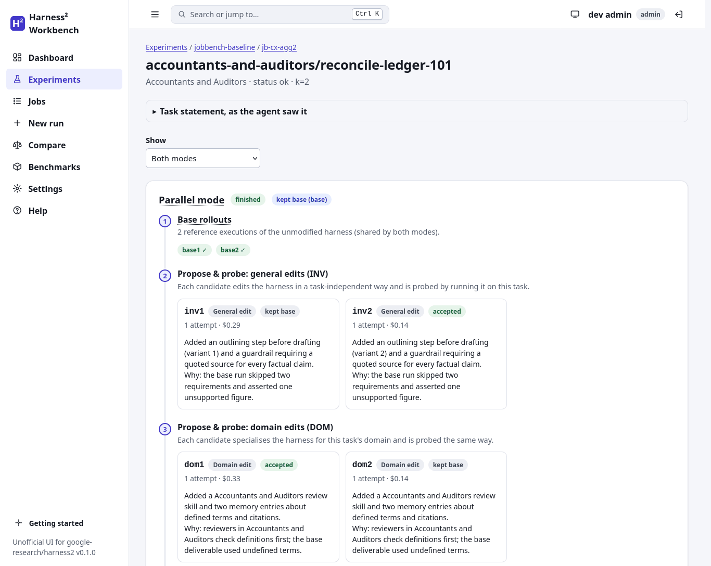

*Mock data.*

### 6.1 Harnesses

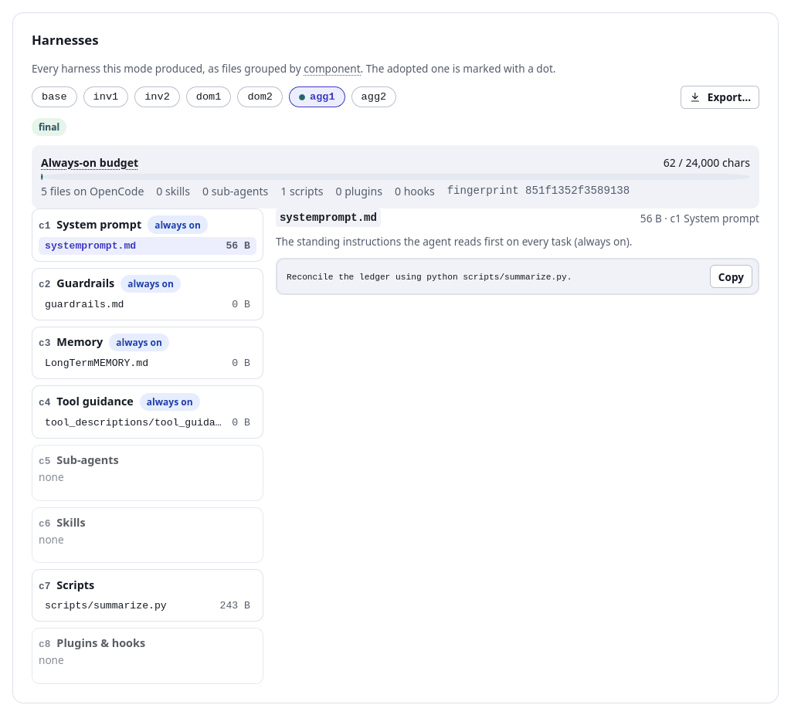

Every harness the mode produced is a button (`base`, `inv1`, …, with a dot on the adopted one).
The viewer groups the files by the eight components **c1 to c8** (system prompt, guardrails, memory,
tool guidance, sub-agents, skills, scripts, plugins and hooks); always-on components are marked, and
the **Always-on budget** bar shows how much of the cap (24,000 characters for OpenCode, 8,000 for
Codex) is used. Click a file to read it (**Copy**). Also shown: counts of skills, sub-agents,
scripts, plugins and hooks, and the harness **fingerprint**.

### 6.2 Comparing two harnesses

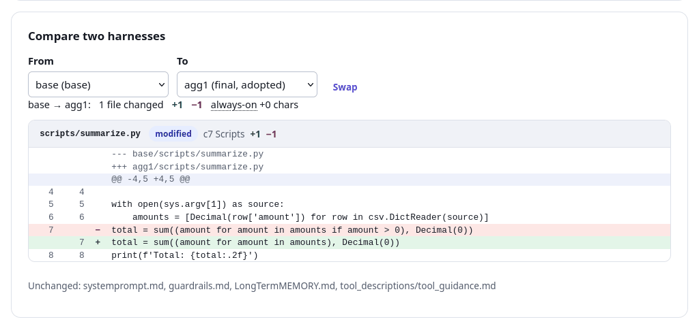

**Compare two harnesses** diffs any two labels (defaults: `base` against the adopted one), file by
file, with line numbers, a summary (`1 file changed +1 −1`, always-on characters added or removed)
and the list of unchanged files. **Swap** exchanges the two sides.

### 6.3 Rollouts

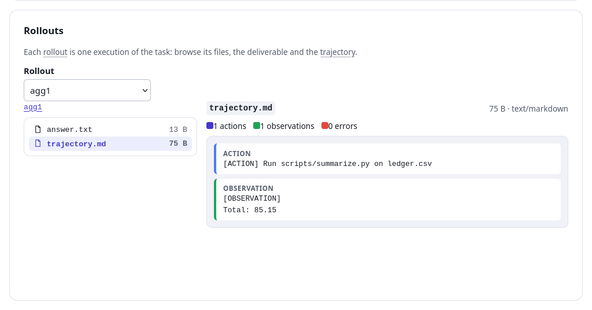

Pick a rollout, then a file of its run directory: the deliverable (`answer.txt`) and the
**trajectory**, which is highlighted by step (actions, observations and errors are counted and
coloured). Rollout files are written by models and by the task: treat them as untrusted text.

### 6.4 Export

**Export…** takes the shown harness out of the Workbench.

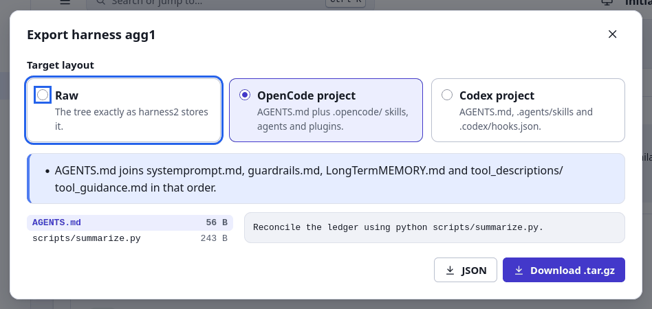

Choose the layout: **Raw** (the tree exactly as harness2 stores it), **OpenCode project** (`AGENTS.md`
plus `.opencode/` skills, agents and plugins) or **Codex project** (`AGENTS.md`, `.agents/skills` and
`.codex/hooks.json`). For the project layouts `AGENTS.md` joins `systemprompt.md`, `guardrails.md`,
`LongTermMEMORY.md` and `tool_descriptions/tool_guidance.md` in that order. Preview the files, then
**JSON** (downloads the files as one JSON document) or **Download .tar.gz** (a deterministic
archive). Read what a harness contains before you put it in a project: it was written by a model.

## 7. Starting a run

**New run** (`/new`) is a five-step wizard that shows exactly what will happen and what it will
cost before anything starts. Operators and above can start a run; a viewer can walk it read-only. Each step is a pill at the top; you move with
**Back** and **Next**.

**1. Experiment & benchmark.**

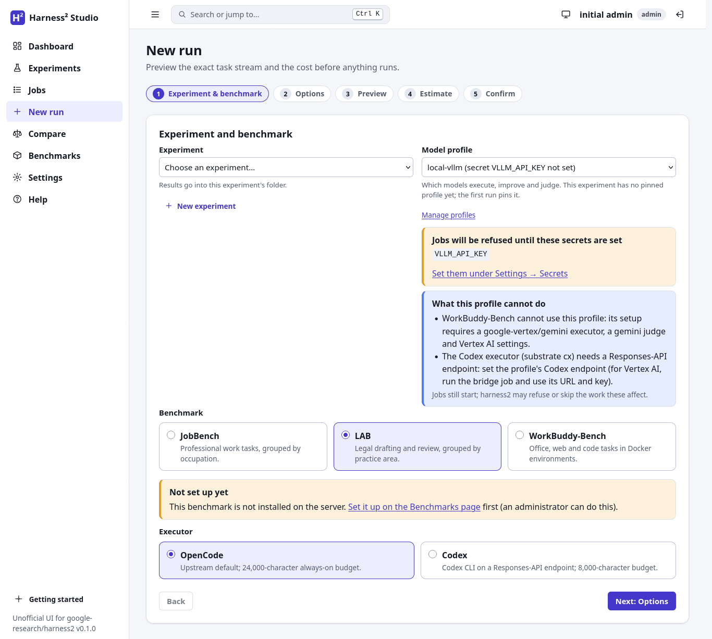

Pick the experiment (or create one) and the model profile (locked to the experiment's pinned one,
if any). Below the profile the page shows the **profile check**: *Jobs will be refused until these
secrets are set* (secrets the profile references that have no value) and *What this profile cannot
do* (the warnings in [MODELS.md](MODELS.md#warnings-the-server-raises); capability notes such as
"WorkBuddy-Bench cannot use this profile" appear for every OpenAI-compatible profile). Then choose
the **benchmark** (JobBench, LAB or WorkBuddy-Bench; one that is not installed says *Not set up yet*
and links to the Benchmarks page) and the **executor** (OpenCode with a 24,000-character always-on
budget, or Codex with 8,000 on a Responses-API endpoint).

**2. Options.**

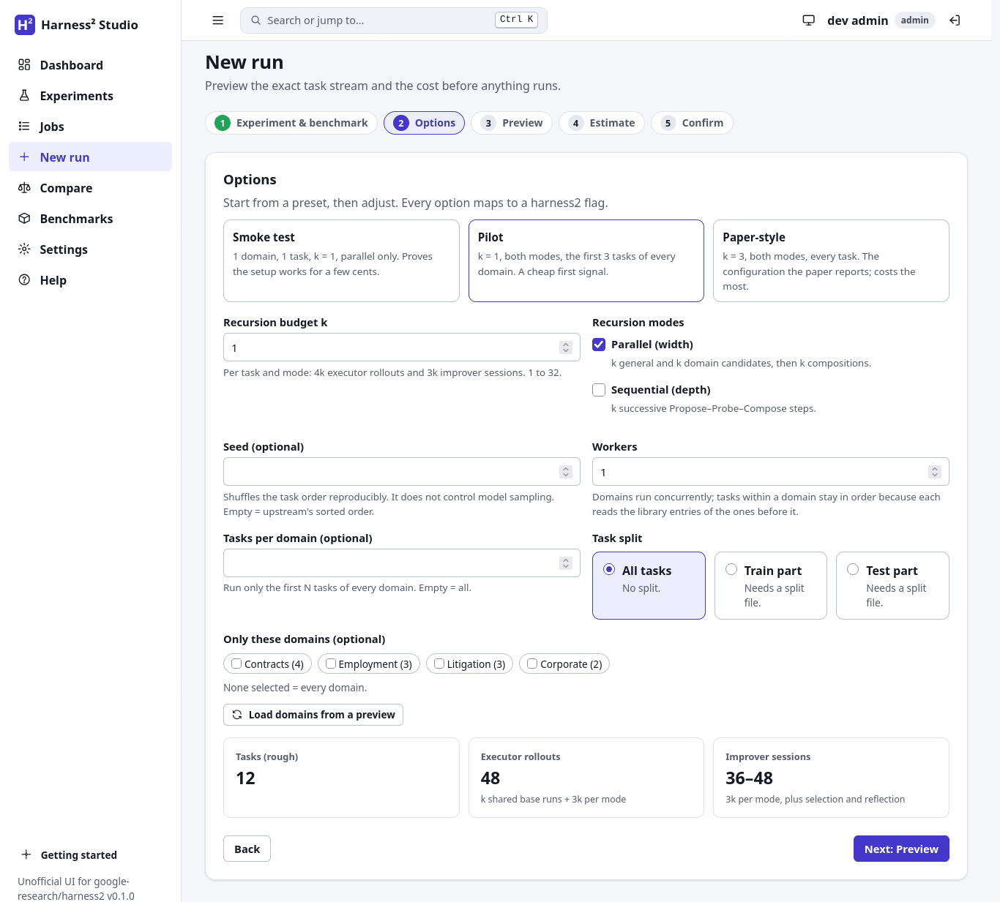

*Mock data.* Start from a preset and adjust: **Smoke test** (1 domain, 1 task, k = 1, parallel only),
**Pilot** (k = 1, both modes, the first 3 tasks of every domain) or **Paper-style** (k = 3, both
modes, every task: the configuration the paper reports, and the most expensive). Options map to
harness2 flags: the **recursion budget k** (1 to 32; per task and mode 4k executor rollouts and 3k
improver sessions), the **modes** (parallel is width, sequential is depth), a **seed** (shuffles task
order reproducibly; it does not control model sampling), **workers** (domains run concurrently; tasks
within a domain stay in order), **tasks per domain**, the **task split** (all, train or test; train
and test need a split from the Benchmarks page) and **only these domains**. A running tally shows
rough task, rollout and session counts.

**3. Preview.** **Run the preview** starts a `preview` job (harness2 with `--dry-run`): no model is
called and nothing is written. It returns the task count, domains, namespaces, a table per domain and
the **task stream in run order**, with a link to the job and its log. You cannot continue until the
preview for the current options has run (*Before you continue: run the preview…*).

**4. Estimate.** The expected rollouts and improver sessions and, when it can, a cost range with its
basis (the profile's prices, or this experiment's earlier runs). It states what it leaves out:
judging is not included, and each improver stage may retry once, so sessions can be up to twice the
count shown.

**5. Confirm.**

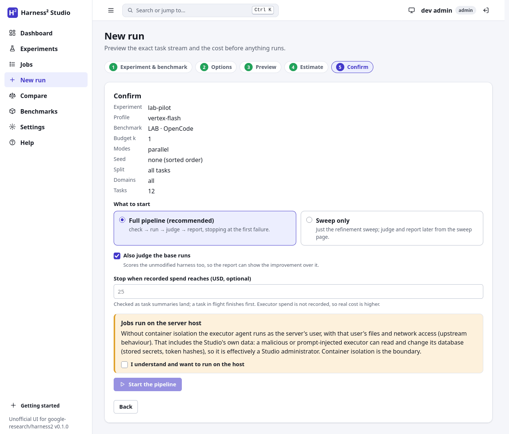

*Mock data.* A summary of every choice, then **What to start**: **Full pipeline (recommended)**
(check → run → judge → report, stopping at the first failure) or **Sweep only**; **Also judge the
base runs**; and **Stop when recorded spend reaches (USD, optional)**, a guard checked as task
summaries land (a task in flight finishes first, and it counts improver spend only: executor
spend is not recorded, so real cost is higher). Under host isolation a banner reads **Jobs run on
the server host** and **Start the pipeline** stays disabled until you tick **I understand and want
to run on the host**. The banner says what that means: the executor runs as the server's user, that
user owns the Workbench's database (stored secrets, token hashes), and so a malicious or
prompt-injected executor is effectively a Workbench administrator (see
[THREAT-MODEL.md](THREAT-MODEL.md)). Under container isolation the banner and the checkbox are not
shown (read from the UI's source, not tried). If an administrator has set
`isolation.preacknowledge_host_risks`, the banner and the checkbox are replaced by one line, *The
server pre-acknowledges host-isolation risks (isolation.preacknowledge_host_risks).*, and **Start the
pipeline** needs no tick; the UI learns this from the server's `host_risks_preacknowledged` field.
That was seen in headless Firefox against the mock API started with its pre-acknowledge option
(wizard) and against a real server with the setting on (the System page, which then says runs do not
ask); a real run through such a server was not started.

Starting opens the job page. A *viewer* can walk the wizard but sees **Read-only: your role (viewer)
can explore the options and estimates, but previews and runs need the operator role**
([section 13](#13-what-each-role-sees)).

## 8. Jobs and live logs

Every harness2 operation is a **job**: the demo, a preview, a check, a run, judging, a report, a
split, an installation, a benchmark setup, the Codex bridge.

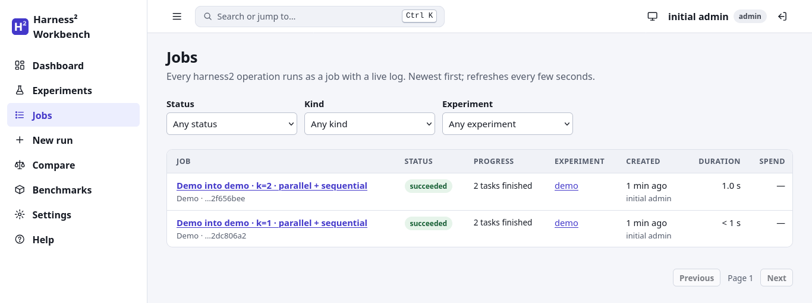

**Jobs** lists them newest first and refreshes every few seconds. Filter by **Status**, **Kind** and
**Experiment**. A row shows the title, kind and short id, the status (`queued`, `running`,
`succeeded`, `partial`, `failed`, `cancelled`), progress, experiment, who and when, duration and
spend. `partial` is not a crash: harness2 finished but some tasks failed or stayed ungraded.

A job page shows the status and progress, the **Steps** (a pipeline has several), the **Result**
parsed from harness2's output, the **Job specification (JSON)** (collapsed), and the **Log**.

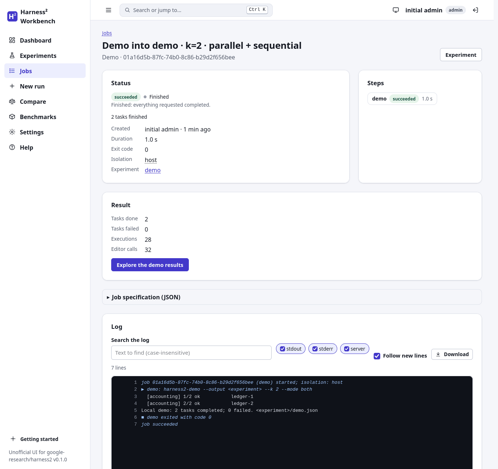

For a running job the page streams live over server-sent events: the status chip says **Live**, a
progress bar and the current task update, and log lines arrive as they are written.

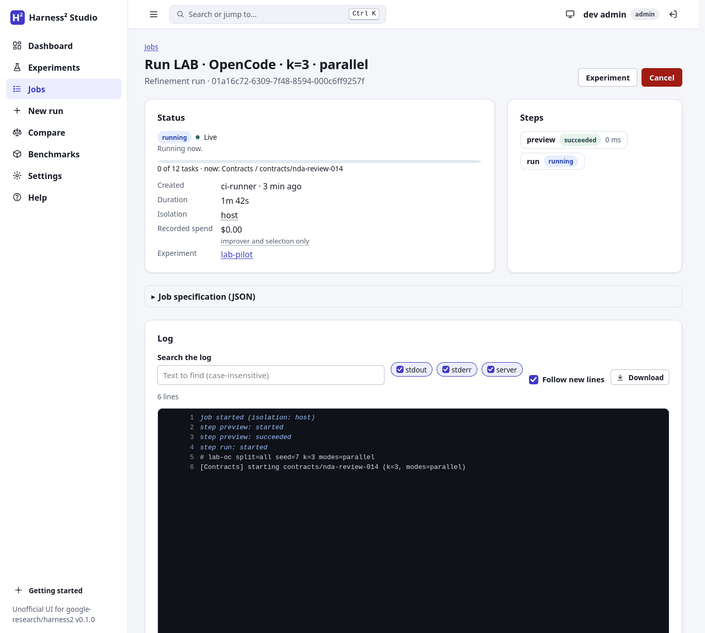

*Mock data.* The log can be filtered with **Search the log** (case-insensitive) and the **stdout**,
**stderr** and **server** switches (server lines are the Workbench's own: step boundaries, isolation
notes); **Follow new lines** keeps the newest line in view; **Download** saves what the page holds.
If the event stream drops, the page is designed to reconnect with a back-off and, after repeated
failures, to poll (from the UI notes; the author did not break a stream to see it). **Cancel** (operators;
the role that could have started the job) asks you to confirm: harness2 gets
`SIGTERM` to its process group and `SIGKILL` after 10 seconds, finished tasks are kept, and the task
in flight starts over if you resume the sweep. Secret values are replaced with `[REDACTED:NAME]`
before a line is stored, but that is best effort and **every viewer can read every job's log**
([THREAT-MODEL.md](THREAT-MODEL.md)).

## 9. Comparing results

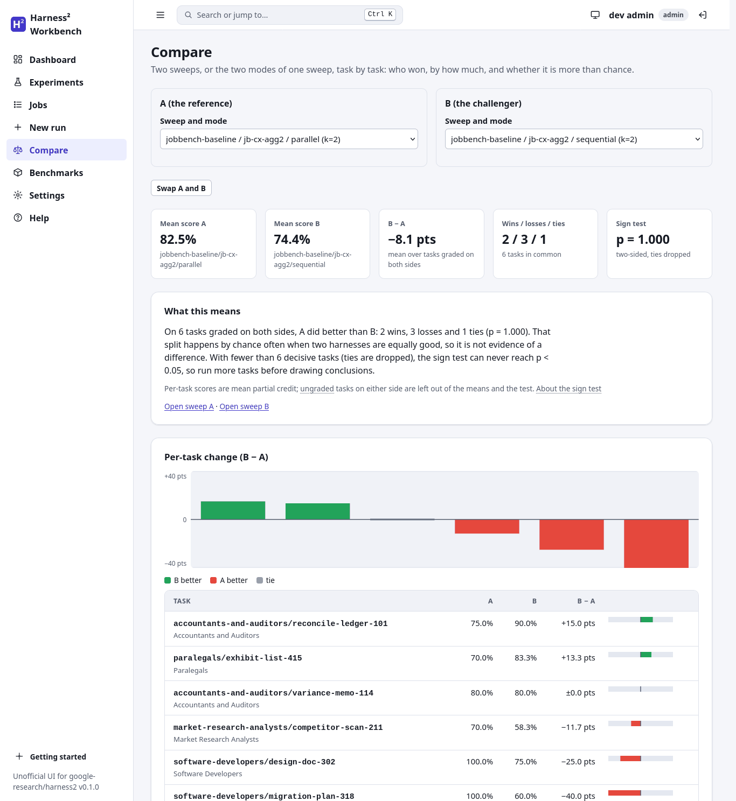

*Mock data.* **Compare** puts two results side by side, task by task: choose **A (the reference)**
and **B (the challenger)**, each a sweep and mode (comparing the parallel and sequential modes of one
sweep is a good start; both must be judged). The page shows the mean score of each, the difference
**B − A** in points, **wins / losses / ties** over the tasks graded on both sides, and the two-sided
**sign test** (ties dropped), then **What this means** in plain words (for example that with fewer
than six decisive tasks the test cannot reach p < 0.05, or that k = 1 results are noisy), a bar chart
of the per-task change and a table. Ungraded tasks are left out of the means and the test.
**Swap A and B** exchanges them, and the chosen pair is in the address, so you can share it.
**Compare…** on a sweep page opens this page with that sweep chosen as A.

## 10. Benchmarks and splits

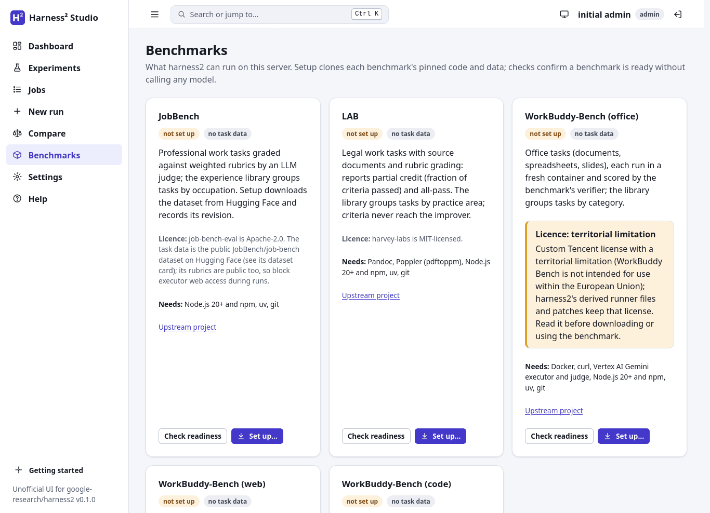

**Benchmarks** lists what harness2 can run on this server: JobBench, LAB and the three WorkBuddy-Bench
subsets. Each card says whether it is set up and has task data, what the benchmark is, its
**licence** (WorkBuddy-Bench carries a custom licence with a **territorial limitation**; the card
says so in a highlighted note: read it before you download or use that benchmark) and what it
**needs** (Node.js, uv, git, Pandoc and Poppler for LAB, Docker and Vertex AI for WorkBuddy-Bench).

- **Check readiness** (operators) runs harness2's offline readiness check for that benchmark; no
  model is called.
- **Set up…** (admin) opens a dialog: choose the **executor to prepare** and, for benchmarks that
  bake model routes into their environments, a **model profile**. **Plan (dry run)** prints every
  command setup would run without changing anything; **Set up now** clones the pinned code, applies
  patches, builds environments and downloads task data (network-heavy, can take long, and runs
  third-party code as the server's user: see [THREAT-MODEL.md](THREAT-MODEL.md)). The job page of a
  dry run lists the planned steps and offers to run setup for real, with a confirmation
  (*Run setup for real?*).
- **Train/test splits** (operators): **New split…** makes a reproducible, domain-stratified
  partition (name, seed, train fraction) so you can improve harnesses on one part and evaluate on
  tasks the recursion never saw.

## 11. Settings

**Settings** has five tabs. Everything except *Model profiles* and *System* is for administrators
(the tabs are marked *(admins only)* for other roles).

### 11.1 Model profiles

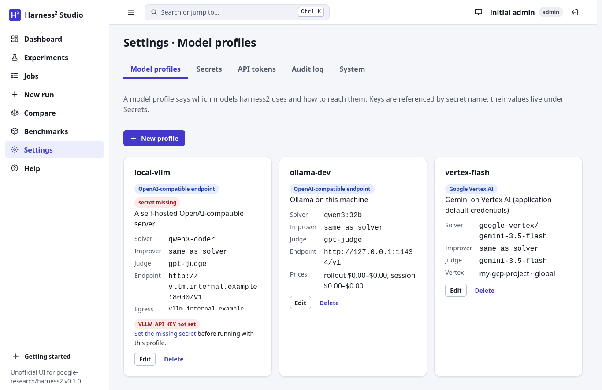

Cards for each profile: kind (Google Vertex AI, OpenAI-compatible endpoint, custom environment),
solver, improver and judge models, endpoint, prices and egress hosts, and a red **secret missing**
chip with **Set the missing secret** when a referenced secret has no value. **New profile** and
**Edit** open the form (the kind, models, endpoint, an *API key secret* that is the **name** of a
secret and never the key itself, judge and Codex endpoints, extra environment variables that may be
literals or secret references, prices for the estimator, and egress hosts); **Delete** is refused
while an experiment is pinned to the profile. What each field means, and what works with which
benchmark and executor, is in [MODELS.md](MODELS.md). The *egress hosts* box is informational:
the server does not add those hosts to the egress allowlist (the form's hint says it derives them;
see the note in [section 14](#14-when-something-looks-wrong)).

After you save, a card says what the profile still lacks (the **profile check**):

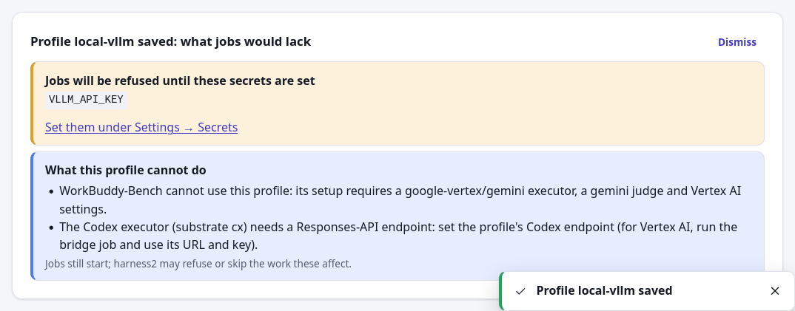

### 11.2 Secrets

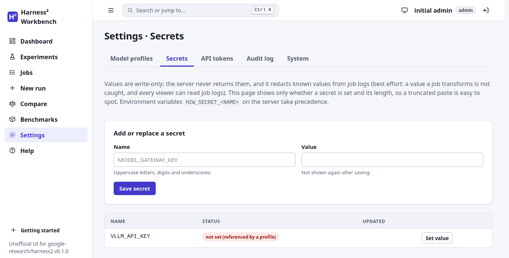

Secrets are **write-only**: the page shows a name, whether it is set and its length (so a truncated
paste is easy to spot), never the value. **Add or replace a secret** takes a name (uppercase letters,
digits and underscores) and a value (not shown again). Secrets that a profile references but that
have no value are listed with **Set value**; stored ones offer **Replace value** and **Delete**. An
environment variable `H2W_SECRET_<NAME>` on the server takes precedence over a stored value.

### 11.3 API tokens

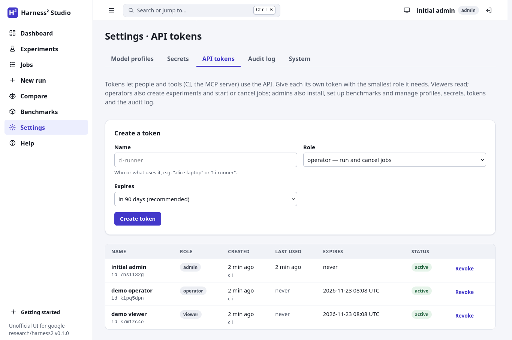

**Create a token** with a name (who or what uses it), a **role** (*viewer, read only*; *operator, run
and cancel jobs*; *admin, everything*) and an expiry (30 days, **90 days (recommended)**, 180 days, a
year, or *never (discouraged)*). The new token is shown **once**: copy it straight into a password
manager. The table lists name, id, role, created, last used, expiry and status, with **Revoke**
(revoking ends that token's browser sessions). Give every person and tool its own token with the
smallest role it needs, and keep MCP agents on **viewer** tokens unless they must start jobs
([MCP.md](MCP.md#3-safety-rules)).

### 11.4 Audit log

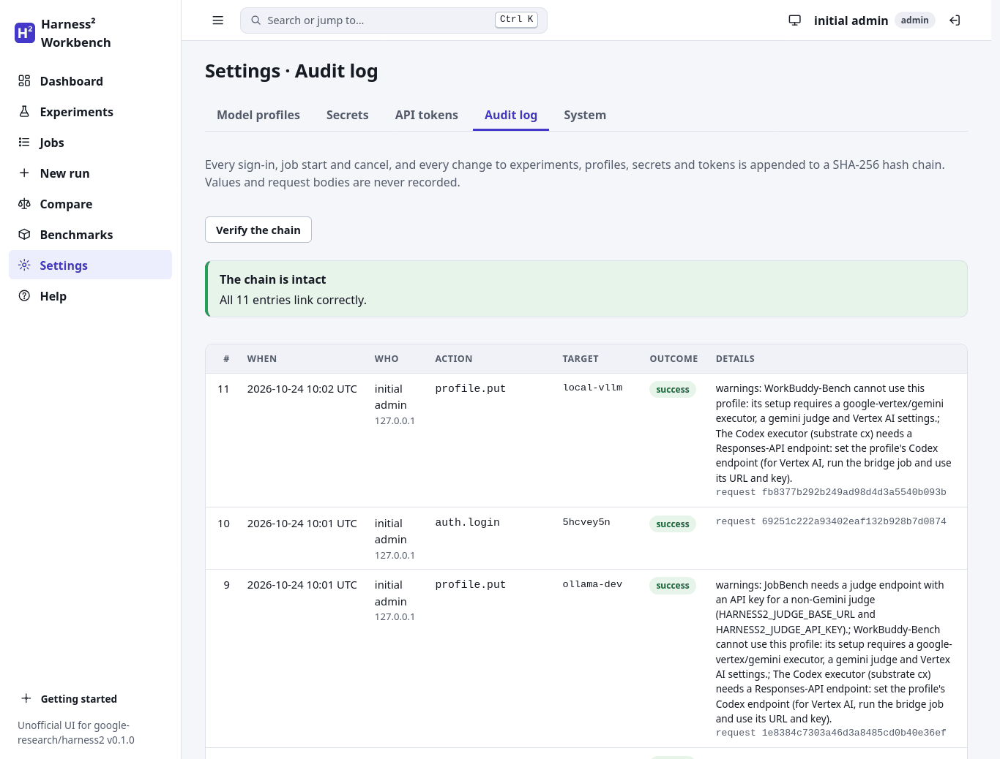

Every sign-in, job start and cancel, and every change to experiments, profiles, secrets and tokens is
appended to a SHA-256 hash chain; values and request bodies are never recorded. **Verify the chain**
re-walks it (*The chain is intact: all N entries link correctly*, with N the number of records). Treat that as
evidence of accidental or casual edits, **not as a tamper-proof record**: anyone who can write the
server's data directory, host-mode jobs included, can rewrite the whole chain and the check will
still pass. Keep the head hash somewhere the server's user cannot write
([ADMIN-GUIDE.md](ADMIN-GUIDE.md#13-audit-log)). Refused credentials are recorded too, but at most
10 a minute per client address (the rest are only counted), so junk requests cannot flood the log.

### 11.5 System

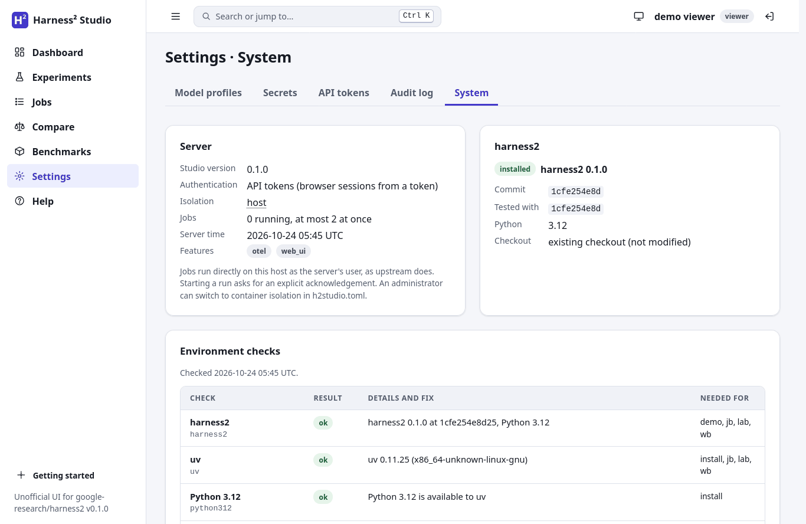

Server version, authentication mode, isolation mode (`host` or `container`) and how many jobs run,
server time, the build's features, the harness2 installation (commit, tested commit, Python,
checkout) and the **Environment checks** (the doctor: one row per tool with its result, details and
what it is needed for; **Re-run checks** for operators and admins). The picture is the *viewer's*
view; an **admin** also sees the data directory and the checkout path (absolute paths on the server)
and the form **Install or reinstall harness2** (an optional 40-character commit id, *Re-create the
virtual environment*, *Include the bridge extra*). The commit id box accepts any well-formed id, but
the server refuses every commit except the tested one (the toast shows its message, `params.rev: only
the tested harness2 commit ... can be installed`) unless an administrator has set
`paths.allow_untested_harness2_rev = true`; with that switch on, the server builds whatever it finds
at the commit, so use only commits you trust ([ADMIN-GUIDE.md](ADMIN-GUIDE.md#12-data-backups-and-upgrades)).
The form's own hint says only that other commits were not tested with this release.

## 12. Keyboard, themes and phones

**Command palette.** Press **Ctrl K** (⌘ K on a Mac), or click the search box.

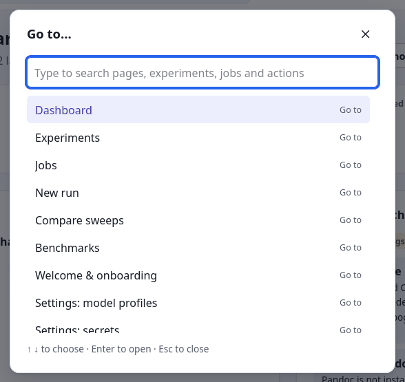

Type to filter pages, actions, experiments and recent jobs; **↑ ↓** choose, **Enter** opens, **Esc**
closes. Actions include **Run the demo**, **Switch theme**, **Show keyboard shortcuts** and **Sign
out**.

**Shortcuts.** Press **?** for the list (ignored while you type in a field).

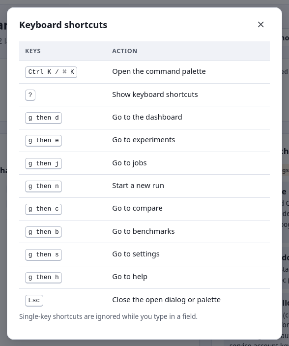

`g` then a letter goes to a page: `d` dashboard, `e` experiments, `j` jobs, `n` new run, `c`
compare, `b` benchmarks, `s` settings, `h` help (every one checked); **Esc** closes a dialog or the
palette.

**Themes.** The theme button cycles **system → light → dark**; the choice is kept in this browser.

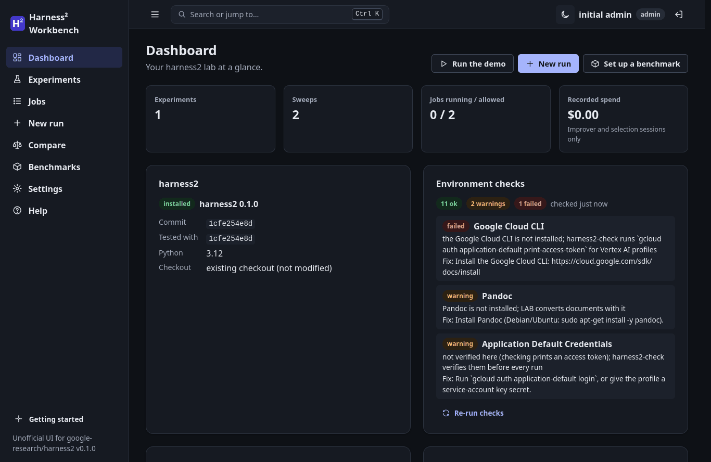

**Phones and narrow windows.** Below a certain width the sidebar becomes a drawer behind the menu
button and the search box becomes an icon; tables scroll inside their container.

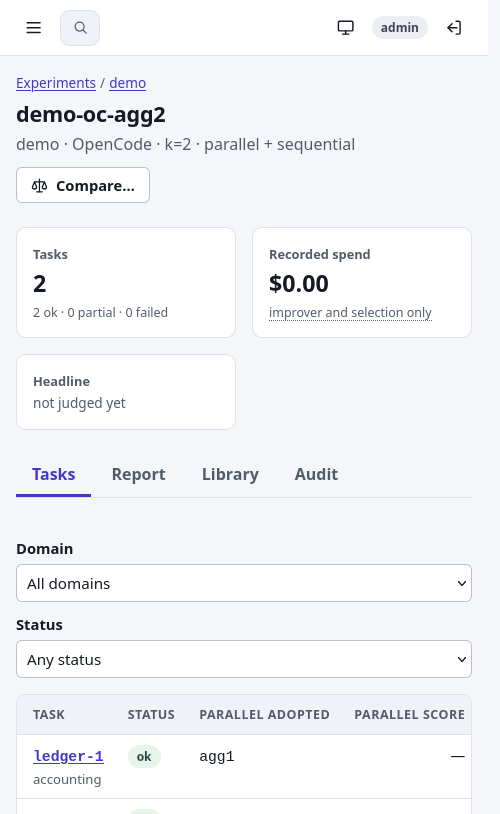
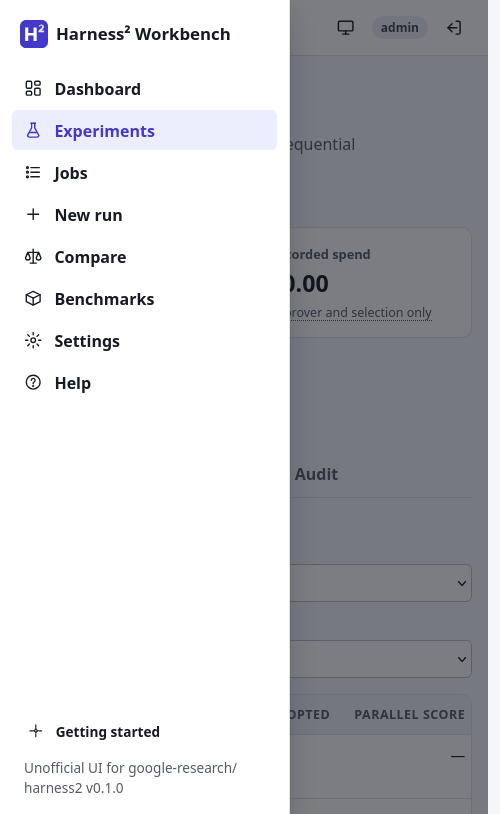

**Help** (`/help`) has the glossary (filterable, every term linkable), the eight harness components,
frequently asked questions and the shortcuts.

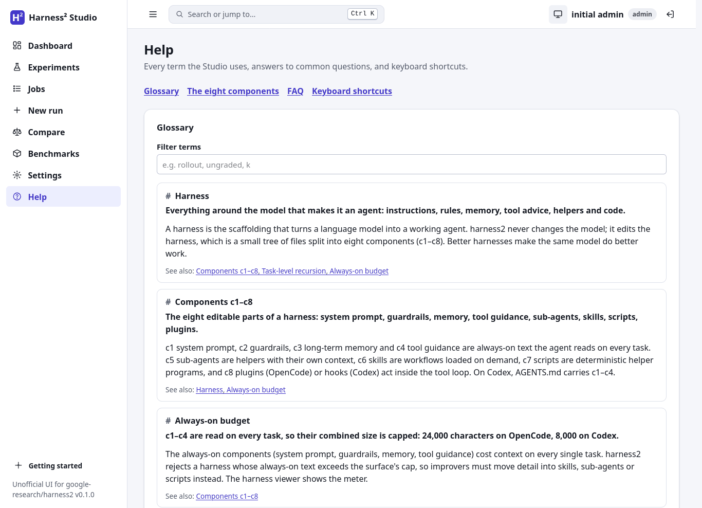

The interface is built for keyboard use (a *Skip to content* link, focus handling in dialogs, tab
lists that move with the arrow keys, status changes announced to screen readers) and respects the
reduced-motion setting. That is the design intent from the contract; it was not audited with a
screen reader or a contrast checker.

## 13. What each role sees

The server enforces roles; the UI hides what you cannot do and says why where it helps.

| Role | What changes on screen |
|---|---|
| **viewer** | Reads everything below and can download manifests and exports. No **Run the demo**, **New run**, **Re-run checks**, **New experiment**, **Edit**, **Archive**, **New run here**, **Check readiness**, **New split…**; the sidebar has no **New run**; the wizard is read-only; **Secrets**, **API tokens** and **Audit log** are marked *(admins only)* and closed; **System** shows no paths and no install form |
| **operator** | Also **Run the demo**, **New run**, **New experiment**, **New run here**, **Edit**, **Archive**, **Check readiness**, **New split…**, **Re-run checks**, judging from a sweep, and cancelling jobs. Cannot set up benchmarks, install harness2, edit profiles, or open secrets, tokens and the audit log |
| **admin** | Everything, including **Set up…**, **Install or reinstall harness2** and all of Settings |

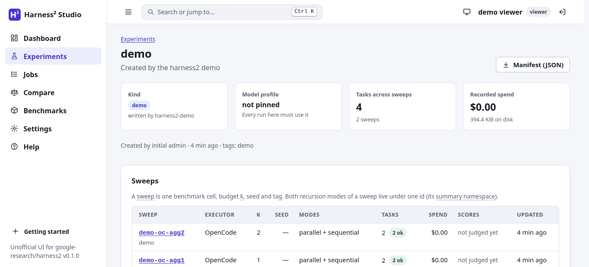

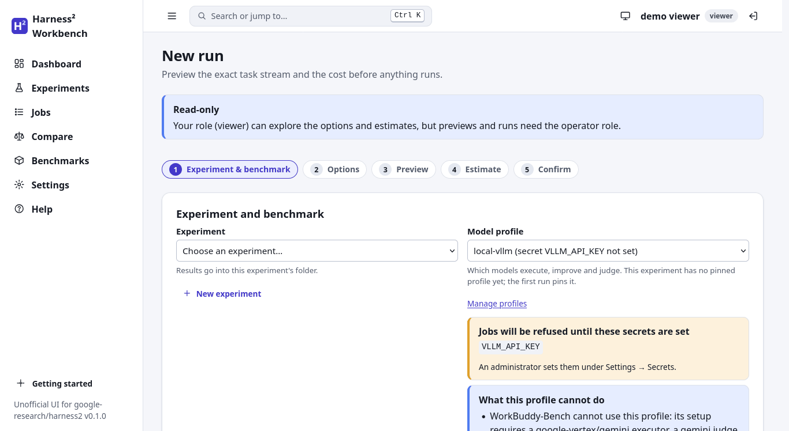

A viewer can still read every experiment, transcript, log and profile (without secret values): there
are no per-experiment permissions.

## 14. When something looks wrong

| You see | What it means |
|---|---|
| The page says `UI not built` | The server was built without the UI; see [section 1](#1-before-you-start). |
| A blank page and *needs JavaScript and WebAssembly* | The browser blocks one of them. |
| You are sent to the sign-in page with no message | Your session ended (expired, signed out, or the token was revoked). Sign in again. |
| `Cannot judge from here` on the Report tab | The sweep has no benchmark cell or the experiment has no pinned profile. |
| **Start the pipeline** is disabled | Tick the host-isolation acknowledgement (it is not shown when the server pre-acknowledges host risks); or you are a viewer. |
| *Before you continue: run the preview…* | The wizard needs a preview for the current options. |
| *Jobs will be refused until these secrets are set* | A profile secret has no value: an admin sets it under **Settings → Secrets**. |
| A tool is listed as `failed` or `warning` on the dashboard | The doctor found something; the fix is printed under it ([TROUBLESHOOTING.md](TROUBLESHOOTING.md#h2workbench-doctor-checks)). |
| Job logs do not update live | A reverse proxy is buffering server-sent events ([ADMIN-GUIDE.md](ADMIN-GUIDE.md#7-reverse-proxy-and-tls)). |
| Any API error | The toast shows the server's message; look it up in [TROUBLESHOOTING.md](TROUBLESHOOTING.md#http-errors-by-status). |

**UI wording that was wrong in the first revision of this guide and has been fixed in the UI**
(checked in headless Firefox on 2026-10-24 against the build of the same source as this text): the
host-isolation banner and the Help FAQ now say that the executor can reach the Workbench's own database;
the profile form says the egress-hosts list is informational and not applied by the server; the FAQ
says an experiment keeps the profile it was created with or, without one, the profile of its first
job that writes into it; and a comparison opened with `agg` or `seq` in the address selects
`parallel` and `sequential`. One difference remains: the **Install or reinstall harness2** form
accepts a commit other than the tested one, which the server then refuses by default (section 11.5).

## 15. What was verified

On 2026-10-24, in headless Firefox 157.0.1 through geckodriver 0.37.1, against the real server and the
mock API described at the top, with the web UI built from the main branch after the security-review
fixes. All 38 pictures were taken again from that build; those of pages that did not change came out
byte-identical to the earlier ones.

- **Exercised and photographed or read back** (the buttons each role sees were listed from the page
  for a viewer, an operator and an admin): sign-in (empty, malformed and wrong token, the return
  to a deep link), the session ending when a token is revoked, sign-out icon present, the dashboard,
  the welcome tour, the experiment list and a single experiment, a sweep's Tasks and Library tabs,
  a whole task page (timeline, harness viewer, diff, a trajectory, the export dialog), the jobs list
  and a finished job, the wizard's first step with the profile check, the Benchmarks page and the
  *Set up…* and *New split…* dialogs (opened, not submitted), the profiles page, saving a profile and
  the check it shows, the secrets and tokens pages, the audit log with **Verify the chain**, the
  System tab (as admin, read in text; as viewer, photographed), the palette, the shortcuts dialog,
  every `g` shortcut, the theme cycle, a narrow window, the Help page, and the viewer's views. On
  the mock: the Report and Audit tabs, a scored task, the wizard's steps 2 to 5 (including a
  preview), a running job, the comparison, and the **Judge this sweep** button (which started a
  mock job).
- **Not exercised:** creating, editing or deleting experiments, profiles, secrets, splits and tokens
  through the UI; **Archive**; **Check readiness** and **Set up now**; **Install**; starting or
  cancelling a job on the real server from the UI other than reading finished ones; the log and file
  **Download** buttons; the wizard's Preview, Estimate and Confirm on the real server (a benchmark
  must be installed first); the narrow layouts of other pages; any browser other than Firefox; any
  screen reader; and everything that needs a model-backed run.

The screenshots contain demo data only. Before saving each one (the two phone-sized pictures
excepted: their text was read instead) the capture script refused any page whose visible text held a
home-directory path, a temporary-directory path, a user name or a token.
